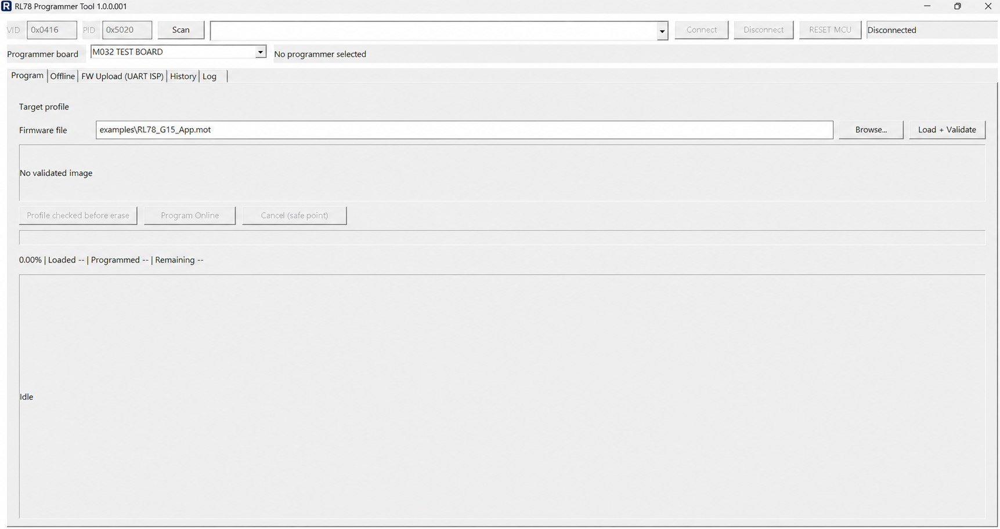
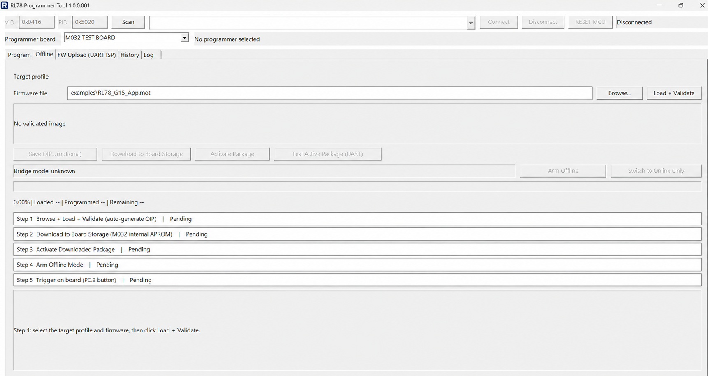
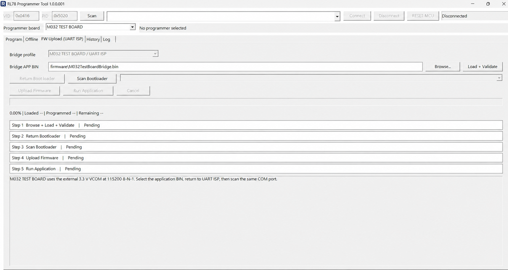

# RL78 Programmer Tool

Windows GUI and bridge firmware for programming RL78/G15 and RL78/G16 devices
through Renesas Protocol B. Two primary programmer boards are supported:

| Programmer board | PC connection | Offline image storage | Offline trigger |
| --- | --- | --- | --- |
| Nu-Link2-Me / M484SIDAE | HS-USB HID | Onboard W25Q16 SPI flash | KEY1 |
| M032 TEST BOARD / M032SE3AE | External 3.3 V VCOM, 115200 8-N-1 | M032 internal APROM, 64 KiB slot | PC.2 button |

The GUI supports:

- Online programming directly from the PC.
- Offline programming after an image has been downloaded and armed.
- Bridge application update through USB HID or UART ISP.
- RL78/G15 4 KiB and 8 KiB Code Flash profiles.
- RL78/G16 16 KiB and 32 KiB Code Flash profiles.

[English](#english-user-guide) | [繁體中文](#繁體中文使用說明)

## English User Guide

### 1. Safety and required items

You need a Windows 10/11 x64 PC, one supported programmer board, a data-capable
USB cable or 3.3 V VCOM adapter, and access to the RL78 target's `TOOL0`,
`RESET#`, `VDD`, and `GND` nets.

Important electrical rules:

- The programmer and RL78 target in this guide use the same 3.3 V domain.
- Remove any other target-board power source before allowing the programmer
  board to supply RL78 VDD. Never connect two power supplies together.
- Make the ground connection first and confirm it with a meter.
- Both TOOL0 branches require their own `47 ohm` series resistor. Do not short
  the MCU pins together before the resistors and do not replace the two
  resistors with one shared resistor.
- Pull RL78 TOOL0 up to the actual target VDD with `1 kohm`.
- RESET# is active-low and must be driven as open-drain.
- Do not use 5 V UART or RS-232 voltage levels with M032 TEST BOARD.
- Disconnect other debuggers that could drive TOOL0 or RESET#.

Generated EXE, Keil `obj/lst`, HEX, and BIN files are intentionally excluded
from Git. Build them locally or obtain them from an approved release package.

### 2. Initial bridge firmware

The resident bootloader must be installed once with ICP, Nu-Link, or another
debug programmer. Later GUI updates replace only the application region.

#### Nu-Link2-Me

Build:

```powershell
powershell -ExecutionPolicy Bypass -File .\scripts\build_nulink2me_keil.ps1
```

Initial factory image:

```text
demo_code/M480BSP_Nulink2Me_RL78/SampleCode/Template/Keil/obj/NuLink2Me_boot_app.hex
```

Application-only GUI update image:

```text
demo_code/M480BSP_Nulink2Me_RL78/SampleCode/Template/Keil/obj/NuLink2MeRl78Bridge.bin
```

#### M032 TEST BOARD

Build:

```powershell
powershell -ExecutionPolicy Bypass -File .\scripts\build_m032_test_board_keil.ps1
```

Initial factory image:

```text
demo_code/M032BSP_RL78_Programmer/SampleCode/RL78_Programmer/KEIL/obj/M032TestBoardBridge_factory.hex
```

Application-only GUI update image:

```text
demo_code/M032BSP_RL78_Programmer/SampleCode/RL78_Programmer/KEIL/obj/M032TestBoardBridge.bin
```

Set CONFIG to boot from APROM with IAP when initially provisioning M032 TEST
BOARD. The resident UART bootloader occupies `0x0000-0x3FFF`; the application
starts at `0x4000`. An application-only BIN cannot update the resident
bootloader. Reprogram the current factory HEX once whenever the resident
bootloader itself changes.

### 3. RL78/G15 wiring

Both programmer boards connect to the same four RL78 target nets:

| RL78 target | Connection |
| --- | --- |
| `TOOL0` | Join the target-side ends of the programmer TX and RX 47-ohm branches |
| `RESET#` | Connect to the programmer reset output; keep open-drain behavior |
| `VDD` | 3.3 V from the selected programmer board, with all other target supplies removed |
| `GND` | Programmer ground; connect this first |

RL78 physical pin numbers depend on the exact device and package. Use the
Renesas hardware manual for the selected part to locate these four nets.

#### 3.1 Nu-Link2-Me wiring

```text
PA.9  / SWDH_DAT / ICEJ4-3 / TX ----[47 ohm]----+
                                                    +---- RL78 TOOL0
PA.10 / SWDH_CLK / ICEJ4-5 / RX ---[47 ohm]----+
                                                    |
Nu-Link2-Me 3.3 V -------------------[1 kohm]----+

PF.5 / RESET, open drain ------------------- RL78 RESET#
Nu-Link2-Me 3.3 V -------------------------- RL78 VDD
Nu-Link2-Me GND ---------------------------- RL78 GND
PB.12 and PB.13 ---------------------------- NC
```

Use PA.9 as the software-TX branch and PA.10 as the software-RX branch. Place
one 47-ohm resistor in each branch, preferably close to ICEJ4. Join the two
branches only after the resistors, near the target TOOL0 node.

Do not confuse `SWDH_DAT/SWDH_CLK` on PA.9/PA.10 with the separate
`ICE_DAT/ICE_CLK` nets on PF.1/PF.0. PB.12 and PB.13 remain unconnected; VDD
sense is disabled.

Complete board details: [Nu-Link2-Me wiring](demo_code/M480BSP_Nulink2Me_RL78/WIRING.md).

#### 3.2 M032 TEST BOARD wiring

```text
A10 / PB.9  / TX, open drain ----[47 ohm]----+
                                                   +---- RL78 TOOL0
A11 / PB.10 / RX input ---------[47 ohm]----+
                                                   |
M032 3.3 V ----------------------[1 kohm]----+

A9 / PB.8 / RESET, open drain ------------- RL78 RESET#
M032 3.3 V --------------------------------- RL78 VDD
M032 GND ----------------------------------- RL78 GND
```

The actual fixture mapping is:

| Fixture net | M032 pin | Function |
| --- | --- | --- |
| A10 | PB.9 | TOOL0 software TX |
| A11 | PB.10 | TOOL0 software RX |
| A9 | PB.8 | RL78 RESET# |
| SW | PC.2 | Offline trigger / forced UART ISP |
| LED-R | PA.11 | Red status LED, active-low |
| LED-G | PA.10 | Green status LED, active-low |

Keep the fitted 30-kohm pull-ups on A10, A11, and A9. PB.9 and PB.10 must not
be shorted together before their two 47-ohm resistors.

The PC connection uses an external 3.3 V TTL VCOM:

| JP22 | M032 signal | VCOM connection |
| ---: | --- | --- |
| 3 | GND | GND |
| 5 | VDD3V3 | Optional 3.3 V reference |
| 6 | PF.2 / MCU_RX | VCOM TX |
| 7 | PF.3 / MCU_TX | VCOM RX |

Use `115200, 8 data bits, no parity, 1 stop bit` for the PC/VCOM link.

Complete board details: [M032 TEST BOARD wiring](demo_code/M032BSP_RL78_Programmer/M032_TEST_BOARD_WIRING.md).

### 4. Start and connect the GUI

Build the Windows application:

```powershell
powershell -ExecutionPolicy Bypass -File .\scripts\build_mfc.ps1 -Configuration Release
```

Then:

1. Run `build/Rl78ProgrammerTool.exe`.
2. Select `Nu-Link2-Me RL78 Programmer` or `M032 TEST BOARD`.
3. Click `Scan`.
4. Select the discovered USB HID device or verified COM port.
5. Click `Connect`.
6. Confirm `Connected / PLP 1.0 session` before programming.

For Nu-Link2-Me, the default application VID/PID is `0x0416/0x5020`. For M032
TEST BOARD, VID/PID fields are disabled and the GUI discovers the 115200
8-N-1 VCOM link. The main window opens maximized.

`RESET MCU` is available while the application session is connected. It
resets the bridge MCU without erasing the application or the stored offline
package. Scan and reconnect after USB or COM re-enumeration.

### 5. Program tab: Online programming



1. Select the exact target profile, including the RL78 family and flash size.
2. Click `Browse` and choose an S-record, Intel HEX, or raw BIN image.
3. Click `Load + Validate`. A `.mot` filename may contain S-record or Intel
   HEX text; the parser detects the content.
4. Review the validated byte count and generated package UUID.
5. Click `Program Online`.
6. Wait for erase, program, and verify to finish. Do not disconnect target
   power or wiring during a destructive stage.
7. Confirm `Programming PASS` and 100% progress. A failure remains a failure
   even if the progress bar previously reached an intermediate percentage.

The progress indicator reports percent, loaded size, programmed size, and
remaining target bytes. `Cancel (safe point)` takes effect only where the
programming state machine can stop safely.

### 6. Offline tab: Store and trigger an image



The OIP package is generated automatically from the validated target image.
The user does not need to create an OIP file first.

1. `Browse + Load + Validate` the desired RL78 image.
2. Optional: click `Save OIP` to export a copy for diagnostics or reuse.
3. Click `Download to Board Storage`.
   - Nu-Link2-Me stores the package in W25Q16 SPI flash.
   - M032 TEST BOARD stores it in the 64 KiB internal APROM slot.
4. Click `Activate Package`.
5. Click `Arm Offline`.
6. Disconnect the GUI if autonomous use is required.
7. Start one offline job:
   - Nu-Link2-Me: press KEY1.
   - M032 TEST BOARD: press the PC.2 button.
8. Wait for the final LED result before disconnecting the target.

Each workflow row turns gray after the corresponding step is complete.
Changing the source image or target profile invalidates stale steps; repeat
Download, Activate, and Arm for the new package.

`Switch to Online Only` disables autonomous triggering but preserves the
stored package. `Test Active Package` runs the active offline image while the
GUI is connected.

### 7. FW Upload tab: Update bridge application



This tab updates the programmer bridge application. It does not upload an
RL78 target image.

Follow the five displayed steps in order:

1. `Browse + Load + Validate` the correct application-only BIN for the selected
   programmer board.
2. Click `Return Bootloader`.
3. Click `Scan Bootloader` and select the discovered bootloader endpoint.
4. Click `Upload Firmware` and wait for validation, erase, write, and verify.
5. Click `Run Application`, then scan and reconnect to the application.

Nu-Link2-Me uses `FW Upload (USB HID)`. M032 TEST BOARD uses
`FW Upload (UART ISP)` on the same 3.3 V VCOM connection at 115200 8-N-1.
Hold PC.2 while resetting or powering M032 TEST BOARD to force UART ISP if the
application cannot return to the bootloader.

If power is interrupted during an application update, the resident bootloader
remains available. Reconnect to the bootloader and upload the application BIN
again. Do not load a factory HEX into this tab.

### 8. History, Log, progress, and LEDs

- `History` shows job time, Online/Offline mode, result, terminal stage, and
  error code for the current GUI session.
- `Log` shows detailed session and programming messages.
- `Save log to file` is disabled by default and stored in
  `build/rl78_programmer.ini`. When enabled, logs are written below
  `build/logs/`.
- Progress bars in Program, Offline, and FW Upload show percentage and byte
  counters.

M032 TEST BOARD application LEDs:

| State | LED |
| --- | --- |
| Ready / idle | Green slow blink |
| Online or Offline programming | Red blink |
| PASS | Green solid |
| FAIL, cancelled, interrupted, or outcome unknown | Red solid |

Nu-Link2-Me uses its onboard status LEDs; see the board-specific
[wiring guide](demo_code/M480BSP_Nulink2Me_RL78/WIRING.md) for the current
mapping.

### 9. Logic-analyzer UART decode

For TOOL0 measurements, use:

| Probe point | Baud | Data | Parity | Stop |
| --- | ---: | ---: | --- | ---: |
| TOOL0 | 115200 | 8 | Odd | 1 |
| PA.9/PB.9 TX before 47 ohm | 115200 | 8 | Odd | 2 |
| PA.10/PB.10 RX before 47 ohm | 115200 | 8 | Odd | 1 |

Use LSB first, non-inverted signaling. TOOL0 is a bidirectional line, so the
decoder may show both two-stop-bit bridge frames and one-stop-bit RL78
responses. Do not confuse these settings with the PC/VCOM link, which is
115200 8-N-1.

### 10. Build, test, and clean

Common commands:

```powershell
powershell -ExecutionPolicy Bypass -File .\scripts\build_native_tests.ps1 -Configuration Release
powershell -ExecutionPolicy Bypass -File .\scripts\build_mfc.ps1 -Configuration Release
powershell -ExecutionPolicy Bypass -File .\scripts\build_nulink2me_keil.ps1
powershell -ExecutionPolicy Bypass -File .\scripts\build_m032_test_board_keil.ps1
.\scripts\clean_mfc.bat
```

`scripts/clean_mfc.bat` removes:

- `build/obj/`
- `build/logs/`

It preserves:

- `build/Rl78ProgrammerTool.exe`
- `build/rl78_programmer.ini`

It does not delete any other file in the root `build` directory and does not
remove Keil project `obj/lst` directories. With the expected build layout,
only the EXE and INI remain after cleaning. Keil generated directories are
excluded by `.gitignore`.

### 11. GitHub publication and privacy

The repository excludes local output, IDE state, logic-analyzer captures, and
Keil generated files through `.gitignore`. Before publishing:

1. Run `scripts/clean_mfc.bat`.
2. Review `git status --short --ignored`.
3. Search the staged files for user names, customer names, drive-letter paths,
   private keys, tokens, and passwords.
4. Do not force-add anything under `build/`, Keil `obj/lst`, `.vs`, `.vscode`,
   or `*.uvguix.*`.
5. Publish generated EXE/HEX/BIN files as reviewed release assets if they are
   required; do not commit local build directories.
6. Confirm that every third-party PDF, BSP, and vendor source file is permitted
   for redistribution under its license.

The screenshots in this README use neutral example paths and contain no local
workstation path.

### 12. More documentation

- [Architecture and normative documents](docs/README.md)
- [ADR index](docs/adr/README.md)
- [Nu-Link2-Me wiring](demo_code/M480BSP_Nulink2Me_RL78/WIRING.md)
- [M032 TEST BOARD wiring](demo_code/M032BSP_RL78_Programmer/M032_TEST_BOARD_WIRING.md)
- [Current implementation handoff](HANDOFF.md)
- [Verification record](SELF_CHECK.md)

---

## 繁體中文使用說明

本專案提供 Windows GUI 與 bridge firmware，透過 Renesas Protocol B 燒錄
RL78/G15 與 RL78/G16。目前主要支援兩種 programmer board：

| Programmer board | PC 連線 | Offline image 儲存位置 | Offline 觸發方式 |
| --- | --- | --- | --- |
| Nu-Link2-Me / M484SIDAE | HS-USB HID | 板上 W25Q16 SPI flash | KEY1 |
| M032 TEST BOARD / M032SE3AE | 外接 3.3 V VCOM，115200 8-N-1 | M032 內部 APROM 64 KiB slot | PC.2 按鈕 |

GUI 支援：

- 由 PC 直接執行 Online programming。
- 先下載並啟用 image，再由板上按鈕執行 Offline programming。
- 透過 USB HID 或 UART ISP 更新 bridge application。
- RL78/G15 4 KiB、8 KiB Code Flash。
- RL78/G16 16 KiB、32 KiB Code Flash。

### 1. 安全注意事項與所需設備

需要 Windows 10/11 x64 PC、任一支援的 programmer board、可傳輸資料的 USB
線或 3.3 V VCOM，以及 RL78 target 的 `TOOL0`、`RESET#`、`VDD`、`GND`。

重要電氣規則：

- 本說明中的 programmer 與 RL78 target 使用相同的 3.3 V domain。
- 若由 programmer board 供應 RL78 VDD，必須先移除 target board 的其他電源。
  不可讓兩組電源同時供電。
- 先接 GND，並用電表確認共地。
- TOOL0 的 TX 與 RX branch 必須各自串接一顆 `47 ohm`。不可在電阻前短路
  兩個 MCU pin，也不可只使用一顆共用電阻。
- RL78 TOOL0 需以 `1 kohm` pull-up 到 target 實際 VDD。
- RESET# 為 active-low，必須維持 open-drain。
- M032 TEST BOARD 不可使用 5 V UART 或 RS-232 電壓。
- 其他 debugger 不可同時驅動 TOOL0 或 RESET#。

EXE、Keil `obj/lst`、HEX 與 BIN 為本機生成檔，已排除於 Git。請在本機
build，或由受控的 release package 取得。

### 2. 首次燒錄 bridge firmware

Resident bootloader 必須先透過 ICP、Nu-Link 或其他 debug programmer 燒錄
一次。後續 GUI 更新只會替換 application 區域。

#### Nu-Link2-Me

Build：

```powershell
powershell -ExecutionPolicy Bypass -File .\scripts\build_nulink2me_keil.ps1
```

首次 factory image：

```text
demo_code/M480BSP_Nulink2Me_RL78/SampleCode/Template/Keil/obj/NuLink2Me_boot_app.hex
```

GUI application-only 更新 image：

```text
demo_code/M480BSP_Nulink2Me_RL78/SampleCode/Template/Keil/obj/NuLink2MeRl78Bridge.bin
```

#### M032 TEST BOARD

Build：

```powershell
powershell -ExecutionPolicy Bypass -File .\scripts\build_m032_test_board_keil.ps1
```

首次 factory image：

```text
demo_code/M032BSP_RL78_Programmer/SampleCode/RL78_Programmer/KEIL/obj/M032TestBoardBridge_factory.hex
```

GUI application-only 更新 image：

```text
demo_code/M032BSP_RL78_Programmer/SampleCode/RL78_Programmer/KEIL/obj/M032TestBoardBridge.bin
```

首次燒錄 M032 TEST BOARD 時，CONFIG 應設為 APROM with IAP。Resident UART
bootloader 位於 `0x0000-0x3FFF`，application 從 `0x4000` 開始。
Application-only BIN 無法更新 resident bootloader；若 bootloader 有變更，
必須重新燒錄最新 factory HEX 一次。

### 3. RL78/G15 接線

兩種 programmer board 最後都連到 RL78 的相同四個 net：

| RL78 target | 接法 |
| --- | --- |
| `TOOL0` | 將 programmer TX 與 RX 兩條 47-ohm branch 的 target-side 端匯合 |
| `RESET#` | 接 programmer reset output，維持 open-drain |
| `VDD` | 由選定 programmer board 供應 3.3 V，target 其他電源必須移除 |
| `GND` | 接 programmer GND，並且最先接好 |

RL78 實體 pin number 會隨 MCU 型號與 package 改變，請依所選型號的 Renesas
Hardware User's Manual 找出上述四個 net。

#### 3.1 Nu-Link2-Me 接線

```text
PA.9  / SWDH_DAT / ICEJ4-3 / TX ----[47 ohm]----+
                                                    +---- RL78 TOOL0
PA.10 / SWDH_CLK / ICEJ4-5 / RX ---[47 ohm]----+
                                                    |
Nu-Link2-Me 3.3 V -------------------[1 kohm]----+

PF.5 / RESET，open drain ------------------ RL78 RESET#
Nu-Link2-Me 3.3 V -------------------------- RL78 VDD
Nu-Link2-Me GND ---------------------------- RL78 GND
PB.12 與 PB.13 ----------------------------- NC
```

PA.9 是 software-TX branch，PA.10 是 software-RX branch。兩路各自串接一顆
47-ohm，最好靠近 ICEJ4；只有在電阻之後、靠近 target TOOL0 的位置才可匯合。

不可將 PA.9/PA.10 的 `SWDH_DAT/SWDH_CLK` 與 PF.1/PF.0 的另一組
`ICE_DAT/ICE_CLK` 混用。PB.12 與 PB.13 保持 NC，firmware 已關閉 VDD sense。

完整資料請看 [Nu-Link2-Me 接線](demo_code/M480BSP_Nulink2Me_RL78/WIRING.md)。

#### 3.2 M032 TEST BOARD 接線

```text
A10 / PB.9  / TX，open drain ----[47 ohm]----+
                                                   +---- RL78 TOOL0
A11 / PB.10 / RX input ---------[47 ohm]----+
                                                   |
M032 3.3 V ----------------------[1 kohm]----+

A9 / PB.8 / RESET，open drain ------------- RL78 RESET#
M032 3.3 V --------------------------------- RL78 VDD
M032 GND ----------------------------------- RL78 GND
```

Fixture 的實際 mapping：

| Fixture net | M032 pin | 功能 |
| --- | --- | --- |
| A10 | PB.9 | TOOL0 software TX |
| A11 | PB.10 | TOOL0 software RX |
| A9 | PB.8 | RL78 RESET# |
| SW | PC.2 | Offline trigger / 強制 UART ISP |
| LED-R | PA.11 | 紅色狀態 LED，active-low |
| LED-G | PA.10 | 綠色狀態 LED，active-low |

A10、A11、A9 原有的 30-kohm pull-up 保留。PB.9 與 PB.10 不可在兩顆
47-ohm 電阻前短路。

PC 端需使用外接 3.3 V TTL VCOM：

| JP22 | M032 signal | VCOM 接法 |
| ---: | --- | --- |
| 3 | GND | GND |
| 5 | VDD3V3 | 選用的 3.3 V reference |
| 6 | PF.2 / MCU_RX | VCOM TX |
| 7 | PF.3 / MCU_TX | VCOM RX |

PC/VCOM 連線參數為 `115200, 8 data bits, no parity, 1 stop bit`。

完整資料請看 [M032 TEST BOARD 接線](demo_code/M032BSP_RL78_Programmer/M032_TEST_BOARD_WIRING.md)。

### 4. 啟動與連接 GUI

Build Windows application：

```powershell
powershell -ExecutionPolicy Bypass -File .\scripts\build_mfc.ps1 -Configuration Release
```

操作方式：

1. 執行 `build/Rl78ProgrammerTool.exe`。
2. 選擇 `Nu-Link2-Me RL78 Programmer` 或 `M032 TEST BOARD`。
3. 按 `Scan`。
4. 選擇找到的 USB HID device 或已驗證的 COM port。
5. 按 `Connect`。
6. 燒錄前確認畫面顯示 `Connected / PLP 1.0 session`。

Nu-Link2-Me application 預設 VID/PID 為 `0x0416/0x5020`。M032 TEST BOARD
會停用 VID/PID 欄位，改由 GUI 尋找 115200 8-N-1 VCOM。程式預設最大化開啟。

Application session 已連線時可按 `RESET MCU`。此動作會 reset bridge MCU，
但不會清除 application 或已儲存的 offline package。USB 或 COM
重新 enumeration 後，再次 Scan 與 Connect。

### 5. Program tab：Online programming


1. 選擇正確的 target profile，包括 RL78 family 與 flash size。
2. 按 `Browse`，選擇 S-record、Intel HEX 或 raw BIN。
3. 按 `Load + Validate`。`.mot` 副檔名可包含 S-record 或 Intel HEX，
   GUI 會依內容判定。
4. 確認 validated byte count 與 package UUID。
5. 按 `Program Online`。
6. 等待 erase、program、verify 完成；destructive stage 期間不可移除電源或接線。
7. 確認顯示 `Programming PASS` 且進度為 100%。即使 progress bar 曾到達某個
   中間百分比，terminal failure 仍代表燒錄失敗。

Progress indicator 會顯示百分比、loaded size、programmed size 與剩餘 byte。
`Cancel (safe point)` 只會在 state machine 可安全停止的位置生效。

### 6. Offline tab：儲存與觸發 image


OIP 會由 validated target image 自動產生，user 不需要事先製作 OIP。

1. 對所需 RL78 image 執行 `Browse + Load + Validate`。
2. 選用：按 `Save OIP` 匯出診斷或重複使用的副本。
3. 按 `Download to Board Storage`。
   - Nu-Link2-Me 儲存到 W25Q16 SPI flash。
   - M032 TEST BOARD 儲存到 64 KiB internal APROM slot。
4. 按 `Activate Package`。
5. 按 `Arm Offline`。
6. 若要完全 autonomous 使用，可中斷 GUI 連線。
7. 啟動一次 offline job：
   - Nu-Link2-Me：按 KEY1。
   - M032 TEST BOARD：按 PC.2 button。
8. 確認最終 LED 結果後，才移除 target。

每完成一個 step，對應 workflow row 會反灰。若更換 source image 或 target
profile，舊 step 會失效，必須重新 Download、Activate、Arm。

`Switch to Online Only` 會關閉 autonomous trigger，但保留已儲存 package。
`Test Active Package` 可在 GUI 連線時執行目前 active offline image。

### 7. FW Upload tab：更新 bridge application


此 tab 更新的是 programmer bridge application，不是 RL78 target image。

依畫面五個 step 操作：

1. `Browse + Load + Validate` 與所選 programmer board 相符的
   application-only BIN。
2. 按 `Return Bootloader`。
3. 按 `Scan Bootloader`，並選擇找到的 bootloader endpoint。
4. 按 `Upload Firmware`，等待 validation、erase、write、verify 完成。
5. 按 `Run Application`，再 Scan 並重新連線 application。

Nu-Link2-Me 使用 `FW Upload (USB HID)`。M032 TEST BOARD 使用同一組 3.3 V
VCOM 的 `FW Upload (UART ISP)`，參數為 115200 8-N-1。若 M032 TEST BOARD
application 無法回到 bootloader，可按住 PC.2 再 reset 或上電，強制進入
UART ISP。

Application 更新途中斷電時，resident bootloader 仍會保留。重新連接
bootloader，再次上傳 application BIN 即可。此 tab 不可載入 factory HEX。

### 8. History、Log、progress 與 LED

- `History` 顯示本次 GUI session 的 job time、Online/Offline、result、
  terminal stage 與 error code。
- `Log` 顯示詳細 session 與 programming 訊息。
- `Save log to file` 預設關閉，設定值保存在
  `build/rl78_programmer.ini`；啟用後 log 寫入 `build/logs/`。
- Program、Offline、FW Upload 的 progress bar 會顯示百分比與 byte counter。

M032 TEST BOARD application LED：

| 狀態 | LED |
| --- | --- |
| Ready / idle | 綠燈慢閃 |
| Online 或 Offline programming | 紅燈閃爍 |
| PASS | 綠燈恆亮 |
| FAIL、cancelled、interrupted、outcome unknown | 紅燈恆亮 |

Nu-Link2-Me 使用板上 status LED；最新 mapping 請看
[板級接線文件](demo_code/M480BSP_Nulink2Me_RL78/WIRING.md)。

### 9. Logic analyzer UART decode

量測 TOOL0 時使用：

| Probe point | Baud | Data | Parity | Stop |
| --- | ---: | ---: | --- | ---: |
| TOOL0 | 115200 | 8 | Odd | 1 |
| PA.9/PB.9 TX，47 ohm 電阻前 | 115200 | 8 | Odd | 2 |
| PA.10/PB.10 RX，47 ohm 電阻前 | 115200 | 8 | Odd | 1 |

設定為 LSB first、non-inverted。TOOL0 是 bidirectional line，因此 decoder
可能同時看到 bridge 的 two-stop-bit frame 與 RL78 的 one-stop-bit response。
此設定不同於 PC/VCOM 的 115200 8-N-1。

### 10. Build、test 與 clean

常用指令：

```powershell
powershell -ExecutionPolicy Bypass -File .\scripts\build_native_tests.ps1 -Configuration Release
powershell -ExecutionPolicy Bypass -File .\scripts\build_mfc.ps1 -Configuration Release
powershell -ExecutionPolicy Bypass -File .\scripts\build_nulink2me_keil.ps1
powershell -ExecutionPolicy Bypass -File .\scripts\build_m032_test_board_keil.ps1
.\scripts\clean_mfc.bat
```

`scripts/clean_mfc.bat` 會移除：

- `build/obj/`
- `build/logs/`

會保留：

- `build/Rl78ProgrammerTool.exe`
- `build/rl78_programmer.ini`

此 script 不會刪除 `build` 根目錄的其他檔案，也不會刪除 Keil project
的 `obj/lst`。依照預期的 build layout，clean 後只會留下 EXE 與 INI；
Keil 生成目錄已由 `.gitignore` 排除。

### 11. GitHub 上傳與隱私檢查

`.gitignore` 已排除本機 output、IDE state、logic-analyzer capture 與 Keil
生成檔。上傳前：

1. 執行 `scripts/clean_mfc.bat`。
2. 檢查 `git status --short --ignored`。
3. 搜尋 staged files 是否包含 user name、customer name、drive-letter path、
   private key、token、password。
4. 不可 force-add `build/`、Keil `obj/lst`、`.vs`、`.vscode` 或
   `*.uvguix.*`。
5. 若需發布 EXE/HEX/BIN，請作為經審查的 release asset，不要 commit 本機
   build directory。
6. 確認第三方 PDF、BSP、vendor source 的 license 允許重新散布。

README 的 GUI 截圖已使用中性的範例路徑，不包含本機 workstation path。

### 12. 其他文件

- [架構與 normative documents](docs/README.md)
- [ADR index](docs/adr/README.md)
- [Nu-Link2-Me 接線](demo_code/M480BSP_Nulink2Me_RL78/WIRING.md)
- [M032 TEST BOARD 接線](demo_code/M032BSP_RL78_Programmer/M032_TEST_BOARD_WIRING.md)
- [目前 implementation handoff](HANDOFF.md)
- [驗證記錄](SELF_CHECK.md)
