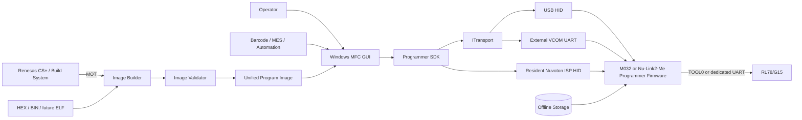
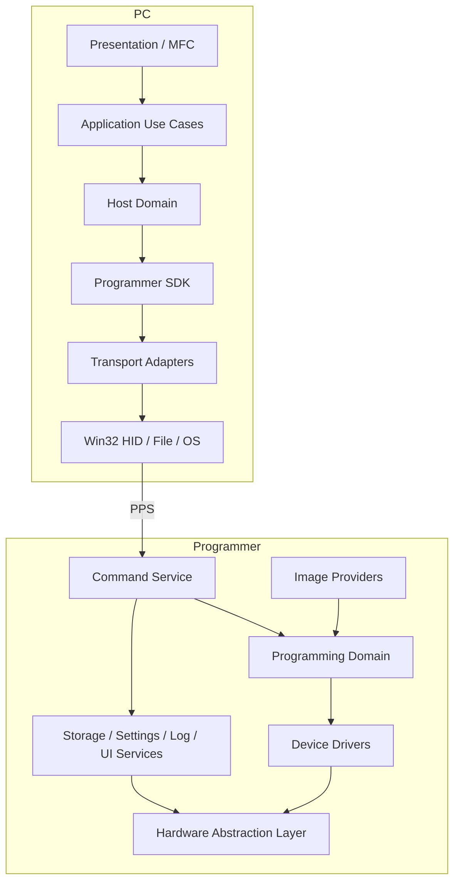
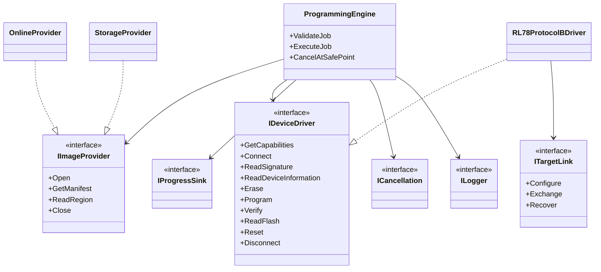
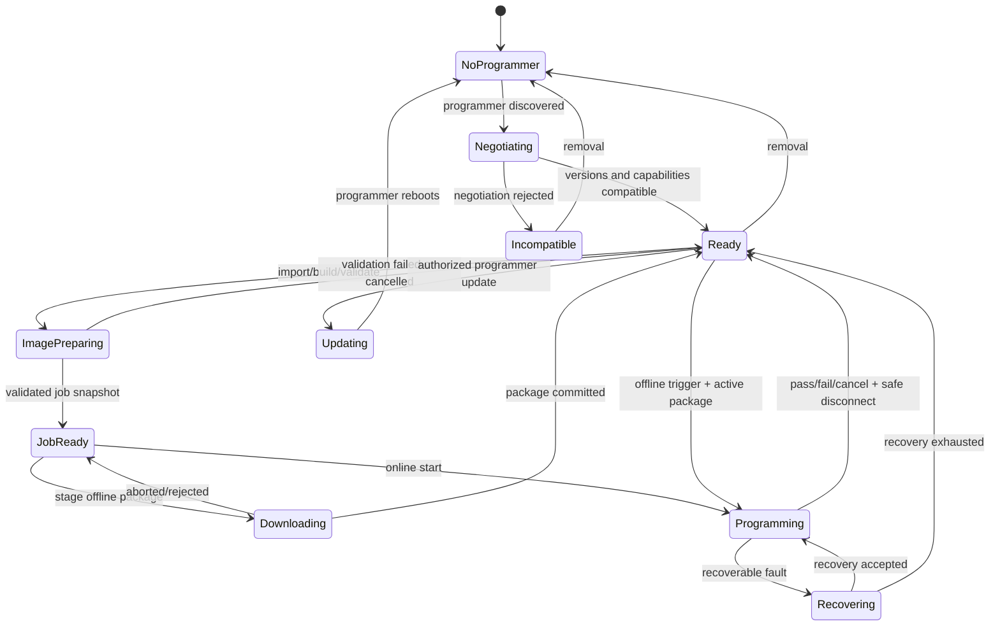
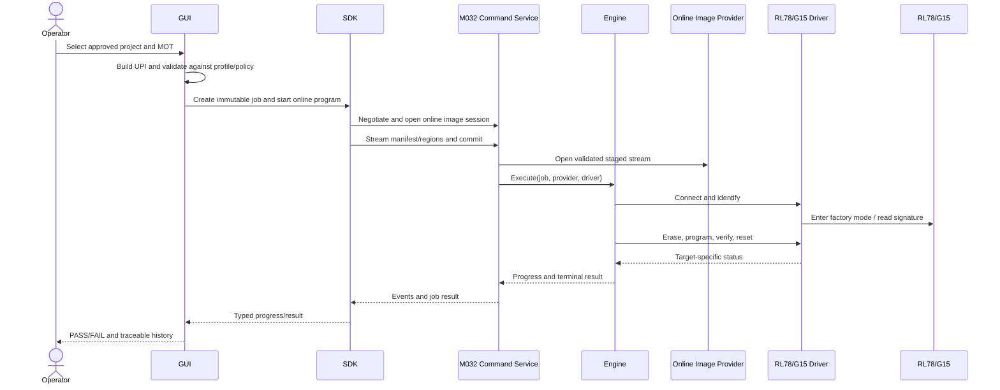
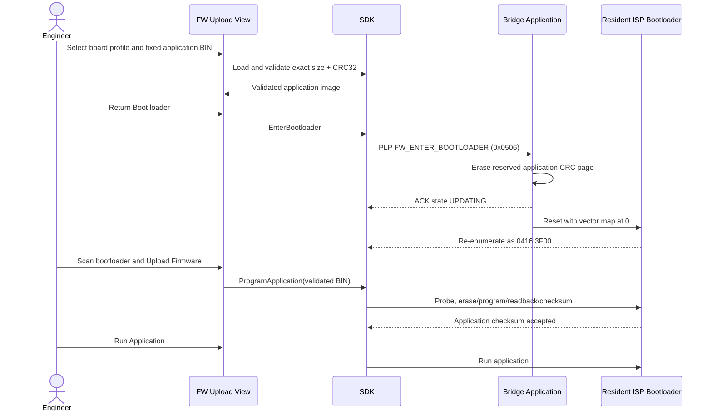
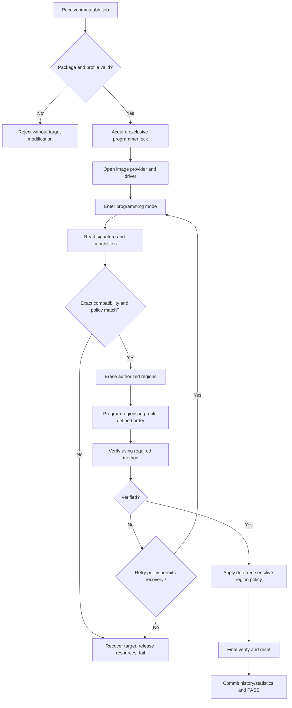
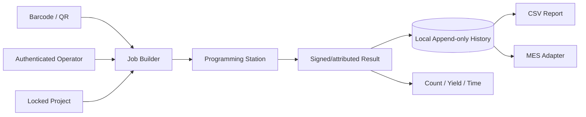

# Software Architecture Specification (SAS)

| Field | Value |
| --- | --- |
| Document ID | SAS-RPP-001 |
| Product | Reusable Programmer Platform — RL78/G15 Profile |
| Version | 1.0-draft |
| Status | Implementation baseline; physical HIL and release approval required |
| Owners | System Architecture, PC Lead, Firmware Lead, Validation Lead |
| Normative dependencies | PPS, FSDS, GSDS, OIS, PSDK, Common Contract Registry |

<style>
@media print {
  @page { size: A4 portrait; margin: 10mm; }
  h2, h3 { break-after: avoid-page; page-break-after: avoid; }
  table, .mermaid, pre.mermaid, .mermaid svg {
    break-inside: avoid-page !important;
    page-break-inside: avoid !important;
  }
  .mermaid svg { max-width: 100% !important; max-height: 235mm !important; height: auto !important; }
}
</style>

## 1. Overview

### 1.1 Purpose

This document defines the top-level architecture, ownership boundaries, dependencies, lifecycle, extension model, production qualities, and verification strategy for a reusable factory programmer platform. It is sufficiently precise for independent PC, SDK, programmer-firmware, device-driver, and validation teams to implement compatible components.

RL78/G15 is the first target profile. Target family knowledge is not permitted in the GUI, general SDK workflow, Programming Engine, storage manager, or generic image model.

### 1.2 Scope

In scope:

- Windows MFC operator GUI and reusable Programmer SDK.
- USB HID communication with NuMaker-M032SE/M484 and 3.3 V VCOM UART
  communication with the M032 TEST BOARD.
- Online programming from a validated PC image stream.
- Offline image download, durable activation, button-triggered programming, and result indication.
- RL78 Protocol B device driver using factory serial programming mode.
- Image ingestion for Motorola S-record, Intel HEX, and binary; ELF reserved.
- Project settings, history, statistics, barcode, export, authorization, logs, firmware update, plug-ins, and production integration boundaries.
- Resident bridge bootloader and application-only USB HID or UART ISP update
  for the selected M032/M484 programmer board.

Out of scope:

- A bootloader or any modification to the customer RL78 application. The
  resident M032/M484 bridge bootloaders are programmer infrastructure and are
  in scope.
- The internal implementation of Renesas CS+ or customer firmware.
- Board schematic, enclosure, gang-programmer fixture, and certified safety design.
- Circumvention of target security/read-protection policy.
- Production keys or credentials in source, logs, packages, or this specification.

### 1.3 Definitions

| Term | Meaning |
| --- | --- |
| Program Image (UPI) | Validated, format-neutral set of address regions and programming policies |
| Offline Package (OIP) | Durable container carrying one or more UPI payloads, metadata, integrity data, and optional signature |
| Programmer | Approved bridge hardware and firmware acting between host/storage and target; currently M032 or Nu-Link2-Me/M484 |
| Target | MCU being programmed; initially an RL78/G15 |
| Device profile | Declarative identity, memory map, capability, protected-range, timeout, and policy data |
| Device driver | Target-protocol behavior behind `IDeviceDriver` |
| Image provider | Source of a validated UPI stream; online, storage, or future provider |
| Job | Immutable programming intent plus mutable execution result |
| Capability | Negotiated behavior that a component actually supports, not behavior inferred from version text |
| Bridge application image | Board-profiled fixed raw BIN loaded by the resident programmer bootloader; distinct from UPI/OIP target content |

### 1.4 Design Principles

- SOLID interfaces and composition-root dependency injection.
- Layered dependency direction toward domain abstractions.
- Ports-and-adapters boundaries for transport, image source, target driver, storage, clock, logging, and hardware.
- One normative truth source for wire IDs, errors, binary formats, and compatibility policy.
- Fail closed before erase/program when identity, range, integrity, authorization, or compatibility is uncertain.
- Bounded timeouts/retries; cancellation is cooperative and has defined safe points.
- Online and offline workflows converge on the same validation and Programming Engine.
- Production actions are attributable and auditable without exposing secrets or full customer image data.

## 2. System Context and Constraints

### 2.1 Context Diagram



### 2.2 Confirmed Constraints

| Constraint | Architecture consequence |
| --- | --- |
| USB HID uses fixed 64-byte reports | PPS provides 52-byte application payload, chunking, sequencing, and flow control |
| RL78/G15 Protocol B communication is 115200 bps | Target throughput estimates and timeouts must use target-driver timing, not HID speed |
| TOOL0 single-line UART is supported | Board HAL must provide direction/tri-state and echo policy; dedicated UART remains a board capability |
| M032SE3AE has 128 KB Flash and 16 KB SRAM | Images are streamed; offline capacity is negotiated; internal A/B cannot be assumed |
| M032 USB is full-speed device | HID is zero-install on Windows, but report scheduling and device removal remain explicit concerns |
| Nu-Link2-Me uses M484SIDAE (512 KiB APROM/160 KiB SRAM), HS USB and W25Q16 2 MiB SPIM | The same 64-byte PLP reports remain transport-stable; package capacity and button/LED behavior come from the board profile. A profile-bounded 64 KiB SRAM execution cache may isolate target timing from SPIM access while W25Q16 remains authoritative |
| M032 TEST BOARD has no USB connector and exposes PF.2/PF.3 UART0 | PLP uses exact 64-byte CRC-valid frames over 115200 8-N-1; UART ISP reuses the COM port and reports `MTB1` identity |
| Both bridge APROM images reserve `0x0000-0x3FFF` for a resident bootloader | GUI updates only a fixed CRC-protected application beginning at `0x4000`; initial bootloader provisioning still uses a debugger |
| Offline use may have USB power only | No PC dependency is permitted after an image becomes `ACTIVE`; durable result indication is required |
| Input may contain option/security areas | Validation policy must separate ordinary code from destructive/sensitive regions |

Authoritative hardware sources:

- [Renesas RL78/G15 User's Manual: Hardware, R01UH0959](https://www.renesas.com/en/document/mah/rl78g15-users-manual-hardware)
- [Renesas RL78 Protocol B Serial Programming Guide, R01AN6332](https://www.renesas.com/en/document/apn/rl78-family-rl78-microcontroller-rl78-protocol-b-serial-programming-guide)
- [Renesas RL78 Flash Programmer Protocol B Application Note, R01AN6782](https://www.renesas.com/en/document/apn/rl78-flash-programmer-rl78-protocol-b-rev100)
- [Nuvoton M031/M032 Series Data Sheet](https://www.nuvoton.com/export/resource-files/DS_M031_M032_Series_EN_Rev2.01.pdf)
- [Nuvoton M032SE3AE product page](https://www.nuvoton.com/products/microcontrollers/arm-cortex-m0-mcus/m032-series/m032se3ae/)

All electrical values, timing, part-number memory maps, and entry sequences must be rechecked against the controlled document revision used by the hardware project.

### 2.3 Assumptions and Missing Information

| Type | Item | Handling before closure |
| --- | --- | --- |
| Assumption | Windows 10/11 x64 with native HID class support | SDK returns explicit platform compatibility error |
| Assumption | TOOL0 single-wire is the initial target link | Board profile may override with dedicated UART |
| Selected / HIL pending | NuMaker-M032SE: UART1 PA.3/PA.2, reset PA.5, PB.3 NC with VDD sense disabled, PA.4 enable Low/physically NC and onboard status LED PB.14 | ADR-0004/ADR-0010; external voltage verification, electrical buffer and HIL approval still gate physical use |
| Selected / partial HIL | Nu-Link2-Me: TIMER2-driven PA.9 open-drain GPIO TX/PA.10 GPIO RX split TOOL0, PF.5 reset, PB.12 NC with VDD sense disabled, PC.7 KEY1, four LEDs, PC.0-PC.3 W25Q16, 64 KiB SRAM target-image cache and PF.2/PF.3 HXT | ADR-0008 and ADR-0009 enable the bounded HIL-candidate path; online G15 passed 30/30, while SRAM-cache autonomous stability HIL remains required |
| Selected / HIL pending | M032 TEST BOARD: PF.2/PF.3 UART0 host link, independent TIMER1 entry delay, PB.9 open-drain TIMER2 TX/PB.10 GPIO-edge plus TIMER2 software RX split TOOL0, PB.8 reset, PC.2 button, PA.11/PA.10 LEDs and internal 64 KiB slot | ADR-0012; PC/native/Keil builds pass, while UART/TOOL0/RESET/G15/G16 physical HIL remains required |
| Selected | Nu-Link2-Me external storage is W25Q16JVSSIQ, 2 MiB raw | `IStorage` reports actual geometry; M032 remains separately capacity-constrained |
| Missing | VID/PID and USB strings | Development values prohibited from production release |
| Missing | Exact RL78/G15 part numbers | No generic G15 memory map may authorize programming |
| Missing | Key and operator/MES policy | Signature/authentication features remain policy interfaces |

## 3. Layered Architecture

### 3.1 Logical Layers



### 3.2 Dependency Rules

Allowed dependencies point downward or toward interfaces owned by the inner layer. Specifically:

- MFC views depend on application use cases, never Win32 HID.
- SDK core depends on `ITransport`, never a concrete HID library.
- Image parsers produce UPI; Programming Engine never calls parsers.
- Programming Engine depends on `IImageProvider`, `IDeviceDriver`, `IProgressSink`, `ICancellation`, and `ILogger`.
- RL78 driver depends on target-link and control-pin abstractions, never M032 registers.
- Firmware services depend on HAL and storage interfaces; HAL implementations may use the vendor BSP.
- Plug-ins communicate through versioned public contracts and cannot access private UI/application objects.

No cyclic dependency is allowed. Composition roots may instantiate concrete adapters but contain no business policy.

### 3.3 Replaceable Ports

| Port | V1 adapter | Future adapters | Stable consumer |
| --- | --- | --- | --- |
| `ITransport` | USB HID | CDC, UART, Ethernet, BLE | Programmer SDK |
| `IImageParser` | Motorola S-record, Intel HEX, BIN | ELF | Image Builder |
| `IImageProvider` | Online stream, internal/external Flash | SD, USB disk, network | Programming Engine |
| `IDeviceDriver` | RL78 Protocol B / G15 profile | G16, G23, F24, other Renesas | Programming Engine |
| `IStorage` | M032 APROM data region or Nu-Link2-Me W25Q16 | SD/eMMC | Storage Manager |
| `IReportSink` | CSV, local history | PDF, database, MES | Production Service |
| Firmware HAL | M032SE3AE and M484SIDAE/Nu-Link2-Me | Replacement programmer MCU | Firmware services/drivers |

## 4. Major Components

The table is normative for component ownership. Detailed states and operations are defined in the specialized specifications.

| Component | Purpose / responsibilities | Inputs → outputs | Required interfaces / dependencies | State and error behavior | Future extension |
| --- | --- | --- | --- | --- | --- |
| Main Window | Operator shell, navigation, global status, safe command enablement | UI events/status → use-case requests/views | Application facade, localization, view models | Reflects job/device states; never owns worker state | Alternate shells, accessibility |
| Project Manager | Immutable project identity and approved policies | Project file/profile → validated project snapshot | Config, device profile registry | Rejects unsupported schema/profile | Signed/locked templates, server projects |
| Image Builder | Converts supported source formats to UPI | MOT/HEX/BIN → UPI + diagnostics | Parser plug-ins, canonicalizer | Parse/build states; no programming side effects | ELF, symbol-aware metadata |
| Image Validator | Enforces target/policy/range/integrity rules | UPI + profile + policy → validation report | Device profiles, option policy | Any error blocks job creation | Regulatory/customer policies |
| Programmer SDK | Stable host API and async operation model | API requests ↔ result/events | Transport, dispatcher, codec | Connection/session/operation states; maps PPS errors | Bindings and new transports |
| Communication Layer | Reliable report exchange and discovery | PPS frames ↔ bytes | HID/other platform adapter | Sequence, timeout, retry, disconnect recovery | CDC/UART/Ethernet/BLE |
| Command Service | Validates PPS commands and routes them | PPS request → response/event | Session, storage, engine, updater | Rejects illegal command for state/capability | New command classes |
| Programming Engine | Target-independent job orchestration | Job + provider + driver → result/progress | Abstract ports only | Safe-point cancellation and bounded recovery | Gang channels, policy stages |
| Image Provider | Streams validated UPI sections | Read requests → immutable chunks | Online session or storage | Open/read/close; detects truncation/hash error | SD/network/USB disk |
| Device Driver | Implements target-specific operations/capabilities | Generic engine operations ↔ target responses | Target link, timer, GPIO control | Driver-owned protocol state and retry policy | Add driver without engine changes |
| RL78 Protocol B Driver | G15 mode entry, identify, erase/write/CRC/reset | Driver calls ↔ 115200-bps Protocol B frames | UART HAL, reset/tool control, clock | Protocol B state machine; target status mapping | G16 profile or other Protocol B targets |
| Storage Manager | Durable images/settings/history/statistics/calibration | Records/packages ↔ atomic storage operations | `IStorage`, integrity provider | Journaled commit/recovery; never exposes half-active slot | Encryption, multiple images |
| Offline Image Manager | Download, validate, activate, select and recover packages | OIP stream/button → active provider/job | Storage, OIS validator, policy | EMPTY/DOWNLOADING/VALID/ACTIVE/QUARANTINED | A/B, multi-image selection |
| Firmware Update Manager | Updates programmer application, not target firmware | PLP handoff + fixed application BIN → ISP result | SDK bootloader client, boot/update boundary, CRC profile | Current app-only flow is fail-recoverable through resident bootloader; future staged path owns signature/rollback | Signed candidates, multiple firmware components |
| Production Service | Job attribution, counters, yield, export, barcode/MES boundary | Job events/identity → history/report | Logger, clock, report plug-ins | Append-only audit; degraded-mode policy explicit | MES, gang programming |
| Unified Logger | Cross-component structured event capture | Log event → sinks/query/export | Clock, redaction, storage | Bounded buffers, severity filters, overflow record | Remote telemetry |
| Configuration Manager | Versioned settings outside source | Config documents → validated snapshots | Schema, storage, policy | Defaults/migration/rollback; no silent write loss | Remote policy provider |
| Plug-in Manager | Discovers and isolates approved extensions | Manifest/binary → registered capabilities | ABI registry, signature policy | Rejected/incompatible/quarantined states | Sandbox/out-of-process plug-ins |

### 4.1 Core Interface Class Diagram



## 5. End-to-End Behavior

### 5.1 System State Model



### 5.2 Online Programming Sequence



The online provider may be backed by a bounded temporary store or flow-controlled stream. The engine never consumes unvalidated bytes directly from HID.

### 5.3 Offline Programming Sequence

```mermaid
sequenceDiagram
    actor Engineer
    participant GUI
    participant SDK
    participant Store as M032 Storage Manager
    actor Operator
    participant Engine
    participant Driver
    participant Target
    Engineer->>GUI: Build and approve offline package
    GUI->>SDK: Download package to candidate slot
    SDK->>Store: Begin, chunks, finalize
    Store->>Store: Validate CRC/hash/signature/policy
    Store-->>SDK: Durable commit and activation token
    SDK-->>GUI: Active package identity
    Note over Operator,Store: Later, USB power only; no PC session required
    Operator->>Store: Apply USB power while Offline Armed
    Store->>Store: Wait bounded HID session grace period
    alt GUI opens HID session
        Store-->>GUI: Report Offline Armed and active package
        GUI->>Store: Keep armed or switch Online Only
    else no HID session
        Store->>Store: Select ACTIVE package and create autorun job
    end
    Store->>Engine: Execute(job, storage provider, driver)
    Engine->>Driver: Connect, identify, program, verify, reset
    Driver->>Target: RL78 Protocol B
    Engine-->>Store: Terminal result and metrics
    Store-->>Operator: PASS/FAIL LED pattern
```

### 5.4 Bridge Application Update Sequence



The resident bootloader is initially written through a debugger and is outside
the ISP writable range. Invalid vectors, an invalid CRC or an interrupted
upload keep `0416:3F00` available for another complete upload. The development
path has no A/B rollback, signature/anti-rollback claim or bootloader self-
update. The bridge application BIN is not placed in RL78 offline storage.
Both bootloaders reside in APROM: the M032 boot target uses
`M031_AP_128.FLM`, and M484 uses `M481_AP_512.FLM`. Initial Nu-Link ICP/Keil
provisioning must preserve unrelated CONFIG bits while setting
`CONFIG0.CBS[7:6]=10` on both boards and `MBS bit 5=1` on M484. The host binds
the selected instance/profile to reported application geometry and rejects an
invalid CBS/MBS state before erase.

#### 5.4.1 Bridge MCU Reset Sequence

The global GUI connection bar exposes a capability-gated normal bridge reset.
The SDK sends non-replay-safe PLP `RESET_PROGRAMMER` (`0x0007`) only in an idle
negotiated session. Firmware schedules the reset after the USB ACK completes,
restores vector page zero and leaves application CRC unchanged. The resident
bootloader therefore validates and launches the same application. The SDK
closes its old transport after ACK; the user establishes a new session after
the normal application PID re-enumerates. This is distinct from
`FW_ENTER_BOOTLOADER`, which deliberately invalidates application CRC.

### 5.5 Programming Flow



Sensitive options may be deferred only if the device driver and approved policy explicitly support a safe ordering. An unrecognized option/security region is always rejected.

## 6. Data Architecture

### 6.1 Authoritative Data Objects

| Object | Identity and immutability | Owner | Persistence |
| --- | --- | --- | --- |
| Device Profile | profile UUID + semantic version | Device plug-in registry | PC package; selected subset on programmer |
| Project Snapshot | project UUID + revision + content hash | Project Manager | PC project file/history |
| UPI | image UUID + SHA-256 + builder version | Image Builder | PC cache or inside OIP |
| OIP | package UUID + content hash + signature identity | Offline Image Manager | programmer storage / release archive |
| Job | job UUID + project/image/profile hashes | Programming Service | append-only history |
| Job Result | job UUID + attempt + terminal error code | Programming Engine | programmer and PC history |
| Programmer Identity | device UUID + hardware/firmware/protocol versions | Device Manager | device info / history |
| Audit Event | timestamp + source + category + correlation IDs | Logger | bounded device log and PC archive |

### 6.2 Configuration

Configuration is outside source and divided by authority:

| Scope | Examples | Authority |
| --- | --- | --- |
| Device immutable | hardware revision, storage geometry, device UUID | manufacturing provisioning |
| Firmware safe defaults | USB timeout, retry ceiling, watchdog window | signed firmware release |
| Project policy | target profile, erase/verify/option policy | project approver |
| Operator preferences | language, window layout, CSV path | local user config |
| Factory policy | auto-run, barcode rule, operator role, MES endpoint | signed/locked production config |

Unknown keys are preserved when safe, but unknown safety-critical values invalidate the configuration. Every schema has a version, migration rule, default rule, validation report, and last-known-good rollback.

### 6.3 Logging and Error Model

All components emit the common event envelope and return the unified 32-bit error code defined in `docs/contracts/CONTRACTS.md`. Logs carry category, severity, correlation IDs, operation stage, component version, and redacted context. Binary image contents, passwords, authentication tokens, and signing keys are never logged.

## 7. Versioning and Compatibility

Independent version domains prevent unrelated upgrades from forcing lockstep releases:

- Product document baseline: semantic `major.minor` plus status.
- PC tool/build: workspace standard `a.b.c.ddd`.
- Programmer firmware: semantic version plus build metadata.
- PPS wire protocol: major/minor in every report.
- OIS format: major/minor in every package.
- SDK ABI: major/minor/patch with exported ABI major.
- Device profile and plug-in contracts: semantic version and capability set.

Compatibility rules:

1. Major mismatch is rejected unless an explicit compatibility adapter exists.
2. Minor versions are backward-compatible within a major; unsupported optional capabilities are not used.
3. Commands, fields, flags, and enum values unknown to a receiver are handled according to their `required/optional` designation.
4. Capability negotiation, not version comparison alone, authorizes a feature.
5. Reserved numeric ranges must remain reserved until a documented allocation.

## 8. Security and Safety

### 8.1 Trust Boundaries

- Files imported on the PC are untrusted until parser and validator completion.
- USB devices are untrusted until identity/protocol negotiation.
- Offline packages are untrusted until structural, integrity, compatibility, rollback, and signature policy checks.
- Plug-ins are untrusted until manifest, ABI, publisher, and policy approval.
- Target-reported identity is verified against the selected profile before any erase.
- MES/operator input is untrusted and schema-validated.

### 8.2 Required Controls

- Length/offset arithmetic must be overflow-safe and bounds-checked.
- No erase/program occurs before exact profile compatibility and authorization.
- Production project lock and sensitive operations require role authorization.
- Package and production firmware-update signature verification is algorithm-
  agile. The current raw bridge application ISP path is explicitly development-
  only and must not be represented as signed or rollback-capable.
- Anti-rollback policy is configurable by product and monotonically auditable.
- Secrets reside only in approved provisioning/secure storage; logs contain key IDs, not keys.
- Firmware update and target programming have distinct command classes and permissions.
- Read Flash defaults to disabled because target security and IP policy may forbid it.

## 9. Production Architecture

### 9.1 Production Data Flow



The V1 station is single-channel. Batch programming means a controlled queue of jobs; gang programming is a future orchestration adapter with independent channel identities and results. MES failure behavior is factory-policy controlled: fail closed, bounded local queue, or supervisor override, all auditable.

### 9.2 Production Records

Minimum record: station/programmer identity, operator identity or approved anonymous station role, job/project/image/profile hashes, target signature, target serial number if available, barcode, start/end UTC and monotonic duration, attempt, stage results, final error, software/firmware/protocol versions, and export/MES disposition.

## 10. Deployment and Operations

### 10.1 PC Deployment

- Zero-install portable package is preferred.
- MFC runtime strategy, plug-in search roots, config location, logs, and data retention are explicit release contents.
- HID uses the Windows class driver unless the approved VID/PID policy requires a signed descriptor/INF package.
- Release manifest contains file hashes, license notices, schema versions, and minimum firmware compatibility.

### 10.2 Firmware Deployment

- Firmware release identifies board profile, memory map, PPS range, OIS range, enabled device drivers, storage providers, and signing key ID.
- Initial deployment writes the resident 16 KiB bootloader and application/
  factory image through a debugger/programmer.
- The current GUI/SDK update path invalidates and replaces only the application
  beginning at `0x4000`; the resident bootloader remains available at
  `0416:3F00` after interruption. It never reuses the RL78 target-programming or
  OIP-storage path.
- A production programmer update must add staged authentication, rollback/
  recovery policy and release evidence; the current development ISP path does
  not satisfy that production requirement.
- Watchdog reset reason and interrupted-operation marker are available through device info/log commands.

### 10.3 Observability

Health data includes boot/reset reason, uptime, storage health, active package identity, last offline result, bounded offline failure-history sequence/overflow, command/session state, target-driver state, error counters, log overflow, firmware version, PPS/OIS range, and capabilities.

## 11. Directory and File Organization

```text
pc/       app, ui, application, domain, sdk, plugins, platform, resources, tests
firmware/ app, services, domain, drivers, transport, storage, hal, board, platform, tests
shared/   generated schemas and catalogs from normative contracts
protocol/ schemas, golden packets, sanitized captures, conformance reports
docs/     architecture, protocol, firmware, GUI, offline, SDK, contracts, ADRs, requirements
tests/    unit, integration, conformance, HIL, fixtures
tools/    generators, validators, package inspectors, release utilities
build/    Windows GUI executable, portable INI and transient PC objects only
```

Private implementation headers remain within their module. Public contracts are versioned and generated from shared schemas where practical. Vendor BSP code is isolated under the programmer platform adapter and is never included by domain modules.

## 12. Extension Strategy

### 12.1 Add a Target

Add a signed device plug-in containing a profile, memory map, capability set, validation policies, driver factory, target error mapping, timeout/retry policy, and conformance vectors. The GUI and Programming Engine consume the generic capabilities and require no modification.

RL78/G16 may reuse the Protocol B transport driver with another profile if official device documentation confirms compatibility. RL78/G23, RL78/F24, or future devices may use different protocol drivers; family names alone never imply compatibility.

### 12.2 Add a Communication Method

Implement `ITransport`, advertise transport capabilities, and pass the same PPS messages or an approved framing adapter. SDK jobs, progress, errors, and GUI workflow remain unchanged.

### 12.3 Add an Image Format or Report

An image parser plug-in emits UPI plus diagnostics; a report plug-in consumes immutable result records. Neither gains access to target transport or private UI objects.

### 12.4 Replace Programmer MCU

Port HAL, board profile, storage geometry, USB/transport adapter, and updater. Command service, storage semantics, OIS validator, Programming Engine, and device-driver interfaces remain portable.

## 13. Risk Analysis

| Risk | Severity | Mitigation / acceptance evidence |
| --- | --- | --- |
| Wrong G15 part profile erases invalid range | Critical | Exact signature match, profile hash, HIL matrix, no family wildcard |
| TOOL0 contention damages or corrupts communication | Critical | Approved tri-state circuit, direction HAL, echo tests, logic-analyzer evidence |
| Power loss activates partial offline image | Critical | Candidate slot, journal, full verify, atomic activation record, boot recovery tests |
| Option/security bytes lock target unexpectedly | Critical | Explicit policy, protected classification, role approval, deferred ordering where supported |
| Programmer storage cannot hold desired image | High | Capability/geometry query, preflight capacity check, M484 W25Q16 or future storage option |
| HID report loss/duplication corrupts data | High | sequence, CRC16, offset, chunk CRC, idempotency token, final SHA-256 |
| UI cancellation leaves target undefined | High | safe-point model, explicit `cancel_pending`, mandatory reset/recovery/result state |
| Version drift across SDK/firmware/docs | High | generated registries and compatibility conformance suite |
| Plug-in ABI or trust failure | High | ABI major, manifest/signature policy, isolated discovery, quarantine |
| Logs expose firmware or personal data | Medium | structured allow-list, redaction, retention/export policy |
| Statistics double-count retries | Medium | job UUID + attempt identity and idempotent result ingestion |
| Firmware event flood starves watchdog/USB | Medium | bounded queues, priority scheduler, overflow event and stress tests |
| Bridge application update erases resident recovery code | Critical | Bootloader range is excluded in SDK profile, ISP handler and linker; initial bootloader changes require debugger |
| Power loss after app CRC invalidation leaves no PLP application | High | Resident bootloader remains at `0416:3F00`; repeat a complete validated app upload |

No Critical or High risk may remain without an approved owner, test evidence, and release waiver.

## 14. Verification Strategy

### 14.1 Unit Test Suggestions

- Each state transition, illegal transition, timeout, retry limit, and cancellation safe point.
- MOT/HEX/BIN parser corruption, overlap, duplicate, unsupported address, and sparse fill behavior.
- UPI/OIP offsets, integer overflow, CRC/hash/signature, target compatibility, and rollback rules.
- Error mapping and log redaction.
- Profile registry and plug-in ABI/capability negotiation.
- Storage journal recovery at every write/erase boundary.

### 14.2 Integration and Conformance

- Golden PPS request/response/event vectors for every command and error.
- SDK against a virtual programmer with disconnect, duplicate, stale response, malformed frame, and delayed event injection.
- Firmware services against fake HAL/storage/driver providers.
- OIS packages produced and consumed independently by PC and firmware implementations.
- Compatibility tests across supported minor versions.

### 14.3 Hardware-in-Loop

- Each approved RL78/G15 orderable part, voltage corner, erased/non-erased state, option policy, and valid image size.
- TOOL0 and dedicated UART where supported; analyzer-confirmed timing and direction.
- USB removal and target power interruption at controlled stages.
- Application-to-bootloader re-enumeration, application erase/program
  interruption, invalid vector/CRC stay-in-boot behavior and successful launch
  for both bridge boards.
- Offline cold boot, button debounce/long press policy, PASS/FAIL indication, repeated programming, storage wear.
- Comparison with Renesas reference programmer results and CRC where the target protocol permits.

## 15. Future Improvements

- Multi-channel/gang programming with isolated channel state and power control.
- External secure element for programmer identity and package verification.
- Encrypted OIP payloads with per-station authorization.
- SD/USB/network image providers.
- Out-of-process PC plug-ins and formal protocol schema generation.
- Remote fleet health and signed audit upload.
- Deterministic timing model and fault-injection automation.

## 16. Acceptance Criteria

The architecture baseline is accepted when:

1. Hardware, PC, firmware, validation, security, and production owners approve their boundaries.
2. Every prompt requirement maps to a document section and planned test.
3. PPS and OIS golden vectors are independently reviewed.
4. Board/storage/security ADRs are closed.
5. Independent PC and firmware prototypes complete negotiate → identify → program → verify using only published contracts.
