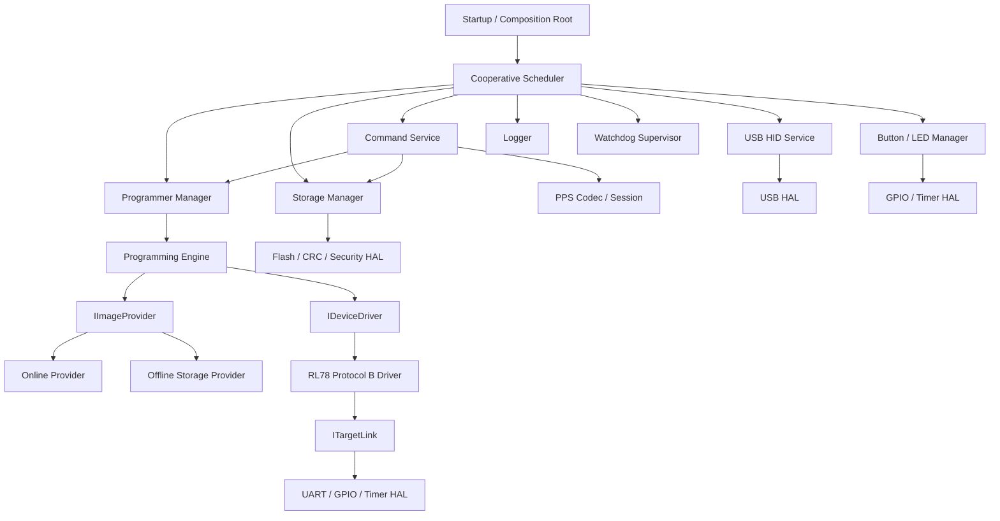
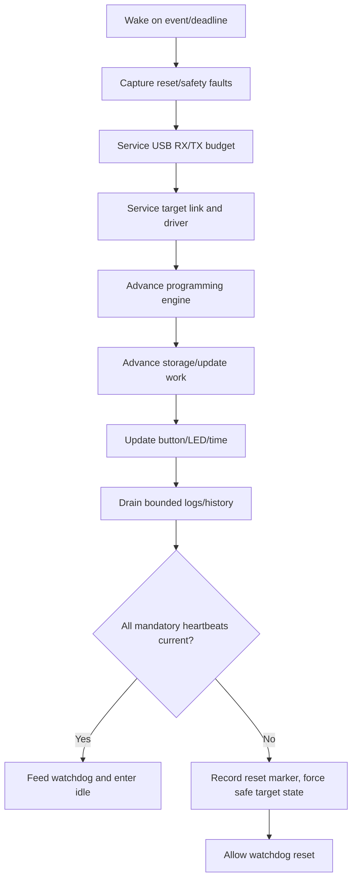
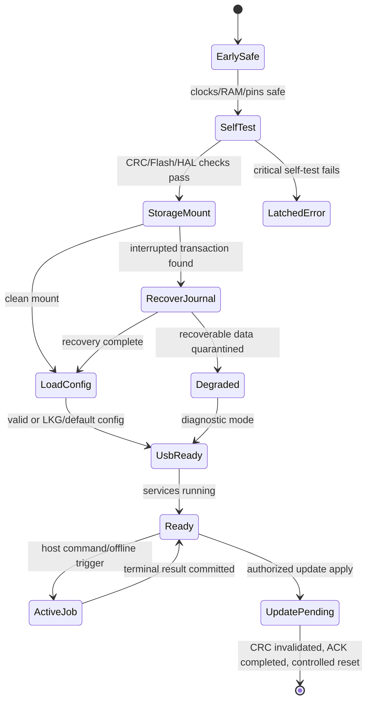
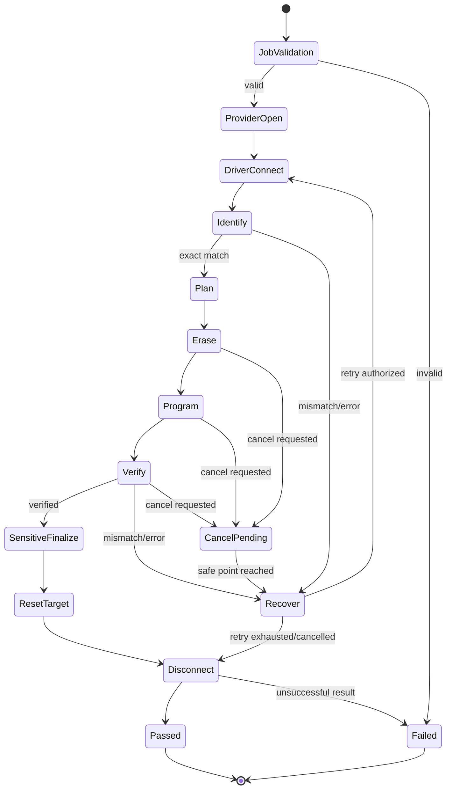
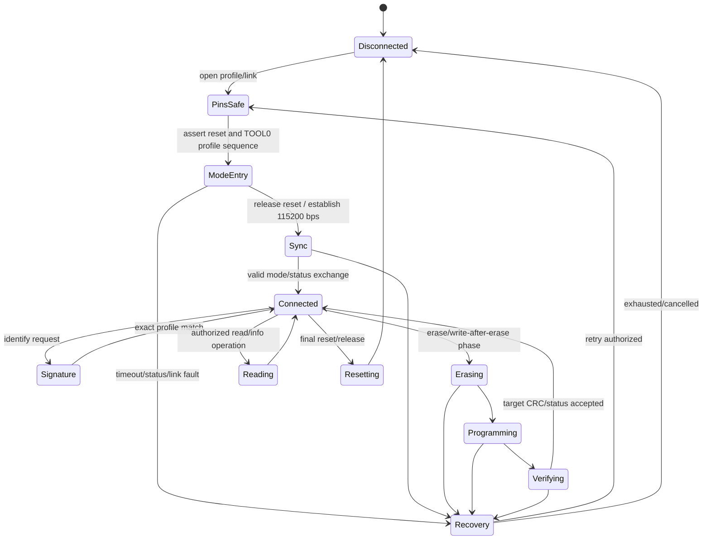
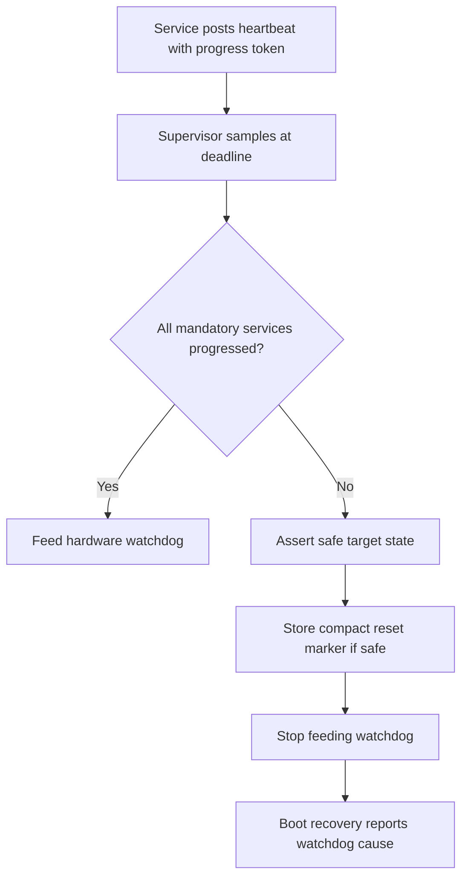
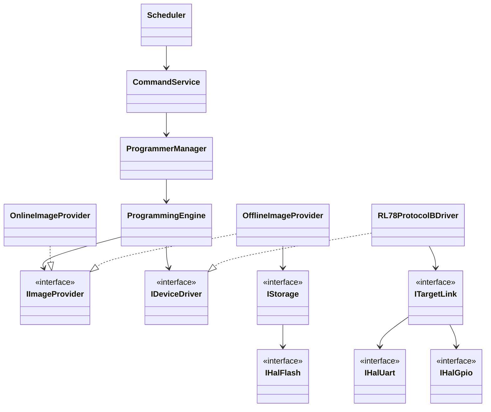

# Firmware Software Design Specification (FSDS)

| Field | Value |
| --- | --- |
| Document ID | FSDS-RPP-001 |
| Target platform | Nuvoton M032SE3AE EVB and M484SIDAE Nu-Link2-Me |
| Version | 1.0-draft |
| Architecture | Cooperative event-driven services, target-independent domain, HAL |
| Normative dependencies | SAS, PPS, OIS, Common Contract Registry |

<style>
@media print {
  @page { size: A4 portrait; margin: 10mm; }
  h2, h3 { break-after: avoid-page; }
  table, .mermaid, pre.mermaid, .mermaid svg { break-inside: avoid-page !important; page-break-inside: avoid !important; }
  .mermaid svg { max-width: 100% !important; max-height: 235mm !important; height: auto !important; }
}
</style>

## 1. Overview

### 1.1 Purpose

This document defines implementable internal boundaries for programmer firmware while keeping the Programming Engine, image provider, storage semantics, command service, and device-driver interfaces portable across M032 and M484 board adapters.

### 1.2 Responsibilities

- Expose a PLP-capable USB HID or board-profiled UART programmer transport.
- Receive, validate, sequence, and dispatch PPS commands without blocking the
  selected transport service.
- Store and recover configuration, offline images, history, statistics, calibration, logs, and firmware-update metadata.
- Execute the same target-independent Programming Engine for online and offline providers.
- Drive target UART/TOOL0/reset/power-sense only through HAL.
- Provide deterministic button, LED, watchdog, error recovery, progress, and production behavior.
- Keep the resident bridge bootloader isolated from the updatable application
  and provide the PLP-to-ISP handoff callback.

### 1.3 Constraints

- M032SE3AE: 128 KB APROM, 16 KB SRAM, 4 KB LDROM, 512-byte SPROM, USB FS device, hardware CRC, three UARTs, and no QSPI according to the controlled data-sheet baseline.
- Nu-Link2-Me: M484SIDAE, 512 KiB APROM, 160 KiB SRAM, HS USB, 12 MHz HXT and W25Q16JVSSIQ 2 MiB SPIM storage. The formal target is a physical-HIL candidate, not production-approved firmware.
- RL78/G15 target profile: Protocol B at fixed 115200 bps, 8-bit odd parity;
  programmer transmit uses two stop bits and target response uses one. TOOL0
  single-wire is the default.
- V1 USB reports: fixed 64 bytes; domain processing is chunked/streamed.
- Firmware C implementation is expected to remain C90-friendly and avoid dynamic allocation after initialization.
- NuMaker-M032SE pin mapping is accepted by ADR-0004/ADR-0010. PB.3 is NC and target-VDD sensing is disabled, so entry performs no voltage read/range gate; PA.4 remains Low and physically unconnected. Target voltage must be verified externally, and the target buffer circuit/HIL and storage endurance remain release-blocking decisions. ADR-0011 fixes the APROM boot/application/storage partition.
- Nu-Link2-Me uses only its own 3.3 V rail for the target domain. PB.12 is NC and its target-VDD sense capability is disabled; PB.13 is reserved and unconnected. Entry therefore performs no voltage read/range gate for this board profile. External target supplies, 1.8 V and 5 V remain prohibited until a separate level interface is approved.
- Nu-Link2-Me pin/storage/indicator mapping is accepted by ADR-0008. The formal Keil target enables the bounded target path for HIL, while physical HSUSB/SPIM/TOOL0/reset/RL78 evidence remains open.
- M032 TEST BOARD is accepted by ADR-0012: PF.2/PF.3 UART0 provides PC PLP at
  115200 8-N-1; PB.9 open-drain TIMER2 TX and PB.10 GPIO/TIMER2 software RX
  join RL78 TOOL0 through
  separate 47-ohm resistors; PB.8 is RESET#, PC.2 is the offline/forced-ISP
  button, PA.11/PA.10 are active-low Red/Green LEDs, and internal APROM retains
  the standard metadata plus 64 KiB slot. Physical HIL remains open.

## 2. Architecture

### 2.1 Component View



### 2.2 Dependency Rules

- `main` is a composition root only: initialize, inject, start, and supervise.
- Interrupt handlers capture minimal hardware events into bounded queues; they do not parse PPS, write storage records, log formatted events, or run target protocol state machines.
- Scheduler invokes bounded work steps. No service waits in an unbounded loop.
- Domain modules include only portable types/interfaces and common contracts.
- M032 register/BSP access is limited to `platform/m032` HAL implementations.
- USB command handling does not call the RL78 driver directly; it submits a request to Programmer Manager/Engine.
- Engine does not know whether the selected provider is online storage, offline Flash, SD, or network.

## 3. Module Design Catalog

Each row defines purpose, responsibilities, interfaces, state/error behavior, and extension path for a firmware module.

| Module | Purpose and responsibilities | Inputs → outputs / public interfaces | State and error handling | Dependencies | Future extension |
| --- | --- | --- | --- | --- | --- |
| Startup / `main` | Clock/self-test, dependency construction, reset-cause capture, initial safe pins, scheduler start | reset cause/config → initialized services | BOOT→RECOVERY/READY/ERROR; fail-safe target reset asserted on init failure | HAL factories, config, logger | Alternate board/platform composition |
| Task Scheduler | Priority-based cooperative dispatch, deadlines, queue budgets, idle entry | events/ticks → bounded service steps | Detects deadline/queue overrun; reports health, never spins | Clock HAL, watchdog supervisor | RTOS adapter preserving task contracts |
| USB HID HAL | Endpoint setup, report I/O, suspend/resume/removal events | 64-byte reports ↔ endpoint buffers | ISR-safe queues; stall/reset recovery; overflow counted | Nuvoton USBD BSP only | CDC/BLE/Ethernet platform adapter |
| USB HID Service | Owns report buffers, validates transport framing handoff, prioritizes responses/events | HAL report → codec frame / frame → HAL report | DETACHED/ENUMERATED/ACTIVE/SUSPENDED; malformed frames dropped/counted | USB HAL, PPS codec | Multi-transport mux |
| PPS Codec | Header/flags/length/padding/CRC16 serialization and parsing | bytes ↔ validated PLP message | Stateless except counters; no handler invoked on invalid frame | CRC interface, contracts | Generated codec/schema |
| Session Manager | Version/capability negotiation, sequence/replay, exclusive session, event counters | PLP control messages → session decisions | UNNEGOTIATED/READY/SESSION; expiry/disconnect policy | Clock, device info, auth policy | Authenticated/multi-client session |
| Command Parser | Schema and command payload validation | validated message → typed request or NAK detail | Rejects unknown required fields before side effects | Contract registry | Generated validators |
| Protocol Dispatcher | State/capability/authorization gate and service routing | typed request → service call/response | One routing table; illegal state returns unified error | Session, services, error mapper | New command classes |
| Programmer Manager | Exclusive target ownership, job lifecycle, online/offline arbitration | start/query/cancel → job state/result | IDLE/PREFLIGHT/RUNNING/RECOVERING/TERMINAL | Engine, job store, providers/drivers | Multiple independent channels |
| Programming Engine | Generic validate/connect/identify/erase/program/verify/reset orchestration | job/provider/driver → progress/result | Section 6; cancellation at safe points; bounded retry | Abstract interfaces, logger | Policy pipeline/gang coordinator |
| Online Image Provider | Exposes committed staged UPI to Engine | region reads → immutable chunks | CLOSED/OPEN/EOF/ERROR; detects changed/truncated transfer | staging storage | True streaming with verified window |
| Offline Image Manager | Candidate download, validate, list, activate, quarantine, recovery | PPS transfers/storage scan → package records | EMPTY/RECEIVING/VALID/ACTIVE/QUARANTINED; atomic activation | Storage Manager, OIS validator | Multiple images/A/B/selection UI |
| Offline Storage Provider | Exposes active package UPI regions | Engine reads → chunks | Verifies package/section identity on open/read | Offline manager, storage | SD/USB/network provider |
| OIS Validator | Bounds, CRC32, SHA-256, signature, compatibility and rollback policy | package stream → validation report | Pure staged validation; any required failure blocks VALID | Hash/signature services | Encryption/decompression algorithms |
| Storage Manager | Geometry, records, journaling, allocation, atomic commit, wear/health | record/package operations → durable result | MOUNT/SCAN/READY/DEGRADED/RECOVERY/FAILED | Storage HAL, CRC/hash, clock | External Flash/SD providers |
| Internal Flash Storage | APROM data-region erase/program/read provider | block operations → completion | Enforces partition and alignment; readback verify | Flash HAL | Replace with external storage |
| Settings Manager | Versioned config snapshot, validation, migration, LKG rollback | config stage/commit/get → snapshot | DEFAULT/VALID/STAGED/RECOVERY; no partial critical writes | Storage, schema | Remote/signed policy |
| History / Statistics | Durable job summaries, lifetime/resettable counters, yield metrics | terminal job event → records/counters | Append/compact/recover; job UUID prevents double count | Storage, clock | MES queue, richer metrics |
| Boot Handoff / Firmware Update | Normal CRC-preserving reset, application CRC-page invalidation, ACK-completion reset and future signed candidate state | `RESET_PROGRAMMER`, `FW_ENTER_BOOTLOADER` or future FW commands → reset/handoff/update result | Current IDLE/PENDING_RESET; future RECEIVING/VALID/PENDING/ROLLBACK/ERROR | FMC boundary, USB completion, resident bootloader; future secure policy/storage | Signed dual-bank/external updater |
| RL78 Protocol B Driver | Device-specific mode entry, signature/info, erase/write/CRC/reset/disconnect | generic driver operations ↔ target status | Section 7; target error map; profile deadlines/retries | Target link, timer, GPIO control | Other Protocol B profiles |
| Target Serial Link | Board-selected hardware or GPIO software UART, single-wire direction, frames, FIFO and timeout/recovery | target frames ↔ driver | DISABLED/RX/TX/TURNAROUND/ERROR | UART/GPIO/timer HAL | Dedicated UART, other serial PHY |
| Device/Profile Registry | Driver/profile discovery, exact target matching, capability/memory policy | profile ID/signature → driver/profile | Rejects absent/ambiguous/outdated profile | generated signed profiles | Plug-in/profile pack update |
| GPIO HAL | Reset, TOOL0 direction/control, VDD sense/control, LEDs/button | logical signals ↔ board pins | Safe initialization values; invalid mapping is boot error | M032 BSP/board map | Replacement MCU/fixture |
| UART HAL | Configured asynchronous TX/RX and error reporting | buffers/events ↔ UART | No policy; detects overrun/framing/noise/timeout | M032 BSP | DMA/alternate UART |
| Timer/Clock HAL | Monotonic deadlines, wall-clock optional, debounce and metrics | time requests → ticks/deadlines | Wrap-safe; invalid RTC reported, monotonic remains available | M032 timers/RTC if present | External RTC/time sync |
| Flash HAL | APROM/LDROM/SPROM approved operations and geometry | aligned operations → verified status | Range/lock/voltage checks; no upper-layer raw FMC access | M032 BSP | External NOR adapter |
| CRC/Crypto Service | CRC16, CRC32, SHA-256, signature verification abstraction | buffers/streams → digest/result | Known-answer self-test; crypto failure fail-closed | HW CRC or approved library | Secure element/algorithms |
| Button Manager | Debounce, press policy, offline start interlock, ignore/queue rules | GPIO edges/ticks → semantic event | IDLE/DEBOUNCE/PRESSED/HELD/RELEASE; never starts job in ISR | GPIO/timer, Programmer Manager | Image select/fixture start input |
| LED Manager | Deterministic nonblocking state/result patterns and priority arbitration | system/job events → LED pattern | Highest-severity owner wins; pattern timeout/latch policy | GPIO/PWM/timer HAL | Display/buzzer stack-light |
| Unified Logger | Structured bounded events, severity/category/correlation, redaction | events → RAM queue/durable log/PPS cursor | Drop policy preserves error/terminal summary; overflow visible | Clock, storage, PPS event | External trace/telemetry |
| Error Handler | Unified error creation, mapping, escalation and safe recovery request | module error → error/event/action | No silent conversion to success; latches critical faults | Logger, supervisor, manager | Fault injection/health manager |
| Watchdog Supervisor | Proves scheduler and critical services advanced before feeding HW watchdog | heartbeats/deadlines → feed/reset | Missing/stale heartbeat causes recorded controlled reset | Watchdog HAL, reset marker | Windowed/external watchdog |
| Device Information | Stable programmer identity, versions, capabilities, reset/health | info query → paged records | Read-only; unavailable fields explicit | configuration/provisioning | Secure attestation |

## 4. Scheduler and Task Model

### 4.1 Task Priorities and Budgets

| Priority | Work | Trigger | Bounded behavior |
| ---: | --- | --- | --- |
| 0 | Target electrical safety/watchdog supervision | deadline/fault | Always serviced first; may assert reset/disable link |
| 1 | USB OUT receive and direct response transmit | endpoint event | Fixed reports per cycle; backpressure rather than unbounded queue |
| 2 | Target link/driver step | UART/deadline | One protocol transition or bounded byte batch |
| 3 | Programming Engine step | driver/provider completion | One state transition/chunk |
| 4 | Storage/update step | request/flash completion | One erase/program/hash quantum; yields to USB/watchdog |
| 5 | Button/LED/time services | edge/tick | Constant work; no busy wait |
| 6 | Log/history compaction and health | queue/idle | Budgeted; deferrable but overflow observable |

The firmware must publish measured worst-case step latency and prove the watchdog window and USB servicing margin in the target build report. Flash erase/program operations that block CPU require a platform-specific strategy and timing proof.

### 4.2 Queue Policy

All queues have compile-time or configuration-bounded capacities. Responses outrank progress events; terminal results are durable before event delivery; repeated progress may coalesce by job/stage. Queue overflow creates one rate-limited error record and health flag. Payload ownership is explicit and static pools are preferred.

### 4.3 Scheduler Flow



## 5. Startup, Recovery and Global State



Startup asserts target reset or otherwise establishes the board-approved non-programming state before parsing configuration. Interrupted jobs are recorded as interrupted/unknown and never counted PASS. Interrupted offline activation recovers the last committed active record. At address zero, the resident bootloader validates the application vectors and CRC before remapping vectors to `0x4000`; invalid applications remain in ISP HID instead of entering this application state machine.

## 6. Programming Engine Design

### 6.1 Engine Interfaces

| Interface | Required operations | Contract |
| --- | --- | --- |
| `IImageProvider` | open, manifest, enumerate regions, read immutable range, close | OIS/UPI identity does not change while open |
| `IDeviceDriver` | capabilities, connect, signature/info, read, erase, program, verify, reset, disconnect | All target-specific behavior and deadlines contained here |
| `IProgressSink` | stage start/update/end, warning, terminal result | Must be nonblocking and tolerate coalescing |
| `ICancellation` | query request and safe-point disposition | No asynchronous destruction of driver state |
| `ILogger` | structured event with correlation IDs | Bounded/redacted |
| `IClock` | monotonic now/deadline | Wrap-safe |

### 6.2 Engine State Machine



### 6.3 Programming Plan

The plan is immutable after target identity confirmation and contains ordered regions, erase units, program units, verify method, protected/deferred regions, fill handling, retry ceilings, and progress weights. It is derived from UPI + exact device profile + project policy; the Engine does not infer a memory map.

### 6.4 Error and Recovery

- Validation, compatibility, authorization, provider integrity, and storage errors occur before target erase.
- After target modification begins, any error enters recovery: complete indivisible operation, stop new writes, attempt driver-defined safe reset/disconnect, record actual known state, and produce terminal result.
- Retry is stage- and error-specific. Image/policy/signature mismatch is never retryable. Transport noise may be retryable within driver policy. Verify mismatch may allow complete reconnect/reprogram only when policy explicitly permits it.
- PASS requires required verification, successful target release/reset policy, and durable terminal record.

## 7. RL78 Protocol B Driver

### 7.1 Purpose and Boundaries

The driver translates generic engine operations into official Protocol B
behavior for exact G15 4/8 KiB and G16 16/32 KiB profiles. It owns target
mode-entry timing, UART framing, response/status interpretation, four-byte
program geometry, internal verify completion, timeouts, retries, and recovery.
It does not parse image files, manage USB, update LEDs, or persist history.

The official R01AN6332 and the selected RL78/G15 hardware manual revision are normative for actual target frames and timing. This architecture document intentionally does not duplicate their byte algorithms.

### 7.2 Driver State Machine



### 7.3 Target Link Requirements

- Configure exact 115200-bps UART and profile-defined parity/frame settings from official documentation.
- Single-wire TOOL0 requires board-approved release/direction handling. The Nu-Link2-Me profile uses TIMER2 at 104 HXT ticks/bit, PA.9 open-drain GPIO 8-O-2 transmit, and PA.10 falling-edge plus mid-bit GPIO 8-O-1 receive into a bounded software FIFO. PA.9 is released and PA.10 is armed at the first stop bit; a valid falling edge during the released stop interval transfers TIMER2 ownership from TX bookkeeping to RX start-bit confirmation so the target's bounded turnaround is not discarded. No fixed millisecond delay is inserted after a four-byte program ACK. During every transmitted Low bit, the Nu-Link2-Me adapter confirms the TOOL0 level through PA.10 at the bit boundary; an unobserved Low terminates the transfer as `TARGET_LINK_DIRECTION_COLLISION` and releases PA.9. Dedicated UART uses separate RX/TX when profile and board both advertise it.
- M032 TEST BOARD reuses the Nu-Link2-Me GPIO/TIMER2 transmit and receive
  ownership model with a 48 MHz HIRC schedule of 417 ticks per nominal
  115200-bit interval. PB.9 is transmit-only open-drain drive. The start bit,
  eight data bits and odd-parity bit are emitted by polling the TIMER2 period
  flag inside one bounded interrupt-masked interval of approximately 87 us.
  This guarantees that a delayed or coalesced ISR cannot omit a data bit.
  PB.9 is released and global interrupts are restored at the first stop bit.
  PB.10 uses a
  falling-edge GPIO interrupt and TIMER2 sampling for 8-O-1 receive. The
  falling-edge handler validates the Low start bit and starts one periodic
  schedule whose first event samples data bit 0. It does not use the M484
  half-bit confirmation interrupt followed by a second timer restart because
  those two scheduling latencies move the first sample too late on the M032
  Cortex-M0. PB.10 edge detection is disabled
  throughout entry Low and transmit data, enabled when PB.9 releases for the
  first stop bit, and may transfer TIMER2 ownership directly from TX to RX when
  the target begins its bounded turnaround. No transmit echo enters the
  software RX FIFO. Direction collision is reported only when PB.9 is driving
  a Low transmit bit and PB.10 simultaneously observes High.
  Every attempt releases PB.9, disables PB.10 edge detection, clears TIMER2 and
  the software RX FIFO/error state, and re-enters through PB.8 RESET. The long
  entry Low cannot create an RX byte because receive is not armed until entry
  release. TOOL0 GPIO/TIMER2 uses the highest interrupt
  priority while the independent PC/VCOM UART0 PLP service uses the lowest
  priority. Application-context protection of the UART0 report buffers may
  mask only `UART02_IRQn` through NVIC and must never use PRIMASK/global
  interrupt disable. The only permitted target-link PRIMASK interval is the
  bounded TX start/data/parity polling described above; it intentionally does
  not depend on interrupts and fits within the UART0 hardware FIFO budget.
  Software parity, stop-bit or FIFO validation failure maps to
  `TARGET_LINK_UART_FRAMING`. Online
  programming permits at most three complete, safe, pre-erase handshake
  attempts at the common 500 ms retry interval. The fixed HIRC schedule and
  voltage/temperature error are HIL release gates.
- M032 TEST BOARD reserves HIRC48 TIMER1 for polling one-shot microsecond
  RESET/TOOL0 entry delays. The delay provider must not use
  `CLK_SysTickDelay()`, because that helper disables the SysTick counter used
  for Protocol B millisecond deadlines. TIMER1 is the Cortex-M0 implementation
  of the same independent delay/deadline separation that Nu-Link2-Me obtains
  from DWT plus SysTick.
- Reset and TOOL0 transitions use monotonic deadlines, never delay loops in upper layers.
- UART overrun, framing, parity, physical direction collision, and timeout are distinct errors.
- Driver verifies the received frame structure/status before advancing state.
- Before target entry, Protocol B calculates a CRC32 over the exact-profile
  dense code image. It separately accumulates CRC32 over each four-byte unit
  obtained from the image provider after board attempt preparation. The two
  values must match before target verify/PASS may be accepted. A mismatch is
  `INTEGRITY_CRC` and forces target cleanup; target ACKs alone cannot authorize
  PASS for a changed or stale provider image.
- Target VDD must be sensed/validated if hardware provides the capability; absence of required voltage capability blocks programming for profiles that demand it.

### 7.4 Capabilities

Each profile declares code/data flash ranges, option/security regions, erase/program/verify operations, readback availability, CRC behavior, required mode, reset behavior, retry/timeout table, and sensitive-region ordering. `ReadFlash` is exposed only if the official protocol, target security state, and product policy all permit it.

## 8. Offline Image and Storage Design

### 8.1 Storage Object Model

| Object | Update model | Recovery rule |
| --- | --- | --- |
| Superblock pair | generation + CRC, alternating copies | choose highest valid committed generation |
| Configuration snapshots | stage then commit pointer | fall back to last-known-good/default |
| Package candidate | sequential/ranged writes into unreferenced allocation | incomplete candidate quarantined/reclaimed |
| Package validation record | append after full OIS validation | absence means not VALID |
| Active package record | redundant atomic generation record | previous active remains until new commit valid |
| Job history | append-only records with CRC and sequence | truncate/quarantine at first invalid tail |
| Statistics | reconstructible checkpoints plus job IDs | rebuild without double-counting jobs |
| Logs | bounded ring with record CRC | preserve error/terminal summaries on compaction |
| Update metadata | candidate/pending/confirmed/rollback states | updater selects last bootable confirmed image |

### 8.2 Capacity Policy

M032SE3AE internal APROM is 128 KiB total. ADR-0011 reserves a resident 16 KiB
bootloader at `0x00000000-0x00003FFF` and a fixed `0xBC00`-byte application
image at `0x00004000-0x0000FBFF`. Linked application code is limited through
`0x0000F9FF`; `0x0000FA00-0x0000FBFF` is the reserved 512-byte CRC erase page,
with little-endian CRC32 at `0x0000FBFC`. ADR-0003 storage addresses remain two
512-byte metadata pages at `0x0000FC00-0x0000FFFF` and one 64 KiB package slot
at `0x00010000-0x0001FFFF`. `IMAGE_BEGIN` rejects packages above 64 KiB.
The internal profile does not advertise A/B retention; external storage or a
larger programmer MCU is required for larger payloads or previous-image rollback.

The Nu-Link2-Me W25Q16 profile exposes 2 MiB raw capacity with two 4 KiB
metadata journal sectors followed by one `0x1FE000`-byte package slot. It also
advertises one slot and no A/B retention. Initialization requires JEDEC ID
`EF 40 15`; erase and write operations are read back before success is
reported. Physical power-cut/endurance validation remains pending.

M484SIDAE APROM similarly reserves the resident bootloader at
`0x00000000-0x00003FFF`. Its fixed application BIN spans
`0x00004000-0x0007FFFF` (`0x7C000` bytes), while linked application content ends
at `0x0007EFFF`. The final 4 KiB page `0x0007F000-0x0007FFFF` is reserved so
the application can invalidate itself without erasing linked code; CRC32 is at
`0x0007FFFC`. W25Q16 OIP storage is separate from this APROM application update.

For `Program Online`, the GUI downloads a validated OIP into the W25Q16
candidate. Before target RESET is asserted, the M484 adapter expands the exact
profile code range into a 64 KiB SRAM cache and validates its CRC32. Cache
identity includes package UUID, profile ID, code size and CRC32. It does not
activate or persistently arm the package. For autonomous offline use, the GUI
downloads, activates and selects Offline Armed/autorun. Offline Armed boot
attempts to preload the active package while retaining HID recovery when the
preload fails. The operator then disconnects or closes the HID session while
retaining USB power; a debounced KEY1 press starts the active package only
after a valid cache is available. All program-unit reads during target RESET,
erase, program and verify come from SRAM, not W25Q16. Candidate download,
finalization and activation invalidate the volatile cache.

Each metadata record carries generation and CRC; boot selects the newest valid
record. Before replacing slot A, the implementation durably invalidates the old
active package and only then erases the slot. Candidate finalization streams the
stored object through SHA-256 and canonical OIP CRC32 validation before a
journaled activation may reference it. The guarded FMC backend requires the
approved scatter file and explicit release-target partition constants.
M032 internal-APROM reads use memory-mapped access and remain available after
the board adapter restores SYS write protection. `FMC_Read()` is prohibited in
this read path because its protected `ISPTRG` command can otherwise leave stale
`ISPDAT`; FMC commands are limited to page erase and word program.

### 8.3 Power-loss Sequence

```mermaid
sequenceDiagram
    participant Host
    participant ImageMgr
    participant Storage
    Host->>ImageMgr: IMAGE_BEGIN(identity,size,hash)
    ImageMgr->>Storage: Reserve candidate allocation
    loop chunks
      Host->>ImageMgr: chunk(offset,data)
      ImageMgr->>Storage: write + readback/CRC policy
      Storage-->>ImageMgr: accepted offset
    end
    Host->>ImageMgr: FINALIZE
    ImageMgr->>Storage: validate complete OIS/hash/signature
    Storage->>Storage: append VALID record
    Host->>ImageMgr: ACTIVATE
    ImageMgr->>Storage: append new active generation
    Storage-->>Host: durable ACTIVE identity
    Note over Storage: A/B retains prior ACTIVE; M032 single-slot safely reports NO_IMAGE during replacement
```

### 8.4 Resident Bootloader and Application Validity

The M032 and M484 application composition roots advertise
`CAP_PROGRAMMER_UPDATE` only when a `ProgrammerBootOps.prepare` callback is
installed, and advertise `CAP_PROGRAMMER_RESET` only when
`ProgrammerBootOps.prepare_reset` is installed. PLP `FW_ENTER_BOOTLOADER`
accepts an empty request only in an idle,
negotiated `SESSION`. The callback unlocks FMC, enables APROM update, erases the
entire board-specific application CRC page, disables APROM update and returns.
Before enabling erase, it rejects an invalid CBS setting on either board or an
invalid M484 MBS setting with `UPDATE_PACKAGE_INCOMPATIBLE`; the application
remains valid. No reset occurs inside the command handler, so the normal PLP ACK
can be queued.

All resident bootloaders are linked/programmed in APROM, not LDROM. The active
Keil/Nu-Link boot targets use `M031_AP_128.FLM` for both M032 profiles and `M481_AP_512.FLM`
for M484. Initial provisioning sets `CONFIG0.CBS[7:6]=10` on both boards and
also `MBS bit 5=1` on M484, while preserving unrelated CONFIG bits.

The board IAP controller observes the selected transport response transition from busy
to complete, waits 20 ms, masks interrupts and restores vector-page address
zero. If response completion is not observed, a 500 ms fallback still performs
the scheduled reset. M032 then requests CPU reset. Starting with Nu-Link2-Me
firmware `1.0.1.5`, M484 requests full-chip reset so its GPIO, timer, SPIM and
HSUSBD state is reset before the resident bootloader runs. External W25Q16 and
target hardware remain powered. Because application invalidation precedes the
ACK, `0x0506` is non-replay-safe.

PLP `RESET_PROGRAMMER` (`0x0007`) uses the same idle-session and transport
ACK-completion/fallback scheduling, but does not erase the application CRC
page. The board-defined reset above restores vector page zero so the resident
bootloader performs its normal vector/CRC validation and launches the existing
application. The bootloader-to-application VECMAP handoff remains an
interrupt-masked CPU reset on both boards. `RESET_PROGRAMMER` is also
non-replay-safe and is rejected while an image transfer or target job is active.

The resident bootloader:

- enumerates at development `VID:PID 0416:3F00` on USB boards, or remains on
  M032 TEST BOARD UART0 at 115200 8-N-1;
- validates initial stack/reset vectors against the board SRAM/application
  ranges and validates CRC-32/ISO-HDLC before application launch;
- accepts an APROM update only for the exact application start and fixed image
  size in the Common Contract Registry;
- reports application geometry so the host can bind it to the selected board
  profile and reject a mismatch before the update/erase command; PDID remains
  display/diagnostic information rather than a hard-coded allowlist;
- reports M032 TEST BOARD identity `0x3142544D` (`MTB1`) in UART CONNECT bytes
  24-27 so a same-MCU foreign bootloader is rejected before erase;
- reports configuration words so the host can require CBS APROM-with-IAP mode
  on both boards and M484 MBS bit 5 before erase; unrelated CONFIG bits are not
  rewritten by the application updater;
- rejects config/data-flash/boot-region changes in this application-only path;
- writes one packet, performs `ReadData`, then compares the returned bytes with
  the saved expected packet; any mismatch fails the command. A final whole-
  image additive checksum provides a separate complete-image check;
- bounds FMC read/program/erase trigger polling and reports timeout/ISP failure
  instead of waiting forever;
- keeps its USB or UART ISP transport available when vectors/CRC are invalid
  or programming is interrupted.

The M032 TEST BOARD application keeps its UART response busy state asserted
until UART0 `TXEND` confirms that the stop bit of the final byte has left
PF.3. Boot-handoff/reset scheduling therefore cannot interpret “all bytes
queued in the TX FIFO” as “the response completed.” The resident polling UART
path likewise waits for transmitter empty after every 64-byte response.
The PC serial transport also drains each complete request through the
external VCOM before closing the handle. For `CMD_RUN_APROM`, the resident
bootloader verifies the APP and requests a full-chip reset; the clean boot
verifies the APP again before the final VECMAP/CPU-reset launch.

Before a valid application launch, the bootloader masks interrupts and only
then changes VECMAP to `0x4000`. Both handoff directions clear/check the FMC
failure flag and confirm the requested VECMAP value by readback before reset;
on failure they do not branch through the new map.

SRecord post-build processing pads the fixed image with `0xFF` and appends the
little-endian CRC32. The bootloader code itself is updated only through the
initial/debugger provisioning path. This development updater has no signature,
A/B or anti-rollback claim.

## 9. Button and LED Behavior

### 9.1 Button Policy

The M032 profile uses the existing EVB reset button and no additional GPIO:

- External pin reset plus persistent Offline Armed/autorun and a valid active
  package starts one offline job after the HID session grace interval.
- Power-on reset alone does not start a target job.
- A failed pre-erase handshake releases the target and retries after 500 ms.
- Opening a HID session suppresses a pending or pre-erase retry job. It never
  interrupts erase/program/verify.

The Nu-Link2-Me profile uses active-low KEY1/PC.7 with 30 ms debounce. A press
starts the active package only while persistent Offline Armed/autorun is set.
There is no reset-trigger grace period for KEY1. A live PLP session retains
authority and suppresses a pre-erase offline handshake; an active destructive
operation is never interrupted. During an autonomous job's pre-erase
`TARGET_CONNECT` stage, every newly debounced KEY1 press requests an immediate
safe link restart: the target adapter releases the in-progress transport,
bypasses any remaining 500 ms retry delay, and re-enters RESET/TOOL0/handshake
within the existing job. This request is rejected once erase/program has begun.

### 9.2 LED Priority and States

| Priority | Condition | Semantic indication (color/pattern assigned by board profile) |
| ---: | --- | --- |
| 0 | Critical/latched error | PB.14 active-low double flash every 1 s |
| 1 | Programming/recovery active | PB.14 fast blink, 125 ms on / 125 ms off |
| 2 | Image transfer/validation | PB.14 blink, 250 ms on / 250 ms off |
| 3 | Terminal offline FAIL/CANCELLED | PB.14 double flash every 1 s, latched |
| 4 | Terminal offline PASS | PB.14 solid on, latched |
| 5 | Ready/USB idle | PB.14 100 ms heartbeat every 2 s |
| 6 | Boot/off | PB.14 high, LED off |

The NuMaker-M032SE has only one MCU-controlled application LED. LED Manager
therefore owns PB.14 exclusively and consumes semantic states; other modules
never manipulate the pin directly.

Nu-Link2-Me uses the active-low ICE/PF.4, ISP/PC.6, Red/PB.9 and Green/PB.8
outputs. Its board adapter follows manual Table 2-4: synchronized three-pulse
boot, four-pulse adapter selection with Green on, ICE for online, ISP plus slow
Green flash during offline programming, ICE for offline PASS, and flashing ISP
for offline FAIL. Normal flash is 125/125 ms and slow flash is 500/500 ms.

M032 TEST BOARD uses active-low Red/PA.11 and Green/PA.10. Its Application
uses one common mapping for host-started Online and PC.2-started Offline jobs:
Red 125/125 ms blink while programming, solid Green for terminal PASS, solid
Red for terminal FAIL/CANCELLED/interrupted/outcome unknown, and a slow Green
idle heartbeat. The
resident UART ISP is a separate execution context: it waits with solid Red and
pulses Green when accepting ISP packets.

## 10. Memory and Resource Architecture

### 10.1 Logical Flash Map

The bridge application and M032 internal package profile use the fixed
ADR-0011/ADR-0003 addresses below; other providers remain geometry-driven.

| Region | Purpose | Constraints |
| --- | --- | --- |
| M032 APROM bootloader | `0x00000000-0x00003FFF`: resident Nuvoton ISP HID/recovery | 16 KiB hard ceiling; excluded from USB application update |
| M032 APROM application image | `0x00004000-0x0000FBFF`, fixed `0xBC00` bytes | Linker ends at `0x0000F9FF`; CRC page `0x0000FA00-0x0000FBFF`; CRC at `0x0000FBFC` |
| M032 APROM durable data | `0x0000FC00-0x0000FFFF`: two 512-byte journals; `0x00010000-0x0001FFFF`: slot A | 64 KiB maximum OIP package; no A/B rollback; outside app update |
| M484 APROM bootloader | `0x00000000-0x00003FFF`: resident Nuvoton ISP HID/recovery | 16 KiB hard ceiling; excluded from USB application update |
| M484 APROM application image | `0x00004000-0x0007FFFF`, fixed `0x7C000` bytes | Linker ends at `0x0007EFFF`; CRC page `0x0007F000-0x0007FFFF`; CRC at `0x0007FFFC` |
| SPROM (optional) | Provisioned identity/key material or secure verification support | 512-byte physical limit; security owner approval; never ordinary package storage |
| Nu-Link2-Me W25Q16 | two 4 KiB journal sectors plus package slot `0x00002000-0x001FFFFF` | 2 MiB raw; JEDEC/readback checks; one slot, no A/B rollback |
| Other external storage (optional) | OIP slots/history/update candidate | Geometry and power-loss semantics advertised by provider |

### 10.2 SRAM Budget Categories

Static budget report must cover stack high-water, USB buffers, PPS RX/TX/event queues, target UART buffers, image/hash window, driver workspace, scheduler/services, logger, and safety reserve. The 16 KiB M032 profile streams images and never buffers a full image. The 160 KiB M484 profile reserves one global 64 KiB `.bss` code-image cache so W25Q16 traffic is excluded from the time-sensitive target phase. The 2026-07-22 recovery-enabled Release map reports 73,528 bytes total RW/ZI including a 2,048-byte stack (71,480 bytes non-stack data/BSS), leaving more than 87 KiB before the stack base. The M032 map reports 4,448 bytes total ZI including its 512-byte stack. Release still requires measured maximum stack and a defined reserve under worst-case simultaneous USB + programming + logging events.

## 11. Configuration and Versioning

Firmware configuration namespaces include USB/session timeouts, target-driver retry ceiling, LED brightness/pattern profile, button/auto-run policy, enabled drivers, storage policy, logging level/retention, factory mode, and security/update policy. Safety limits have signed firmware ceilings that configuration cannot exceed.

V1 implements `ONLINE_ONLY` and `OFFLINE_ARMED` as persistent operating
policies separate from runtime programming state. HID is initialized in both.
M032 Offline Armed external-reset autorun waits for the configured session
grace period. Nu-Link2-Me starts from a debounced KEY1 request without reset
autorun. Opening a PLP session suppresses autorun or a pre-erase retry. Power-on
reset does not trigger programming. Mode changes are
journaled and are rejected during an active job or when no validated package or
ready target driver exists.

Before every Nu-Link2-Me Protocol B entry attempt, the platform adapter
releases PA.9, disables the PA.10 start interrupt, stops and module-resets
TIMER2, clears GPIO/TIMER2 interrupt flags and NVIC pending state, clears the
RX FIFO/error latch, and then reenables only the state needed by the new
attempt. This per-attempt link reset is used instead of resetting M484SIDAE:
a whole-MCU reset would re-enumerate HSUSB and erase the volatile diagnostic
history. The Nu-Link2-Me recovery controller distinguishes a pre-erase connect
stall from a terminal programming failure:

- An offline job that remains in `TARGET_CONNECT` for one second receives a
  target RESET plus TOOL0/TIMER2/GPIO-IRQ/FIFO reset, then immediately restarts
  the pre-erase handshake in the same job. This condition drives the slow-Green
  indication; ordinary Green flashing in erase/program/verify is excluded.
- Any terminal offline FAIL/CANCELLED condition immediately asserts target
  RESET, releases PA.9, and cleans TIMER2/GPIO-IRQ/FIFO state. The partially
  programmed target remains held in RESET. If and only if the authoritative
  terminal result is FAIL with `TARGET_LINK_DIRECTION_COLLISION`, the failure
  indication remains visible for one second and a new complete offline job is
  started from handshake, erase, address zero, program and verify. One physical
  KEY1 request permits two such automatic retries (three total attempts). Each
  retry has a new job counter and terminal/history record.

After the retry budget is exhausted, or for cancellation, any other error or
`OUTCOME_UNKNOWN`, the target stays parked and a new explicit KEY1/host request
is required. A whole-M484 reset is never part of this policy, so HSUSB and the
volatile failure history remain available.

Firmware reports its semantic version/build, board profile, PPS/OIS supported ranges, enabled driver/profile versions, storage format, boot/update state, and device UUID. Persisted records carry schema version and CRC. Migration is forward-only within supported ranges with LKG rollback.

## 12. Watchdog and Error Recovery



The same heartbeat value without meaningful progress does not satisfy supervision. Storage/Flash critical sections must either fit the watchdog window or use a reviewed platform mechanism that preserves safety and observability. Watchdog reset during target modification produces an interrupted result, not PASS.

## 13. Logging

Common log fields: UTC if available, monotonic time, severity, category, component/event ID, programmer/session/job/package/profile correlation, stage, unified error, bounded numeric context, and firmware build. Categories include SYSTEM, USB, PPS, STORAGE, IMAGE, PROGRAMMING, DRIVER, TARGET_LINK, OFFLINE, UPDATE, SECURITY, PRODUCTION, BUTTON, and WATCHDOG.

TRACE/DEBUG may be compile/policy disabled in production. Raw target frames and image bytes require explicit diagnostic build/policy and are redacted by default.

`GET_LAST_OFFLINE_RESULT` returns the last runtime-retained offline terminal
record. For Nu-Link2-Me direction failures, its versioned compact extension is
latched in the TIMER2 handler before PA.9 is released and is later combined
with Protocol B step, address, unit byte index and destructive-state context.
Because repeated KEY1 stress tests commonly finish with a PASS, the core also
stores each non-PASS terminal record in a 64-entry RAM ring. A later PASS cannot
clear the ring. `GET_OFFLINE_FAILURE_HISTORY` traverses it by monotonic sequence
and reports bounded overwrite; reset/power loss remains the explicit volatile
retention boundary.

## 14. Class Diagram



## 15. Production Considerations

- Firmware build is reproducible and records compiler/BSP/linker/profile/schema versions.
- Release evidence includes map/resource budgets, static analysis, unit/integration tests, protocol/OIS conformance, watchdog/fault injection, and HIL matrix.
- Lifetime counters and immutable device identity survive ordinary config reset.
- Calibration data has independent version/CRC and factory authorization.
- Hardware self-test differentiates unavailable fixture capability from target failure.
- Manufacturing provisioning verifies readback/status without exposing secret material.
- Firmware must remain responsive to status/cancel while programming within target protocol safe points.

## 16. Error Handling Rules

1. Every public operation returns a unified error plus stable module detail.
2. Error creation records the first causal failure; cleanup failure is attached without overwriting it.
3. Invalid external data causes no state mutation before complete validation.
4. Critical hardware/storage/security failures latch safe state.
5. Retry counters are finite and visible in metrics/logs.
6. Target pins return to board-approved safe state on normal, error, cancellation, watchdog, and USB disconnect paths.
7. Offline operation remains independent of host presence; loss of USB data session does not reset an active offline job unless power is actually lost.

## 17. Risk Analysis

| Risk | Control |
| --- | --- |
| Scheduler or Flash work starves USB/watchdog | Bounded service quanta, measured worst-case latency and progress-token supervision |
| Target pins become unsafe during boot/reset | Early safe initialization, HAL-only access and reset-marker recovery tests |
| One-wire TOOL0 transmit/receive contention | Approved tri-state circuit, direction state machine, echo/collision diagnostics and waveform evidence |
| Internal APROM partition overlaps firmware/image | Generated memory map, linker assertions, geometry query and capacity preflight |
| Application updater overwrites resident bootloader or M032 storage | APROM boot linker/flash-algorithm audit, exact application range in SDK and ISP handler, linker partitions, fixed-size BIN and address rejection |
| CBS/MBS configuration would make the resident APROM handoff unsafe | Initial ICP/Keil provisioning preserves unrelated bits; updater probes required CBS/MBS state and fails closed before erase |
| FMC trigger never completes or VECMAP does not change | Bounded FMC polling, ISP failure check and VECMAP readback; do not branch/reset through an unconfirmed map |
| Operator selects a valid image for incompatible bridge geometry | Full HID path binds the instance; host binds the selected profile to reported application geometry and rejects before erase |
| Interrupt fires against the old vector map during handoff | Both application-to-boot and boot-to-application paths mask interrupts before changing VECMAP |
| Reset occurs before bootloader-handoff ACK is sent | CRC invalidation occurs in prepare; reset waits for USB response completion with bounded fallback |
| Interrupted application has invalid vectors/CRC | Bootloader stays at `0416:3F00` and accepts another complete application upload |
| Partial storage commit becomes executable | Candidate/VALID/ACTIVE separation, journal and redundant activation records |
| Cancellation interrupts indivisible target operation | Cooperative safe points and mandatory reset/disconnect recovery |
| Driver profile mismatch erases wrong address | Exact target signature/profile match before plan/erase |
| Event/log flood exhausts static pools | Bounded queues, progress coalescing, durable terminal records and overflow health flag |
| Watchdog is fed without real progress | Per-service changing progress tokens and deadline checks |

## 18. Unit and Integration Test Suggestions

- Scheduler priority, queue saturation, event coalescing, wrap-safe deadlines, and watchdog progress tokens.
- PPS codec against every golden and malformed vector.
- Command dispatch for every state/capability/authorization combination.
- Storage power cut after every erase/program/commit boundary; activation always selects previous or new valid package, never partial.
- Settings migration, corrupted snapshots, LKG fallback, and immutable provisioning preservation.
- Engine state/error/cancel/retry combinations with fake provider and driver.
- RL78 driver frame/status/timeout/echo/direction faults using a target-link simulator.
- Button bounce/held/repeated press and LED priority arbitration.
- USB suspend/removal/re-enumeration during transfer and active job.
- `FW_ENTER_BOOTLOADER` capability/state/busy matrix, CRC-page erase failure,
  ACK-completion/fallback reset, exact application bounds, CRC/vector boot gate,
  selected-profile/reported-application-geometry rejection before erase,
  post-read byte mismatch,
  interrupt-masked VECMAP transitions, interrupted ISP transfer and recovery upload.
- Full HIL on every approved target part, voltage and image geometry.

## 19. Extension Strategy and Future Improvement

- A replacement programmer MCU implements HAL and platform adapters only.
- A new target adds a profile/driver/error mapper/conformance suite.
- A new image source implements `IImageProvider` and cannot bypass OIS/UPI validation.
- An RTOS may replace the cooperative scheduler if service contracts, priorities, bounded queues, and watchdog proof remain unchanged.
- Future additions: external NOR/SD, secure element, encrypted OIP, multi-channel manager, authenticated link, external fixture interlock, and remote fleet diagnostics.
