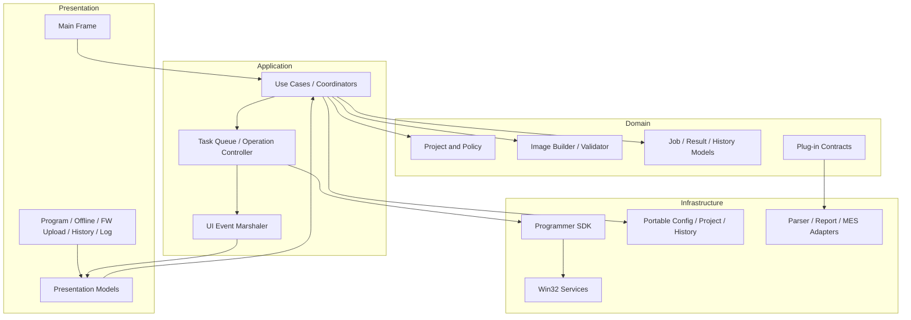
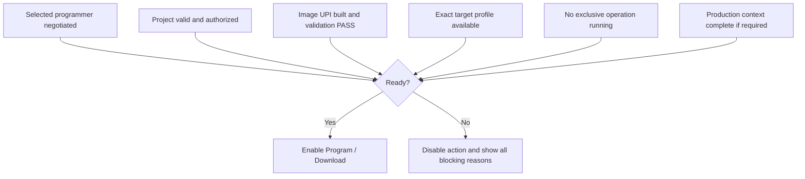
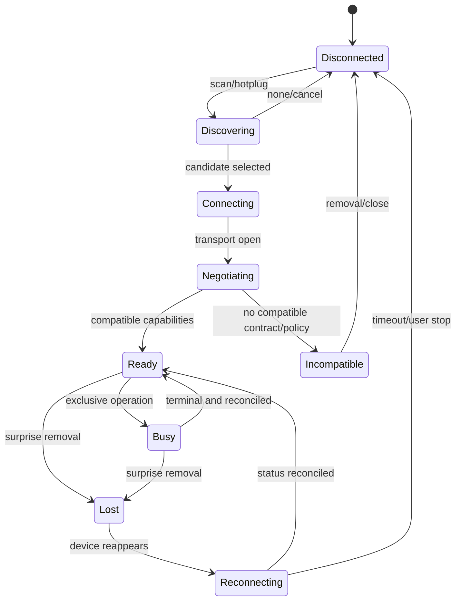
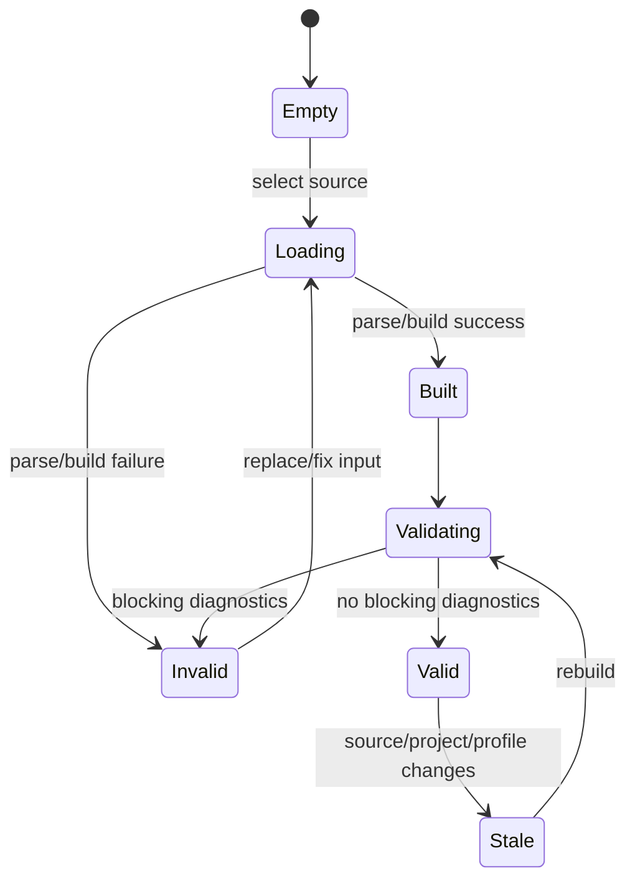
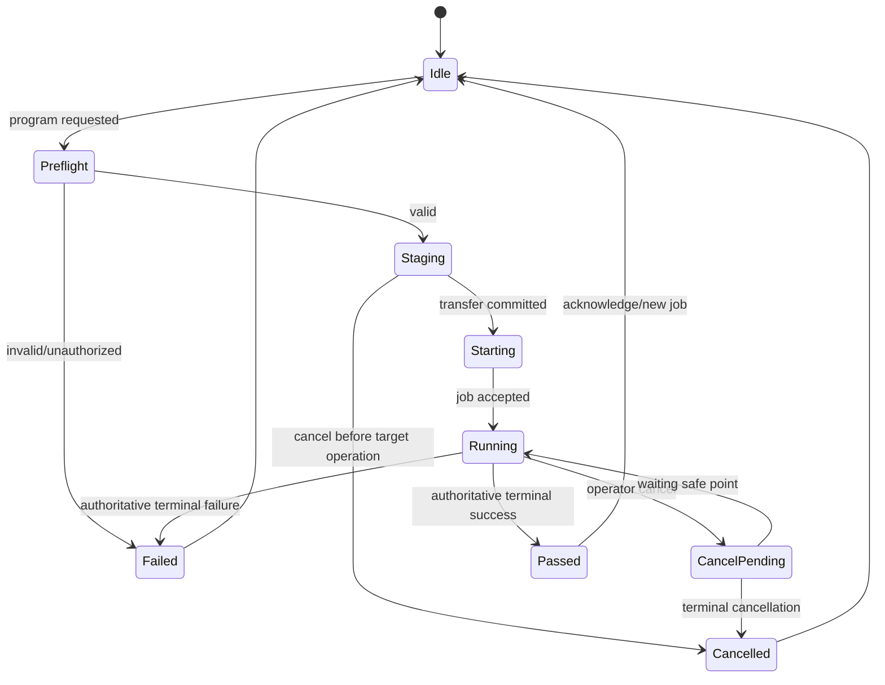
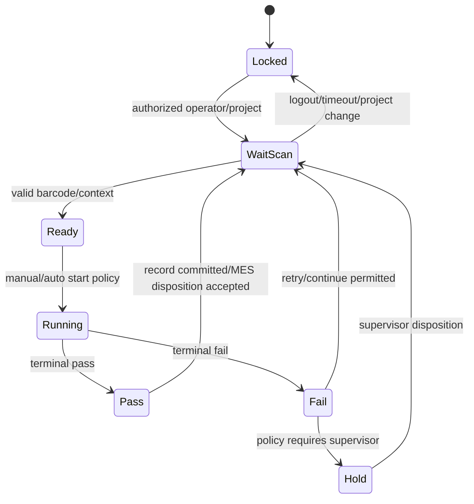
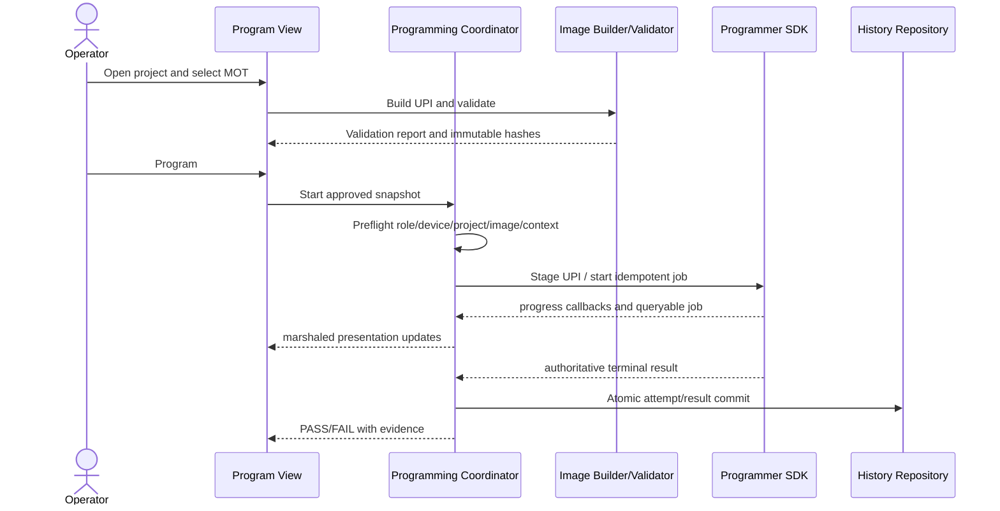
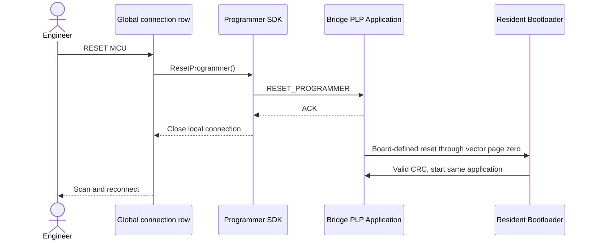
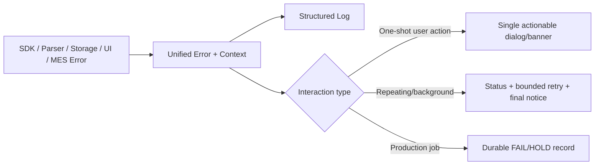
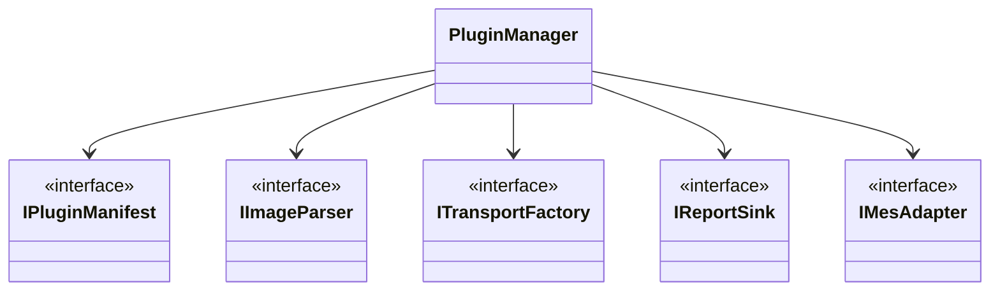

# GUI Software Design Specification (GSDS)

| Field | Value |
| --- | --- |
| Document ID | GSDS-RPP-001 |
| Application | Windows MFC Programmer Tool |
| Version | 1.0-draft |
| Platform | Windows 10/11 x64 |
| Normative dependencies | SAS, PPS, OIS, PSDK, Common Contract Registry |

<style>
@media print {
  @page { size: A4 portrait; margin: 10mm; }
  h2, h3 { break-after: avoid-page; }
  table, .mermaid, pre.mermaid, .mermaid svg { break-inside: avoid-page !important; page-break-inside: avoid !important; }
  .mermaid svg { max-width: 100% !important; max-height: 235mm !important; height: auto !important; }
}
</style>

## 1. Overview

### 1.1 Purpose

This document defines the complete native MFC application architecture, operator workflow, module ownership, concurrency model, persistence, plug-in boundaries, error handling, production functions, and test strategy. The GUI is a client of the reusable Programmer SDK and has no direct HID dependency.

### 1.2 Goals

- Safe, responsive, multilingual online/offline programming workflow.
- Deterministic preflight validation before any destructive request.
- Clear separation of UI, application use cases, domain policy, SDK, plug-ins, and platform services.
- Production-grade project lock, history, statistics, operator/barcode context and export.
- Target/transport/image/report extensibility without changes to core views or Programming Engine.
- Recoverable bridge application updates through SDK-owned PLP and resident ISP
  HID paths, with board-profiled image validation.

### 1.3 Non-goals

The GUI does not implement RL78 Protocol B, parse firmware inside the
Programming Engine, access board GPIO/UART, act as a target or bridge
bootloader, send raw HID/ISP packets, or treat visual progress/ACK as proof of
programming success.

## 2. Layered Design



Dependencies point inward toward public interfaces. `CMainFrame` is the composition root and event router, not a data store, protocol codec, image parser, job worker, or report generator.

## 3. Module Design Catalog

Each row specifies purpose, responsibilities, inputs/outputs, interfaces/dependencies, state/error handling, and future extension.

| Module | Purpose and responsibilities | Inputs → outputs / interfaces | State and error handling | Dependencies | Future extension |
| --- | --- | --- | --- | --- | --- |
| Application / Main Frame | Process lifecycle, composition, navigation, global command/status, safe shutdown | Windows/UI events → use cases/view models | CREATED/INITIALIZING/READY/BUSY/CLOSING; delegates failures to Error Presenter | use-case facade, localization, SDK service | Alternate shell/accessibility |
| Main Window | Device/project/image/job summary and primary Program/Stop actions | presentation state ↔ operator intent | Controls enabled only from combined readiness state; no worker ownership | view model, command router | Multi-channel dashboard |
| Device Manager | Discover, select, connect, negotiate, reconnect, firmware compatibility | SDK device events → device snapshots | DISCONNECTED/DISCOVERING/CONNECTING/READY/INCOMPATIBLE/LOST | Programmer SDK | Network/serial transports |
| Device Information View | Display UUID, HW/FW/build, PPS/OIS, storage, reset, capabilities, health | device info → read-only model | Stale/unavailable fields explicit | Device Manager | Attestation/certificates |
| Project Manager | Create/open/save/validate/version/lock projects; immutable execution snapshot | project document → validated snapshot | CLEAN/DIRTY/VALID/INVALID/LOCKED; atomic save/LKG backup | project schema, policy, profiles | Server/signed templates |
| Project Settings View | Edit target profile, operations, options, retries, serial/barcode/factory policy | operator edits → staged project | Full validation before apply; locked fields read-only | Project Manager, authorization | Role-specific editors |
| Image Manager | Import source, track source hash/build, show regions/diagnostics | files → image source model | EMPTY/LOADING/BUILT/INVALID/VALID/STALE | Image Builder/Validator | Repository/build integration |
| MOT Parser Plug-in | Parse Motorola S-record into normalized records and diagnostics | `.mot` bytes → records | Reject bad checksum/type/address/end record; no target policy | parser contract | Additional S-record dialects |
| HEX Parser Plug-in | Parse Intel HEX | `.hex` bytes → records | Extended address/checksum/EOF validation | parser contract | Vendor extensions by policy |
| BIN Parser Plug-in | Map raw bytes using explicit base/region metadata | `.bin` + mapping → record | No guessed base address; missing mapping blocks build | parser contract | Sidecar manifests |
| Image Builder | Canonicalize records into sorted UPI regions; preserve provenance | parser records/profile hint → UPI | BUILDING/BUILT/FAILED; duplicate/overlap diagnostics | parser registry, CRC/hash | ELF/symbol metadata |
| Image Validator | Address, overlap, duplicate, unsupported area, option/security, version, compatibility, CRC policy | UPI + project + device profile → report | PASS/WARNING/FAIL; any FAIL prevents job | profile registry, policy | Customer rule packs |
| CRC Calculator | Engineering utility for selected source/UPI/package ranges and declared algorithms | bytes/range/algorithm → digest report | Read-only; labels algorithm and covered range; never overrides validation | hash service | Additional algorithms |
| Firmware Downloader | Online UPI staging and bridge programmer application-update routing | approved artifact → SDK transfer | Distinguishes TARGET_IMAGE/OIP from fixed BRIDGE_APPLICATION; never routes one as the other | SDK, authorization | Signed release server source |
| FW Upload View | Select M032/M484 profile, validate fixed app BIN, request bootloader handoff, discover/probe ISP HID, upload/cancel and explicitly run app | operator intent ↔ SDK bridge updater models | EMPTY/VALIDATING/READY/HANDOFF/BOOTLOADER/UPLOADING/PROGRAMMED/RUNNING/FAILED; controls serialized; a successful bootloader scan without a validated image presents `Load + Validate` as the next required action | Programmer SDK, Task Queue | Signed/staged production updater |
| Offline Image Generator | Build/sign/inspect OIP from validated UPI and metadata | project+UPI+policy → OIP/report | DRAFT/VALIDATED/SIGNED/REJECTED; signing failure blocks release | OIS builder, signing provider | Encryption/multi-image |
| Offline Manager/View | Reuse the Program view's exact target profile and MOT/HEX/BIN source, build OIP automatically, then download/activate/arm/test with five workflow rows | validated target image, OIP and SDK metadata ↔ operations | Source/profile change invalidates downstream state; activation and arming require exact downloaded/active package UUID binding | OIS builder, SDK, OIS inspector | A/B, image selection |
| Operating Mode Banner | Show Online Only/Offline Armed, autorun and active package; arm/disarm through SDK | mode snapshot ↔ authorized switch intent | HID remains connected; disable switch while job active | SDK, Offline Manager | Fixture trigger policy |
| Programming Coordinator | Convert approved snapshot into idempotent job and reconcile terminal result | validated snapshot → SDK job/result | PREFLIGHT/STAGING/STARTING/RUNNING/CANCEL_PENDING/TERMINAL | SDK, history, progress | Batch/gang orchestration |
| Programming Monitor | Stage/progress/time/current address/retries/log summary and cancel intent | SDK events/job query → presentation model | Events advisory; periodically reconciles authoritative job; no modal storms | Coordinator | Per-channel visualization |
| Progress Window | Focused progress for transfer, validation, programming, update | operation model → responsive modal/modeless view | Cancellation semantics shown as Requested/Pending/Done | Task Queue, UI marshaler | Background notification center |
| Task Queue | Serialize exclusive device operations; run blocking SDK calls off UI thread | use-case tasks → typed completion/events | QUEUED/RUNNING/CANCEL_REQUESTED/COMPLETED; latest-wins for refresh | SDK executor, cancellation | Priority/multi-device queues |
| Command Dispatcher | Route UI commands to use cases based on current state/role | command ID + context → use case | Rejects illegal commands without side effects | authorization/state service | Automation command surface |
| Error Presenter | Map unified errors/details to localized action-oriented messages | typed error/context → banner/dialog/log | One-shot actions may use modal; loops aggregate and stop boundedly | localization, logger | Knowledge-base links |
| Logger View | Show structured PC/firmware/programming logs and optionally record a UTF-8 session file | events/query → on-screen list and opt-in file sink | Screen is always active; file checkbox defaults off per launch; create/write failures visible; raw secrets/images redacted | unified logger, SDK logs | Filter/search/export/central logging |
| History Repository/View | Show current-session job attempts/results and terminal detail; provide durable traceability in the future | terminal results → current list/future query/export | Current view includes `Detail`; future append transaction and corruption/lock/write errors are visible | job results/future portable store | Shared database/MES |
| Statistics Service/View | Counts, yield, durations, pass/fail by project/station/lot | history snapshots → aggregates | Defines denominator and retry treatment; never double counts job attempt | history repository | SPC charts/trends |
| Production Mode | Locked simplified flow, barcode/operator/lot, auto/batch start | production context → jobs | IDLE/WAIT_SCAN/READY/RUNNING/PASS/FAIL/HOLD; supervisor gates | coordinator, auth, project lock | Gang/MES automation |
| Serial Number Service | Validate/reserve/associate/write policy where supported | barcode/rule → job field/action | Duplicate/format/reservation errors block per policy | production context, driver capability | MES allocation |
| Barcode/QR Adapter | Scanner keyboard/HID/API input normalization | scan input → validated token | Debounce/terminator/length/charset/duplicate policy | production service | Camera/network scanners |
| CSV Report Plug-in | Export current filtered results with stable schema/version | immutable query result → UTF-8 CSV | Atomic file write; extension/content match; error includes path | report contract | PDF/XLSX/MES |
| MES Adapter | Submit/query production context/results | records ↔ MES DTO | OFFLINE/QUEUEING/SYNCING/FAILED; factory fail-open/closed policy | secure network service | Multiple MES vendors |
| Configuration Manager | Portable INI/JSON-like versioned settings beside application package/data root | config file → validated snapshot | DEFAULT/LOADED/MIGRATED/INVALID/LKG; write failures visible | file system, schema | Managed policy |
| Language Manager | All UI strings, canonical terminology, runtime switch/re-layout | locale/key → text | Missing key visible in debug/log; fallback deterministic | resource catalogs | More locales/RTL review |
| Version Service | PC build/timestamp, SDK, plug-in, firmware/protocol compatibility display | generated build info + SDK device info → version model | Single truth source; mismatch warning/block by policy | build manifest, SDK | Update service |
| Authorization / Project Lock | Role/password/provider abstraction, protected action checks, audit | identity/action/project → decision | LOCKED/AUTHENTICATED/EXPIRED; no password in logs/config plaintext | credential provider, audit | AD/SSO/smart card |
| Plug-in Manager | Discover/validate/load device/parser/transport/report plug-ins | manifests → registered factories | DISCOVERED/VALID/INCOMPATIBLE/QUARANTINED/LOADED | ABI/signature policy | Out-of-process sandbox |
| UI Event Marshaler | Deliver worker events to HWND-safe UI thread handlers | worker callback → posted immutable event | Drops events only after view generation invalidation; no raw pointer lifetime | window dispatcher | Reactive UI adapter |

## 4. Main User Experience

### 4.1 Navigation

Recommended primary workspaces:

1. **Program** — device, project/image readiness, Program, Cancel, progress and result.
2. **Offline** — package generation/inspection, storage, download, activation, last offline result.
3. **FW Upload (USB HID/UART ISP)** — the caption follows the selected board;
   bridge application BIN, Return Bootloader, bootloader scan/device selection,
   upload, cancel and Run Application share one workflow.
4. **History** — current-session jobs and attempts, including a terminal
   `Detail` column; future persistence, filters/export and MES disposition.
5. **Log** — always-on structured PC/programmer diagnostics plus the optional
   `Save log to file` checkbox. It defaults cleared on first use or when its
   INI key is missing; otherwise the saved user choice is restored.

Production, Settings and full Device Info workspaces remain planned extensions;
they are not additional tabs in the current five-tab implementation.

The main frame is shown maximized on initial launch. Standard Windows restore,
minimize and maximize controls remain available afterward.

Engineering-only tools such as raw CRC inspection are separated from the primary production path. There is no raw arbitrary protocol-command UI in normal mode.

### 4.2 Readiness Model



The UI must show all blocking reasons, not only the first. `Program` is not enabled by mere file selection or USB connection.

Bridge update readiness is separate from RL78 programming readiness. The
`Upload Firmware` action requires a validated exact-size/CRC application image
and a selected, connected USB `0416:3F00` or UART ISP bootloader whose reported
application geometry matches the selected profile. M032 TEST BOARD additionally
requires UART board ID `MTB1`. PDID is displayed but not allowlisted.
UART `Scan Bootloader` actively opens each enumerated COM candidate with a
bounded timeout and lists only candidates that complete the NuvoISP probe and
match `MTB1`; OS-level COM enumeration by itself never enables Upload.
The probed configuration must also show `CONFIG0.CBS[7:6]=10` for all profiles
and `MBS bit 5=1` for M484; otherwise the view reports the blocking reason and
keeps erase/upload disabled. The updater does not rewrite unrelated CONFIG bits.

The Program, Offline and FW Upload views place a persistent text indicator next to their
progress bar. It presents basis-point progress as a percentage plus
loaded/total, programmed and remaining values in KiB. Local validation values
come from the validated file/image. Active programming values come from the
authoritative job or bootloader byte counters and are not inferred from a
visual progress position. Offline package download uses the generated OIP byte
count and the SDK transfer callback as its authoritative loaded/total values.

The FW Upload result region exposes five non-interactive workflow rows: Load +
Validate, Return Bootloader, Scan Bootloader, Upload Firmware and Run
Application. Each row is session-local `PENDING`, `IN_PROGRESS`, `COMPLETED` or
`FAILED`; completed rows use a gray visual treatment while detailed messages
remain in a separate result field. The rows report actions rather than enforce
sequencing because bootloader recovery permits Scan before local image
validation. A new image/profile resets image/upload/run state; Return or a new
Scan clears stale bootloader selection and resets downstream device actions.

The Offline view exposes the same target profile, firmware path, Browse and
Load + Validate controls as Program; both views reference one validated image
and one automatically generated in-memory OIP. A standalone OIP is not required
for the normal operator path, while Save OIP remains an optional export. Its
five non-interactive workflow rows cover Load + Validate, board-storage
download, activation, arming and physical KEY1/Reset triggering. Rows use
session-local `PENDING`, `IN_PROGRESS`, `READY`, `COMPLETED` or `FAILED` states.
The physical trigger remains `READY` after arming because a trigger performed
without a HID session cannot be falsely reported as completed by the GUI.
Selecting another file/profile clears the package and download binding;
Activate requires the exact session-downloaded package UUID, and Arm/Test
requires the bridge-reported active UUID to match the currently validated OIP.
The validated image is also bound to the exact firmware-path text that produced
it. Editing or replacing that text immediately clears the parsed image,
generated OIP and downstream workflow state, so changing from one MOT file to
another cannot retain the former package UUID. The firmware-path edit is
disabled while an operation is active. If the path nevertheless changes while
asynchronous validation is completing, that completion is discarded and the
operator must run `Load + Validate` again.

`Return Boot loader` requires the normal PLP
application connection and an explicit destructive confirmation; it is disabled
while another worker/device operation is active. If the bridge rejects CBS/MBS
preflight, the view reports `UPDATE_PACKAGE_INCOMPATIBLE`; no CRC invalidation
occurred and the current application remains valid.

The global connection row places `RESET MCU` beside `Connect`/`Disconnect`.
It is enabled only for an idle connected application that advertises
`CAP_PROGRAMMER_RESET`. Activation sends the SDK reset operation without a
destructive confirmation, waits for its ACK, then presents the application as
disconnected and instructs the user to scan/reconnect after USB
re-enumeration. This action never invalidates the bridge application CRC. On
M484/Nu-Link2-Me firmware `1.0.1.5` or later, the acknowledged action performs
a full M484 chip reset to clear internal peripheral state before the resident
bootloader starts the valid application. It does not power-cycle W25Q16 or the
RL78 target. M032 retains its CPU-reset implementation.

## 5. Application State Machines

### 5.1 Device Connection



### 5.2 Image Lifecycle



### 5.3 Programming Operation



### 5.4 Production Mode



## 6. End-to-End Sequences

### 6.1 Online Programming



### 6.2 Offline Package Download

```mermaid
sequenceDiagram
    actor Engineer
    participant Offline as Offline View
    participant Builder as OIP Builder
    participant Sign as Signing Provider
    participant SDK
    Engineer->>Offline: Select exact target profile and MOT/HEX/BIN
    Engineer->>Offline: Load + Validate
    Offline->>Builder: Parsed image + manifest/sections/policies
    Builder->>Sign: Request approved signature if production
    Sign-->>Builder: Signature + key ID or failure
    Builder-->>Offline: Automatically generated OIP + validation report
    Offline->>SDK: Query storage/capabilities
    SDK-->>Offline: capacity/slots/OIS/security support
    Offline->>SDK: Download candidate
    SDK-->>Offline: progress/resume/validation result
    Engineer->>Offline: Activate approved package
    Offline->>SDK: Atomic activate
    SDK-->>Offline: active identity/counter
    Engineer->>Offline: Arm Offline
    Offline->>SDK: Set OFFLINE_ARMED for exact active UUID
    SDK-->>Offline: Mode snapshot; physical trigger is ready
```

### 6.3 Bridge Application Upload

```mermaid
sequenceDiagram
    actor Engineer
    participant View as FW Upload (USB HID)
    participant SDK as Programmer SDK
    participant App as Bridge PLP Application
    participant Boot as Resident ISP HID
    Engineer->>View: Select board profile and application BIN
    View->>SDK: LoadApplicationImage(profile, path)
    SDK-->>View: Exact size/CRC validation result
    Engineer->>View: Confirm Return Boot loader
    View->>SDK: EnterBootloader()
    SDK->>App: FW_ENTER_BOOTLOADER
    App->>App: Invalidate application CRC page
    App-->>SDK: ACK, then reset
    SDK-->>View: Application transport closed; scan requested
    Engineer->>View: Scan Bootloader
    View->>SDK: EnumerateBootloaders()
    Boot-->>SDK: 0416:3F00 descriptor
    SDK-->>View: Selectable bootloader list with full HID paths
    Engineer->>View: Upload Firmware
    View->>SDK: Probe + bind profile/reported application geometry + ProgramApplication
    SDK-->>View: Marshaled packet/byte/basis-point progress
    SDK-->>View: Program/checksum complete
    Engineer->>View: Run Application
    View->>SDK: RunApplication()
```

### 6.4 Bridge MCU Reset



The application BIN path is independent from the RL78 target image path and is
persisted with the selected board profile. Changing the profile invalidates the
previously loaded bridge image. The view requires an explicit warning because
`Return Boot loader` erases the application CRC page before ACK; after that
point, closing the GUI or cancelling an upload does not restore the old
application. Recovery is to scan USB `0416:3F00` or the selected M032 TEST
BOARD COM port and upload a complete valid image.
The bootloader code itself is never selected or uploaded by this view.
For multiple devices, each combo row includes the HID path or COM name; the view never
silently chooses the first match. The full path binds the device instance; a
selected-profile/reported-application-geometry mismatch is reported before
erase even when the BIN itself passed size/CRC validation. The M032 TEST BOARD
UART flow also rejects a missing or mismatched `MTB1` board ID. PDID remains
display/diagnostic information rather than an allowlist.

### 6.4 Disconnect During Job

```mermaid
sequenceDiagram
    participant SDK
    participant Coord
    participant View
    SDK-->>Coord: transport lost; outcome unknown
    Coord-->>View: Reconnecting; do not offer duplicate start
    SDK->>SDK: rediscover and negotiate same programmer UUID
    SDK-->>Coord: reconnected
    Coord->>SDK: Query job UUID/status
    SDK-->>Coord: running or terminal result
    Coord-->>View: reconciled state/result
```

## 7. Concurrency and Responsiveness

### 7.1 Thread Model

- UI thread owns all HWND creation, mutation and destruction.
- One SDK/device worker serializes commands for each programmer instance.
- Parsing, hashing, package building, signing and large exports run on bounded background workers.
- High-frequency refresh uses one worker plus generation token; latest request wins.
- UI does not call `join` during normal interaction. Close performs bounded cancellation, displays unresolved active job state, then bounded cleanup according to shutdown policy.
- SDK callbacks are copied into immutable application events and posted to the UI; callbacks never touch controls directly.

### 7.2 MFC Safety and Layout

- Startup/layout/state helpers verify `GetSafeHwnd()` before control calls.
- Labels/buttons/checkboxes use font/DPI-aware measured widths, not character-count guesses.
- Multilingual switch triggers immediate re-layout.
- Major views support 100%, 125%, and 150% DPI; minimum size and scrolling are explicit.
- Long lists use virtual/owner-data controls and bounded sampling for column sizing.
- Repeating operations aggregate errors into status/log and auto-stop at a configured threshold; no modal-dialog storm.

## 8. Domain Data Structures

| Model | Required fields / behavior |
| --- | --- |
| Project | UUID, schema/revision, name, target profile/version, operation/verify/option/security policies, production rules, lock/signature, audit metadata |
| Source Artifact | path/display name, format, size, modified time, SHA-256, parser ID/version |
| UPI Summary | image UUID/hash, address regions/types, byte counts, fill policy, diagnostics, builder version |
| Validation Report | ruleset/profile/project/image hashes, ordered diagnostics with severity/code/range/remediation, terminal PASS/FAIL |
| Programmer Snapshot | UUID, transport path, HW/FW/PPS/OIS, capabilities, storage/health/reset, active package |
| Bridge Firmware Profile | board target, display name, application start, fixed image size and CRC offset |
| Bridge Firmware Image | validated profile, fixed bytes, stored/calculated CRC32 and complete-image additive checksum |
| Bridge Bootloader Snapshot | full HID descriptor/path, bootloader version, device ID, configuration words and authoritative application geometry |
| Bridge Update Progress | completed/total bytes, packet index and basis points; cancellation is local and non-rollback |
| Job Intent | job UUID, immutable project/image/profile hashes, source mode, policies, production context, expected target identity |
| Job Result | mode, job UUID, result, attempt, target identity, per-stage metrics, terminal stage symbolic name/numeric ID, unified error name/hex code/detail, timestamps/duration, final progress and versions |
| Production Context | station, operator, role, lot/batch, barcode/serial, MES token/disposition |
| Log Event | common envelope from contract registry plus localized presentation at view time |

Image bytes are not duplicated in history. Paths are display metadata; hashes and UUIDs provide identity.

## 9. Configuration and Persistence

### 9.1 Portable Locations

The packaged tool uses an explicit writable data root. User preferences are stored in versioned portable configuration rather than the Windows Registry. If installed under a read-only directory, startup selects an approved per-user data root and reports it visibly. Project/history/export paths never silently fall back after a write failure. In the current executable slice, optional diagnostic file logging has an intentionally fixed, visible location: a `logs` directory beside the running EXE. Failure to create or write that location is reported and never redirects to another directory.

### 9.2 Persistence Rules

- Atomic replace for config/project files, with temp validation and LKG backup.
- History job attempt/result commit is transactional.
- The on-screen Log and History are independent of diagnostic file logging and
  remain active throughout the application session.
- `Save log to file` defaults disabled on first use or when its key is missing.
  The user choice persists in portable `rl78_programmer.ini` as `[Programmer]`
  `SaveLogToFile=0/1`.
- A persisted `SaveLogToFile=1` restores the checked state and creates a new
  uniquely named UTF-8 session log beside the EXE on every launch. A previous
  session file is never reopened for append.
- Disabling file logging stores `SaveLogToFile=0` and stops disk writes
  immediately. A file create/write failure is visible, clears the checkbox for
  the current run and never redirects to another path.
- `Clear Log` clears only the on-screen view; it never deletes or truncates an
  existing session file.
- CSV/export writes to a candidate and atomically renames after complete flush.
- Schema migration retains backup and produces a visible report.
- Import never implicitly replaces full history/project collections.
- Localization defaults/template/runtime catalogs share one generated key source.

### 9.3 Configuration Groups

Connection discovery/timeouts, UI/language/DPI, paths/retention, logging, parser
defaults, production behavior, barcode, export/MES, plug-ins, update and
diagnostics are separate namespaces. The current portable INI stores the last
bridge application path and M032/M484 profile selection; neither setting can
override the SDK's fixed start/size/CRC rules. Safety-critical programming
policy belongs in a project or managed factory policy, not a casual user
preference. The non-safety-critical `Save log to file` preference is stored in
`rl78_programmer.ini` as `[Programmer]` `SaveLogToFile=0/1`; a missing key has
the deterministic disabled default.

## 10. Unified Error Handling



Messages include operation, programmer/job/project identity where safe, stage, path/address where useful, stable error code, retryability, and next action. The original causal code is preserved when cleanup also fails. Unknown errors map to `UNKNOWN_UNCLASSIFIED` and retain sanitized source metadata. Every successful connection record includes the programmer-reported product name, firmware version and uptime so a diagnostic file proves which bridge build was exercised. A terminal programming record includes mode, job UUID, result, stage symbolic name and numeric ID, unified error name and hexadecimal code, detail, attempt, elapsed time and final progress; the History view exposes the same terminal detail. After connection, the GUI reads both the latest offline result and the bounded offline failure history. It emits `OFFLINE_FAILURE_HISTORY_SUMMARY` followed by one `OFFLINE_FAILURE_HISTORY` record per retained failure, including failure sequence, job counter, capture uptime, Protocol B step, unit address/index, TX byte/bit, TIMER2 state/count, PA.9/PA.10 flags and destructive state. `OFFLINE_FAILURE_SNAPSHOT` remains the older-firmware fallback. `COMMAND_UNSUPPORTED` from an older firmware is tolerated. A diagnostic-file write failure is itself visible in the UI and cannot silently select another path or suppress the terminal programming result.

## 11. Plug-in Framework

### 11.1 Plug-in Types

| Type | Contract | Core consumer |
| --- | --- | --- |
| Device profile/driver metadata | capabilities, profile, UI-neutral settings schema | Project/Image validation and SDK/firmware compatibility |
| Transport | `ITransportFactory` through SDK | Device Manager |
| Image parser | `IImageParser` producing normalized records | Image Builder |
| Report | `IReportSink` consuming immutable query/result | History/Production |
| MES | production context/result adapter | Production Service |

### 11.2 Manifest and Lifecycle

Manifest includes plug-in UUID/type, name/vendor, semantic version, ABI major/minor, minimum host version, capabilities, entry factory identifier, publisher/signature identity, and file hashes. States are discovered, validated, compatible, loaded, failed, quarantined, and disabled. Plug-ins receive narrow service interfaces and never private MFC pointers or raw SDK internals.



## 12. File Organization

```text
pc/
├─ app/                 application class, main frame, composition root
├─ ui/
│  ├─ common/           safe control/layout, commands, localization adapters
│  ├─ program/          main programming view/presentation models
│  ├─ offline/          package/storage view
│  ├─ production/       operator/barcode/statistics view
│  ├─ history/          virtual history/query/export view
│  ├─ logs/             log view
│  └─ settings/         device/project/application settings views
├─ application/         use cases, coordinators, task queue, event marshaler
├─ domain/
│  ├─ project/          schema, lock and policy
│  ├─ image/            builder, validator, UPI models
│  ├─ programming/      job/result models
│  └─ production/       context/history/statistics rules
├─ sdk/                 PSDK implementation; UI-independent
├─ plugins/             public plug-in contracts and built-in adapters
├─ platform/win32/      HID/file/credential/clock/platform services
├─ resources/           RC/icon/manifest/localization templates
├─ third_party/         approved dependencies/notices
├─ docs/                implementation notes/generated dependency report
└─ tests/               PC unit/component/UI tests
```

No `.cpp` should grow past the workspace modularity thresholds. Resource IDs have one source; deleted controls remove RC/resource/DDX remnants. Business rules do not reside in dialog event handlers.

## 13. Versioning

- PC display/build version follows workspace `a.b.c.ddd` and generated build timestamp.
- SDK ABI/API version, PLP version, OIS version, plug-in ABI, project schema, device profile, firmware version and report schema are displayed/recorded separately.
- Expected firmware/protocol compatibility comes from one generated compatibility manifest.
- A mismatch is a visible warning or blocker according to capability/policy; it is never hidden in logs only.

## 14. Production Considerations

- Production mode minimizes editable controls and exposes locked project/image hashes.
- Operator authentication timeout and role control protected actions.
- Barcode scan is validated before enabling automatic start; duplicate policy is explicit.
- Retry creates a new attempt under the same job/serial context and does not distort yield.
- CSV schema is versioned, UTF-8, deterministic and derived from current filtered selection when exported from History.
- Local results queue during bounded MES outages only if factory policy allows; queue state is visible.
- PASS screen/indicator occurs only after durable history commit and any required MES disposition rule.
- Support bundle excludes source image bytes, passwords, tokens and signing material by default.

## 15. Risk Analysis

| Risk | Control |
| --- | --- |
| UI freezes during hash/program/export | Background workers, bounded events, virtual lists, no UI joins |
| Stale image programmed after project/source change | source/project/profile hashes and STALE state force rebuild/validation |
| Wrong programmer reconnects | stable programmer UUID and job reconciliation |
| Operator double-click creates duplicate job | serialized command, disabled action, job UUID idempotency |
| Cancel shown complete before safe target stop | explicit Cancel Pending state until terminal SDK result |
| Hidden protocol incompatibility | negotiated capability model and visible version panel |
| Plug-in crashes/corrupts core | narrow ABI, validation/quarantine; future process isolation |
| Production data loss on close/power loss | transactional append/atomic writes and visible sync queue |
| Modal error storm | background aggregation and consecutive-error threshold |
| Language/DPI causes dangerous button ambiguity | measured layout, localization key checks, 100/125/150% validation |
| RL78 image is mistaken for bridge application | Separate file path/view/model and exact fixed-size/CRC SDK validation |
| User closes after Return Boot loader and assumes old app remains | Destructive confirmation explains CRC invalidation; status directs recovery to `0416:3F00` |
| Multiple bootloaders cause wrong board update | Rows show full HID paths; explicit descriptor selection; unique auto-connect only when exactly one device matches; selected profile is rebound to reported application geometry before erase |
| CBS/MBS boot configuration is unsafe | Show probed CONFIG blocking reason; require CBS APROM-with-IAP mode on both boards and M484 MBS bit 5 before enabling erase/upload |
| Optional logging unexpectedly writes files or hides diagnostics | First use/missing INI key defaults off; the explicit user choice persists as `SaveLogToFile=0/1`; screen Log/History remain active independently |
| A restored logging session appends stale evidence | Each enabled launch creates a new unique session log and never appends to an earlier file |
| Log create/write fails or `Clear Log` destroys evidence | Report the exact file failure without path fallback and clear the checkbox for the current run; `Clear Log` is screen-only and disabling closes the file sink |

## 16. Unit and UI Test Suggestions

- Main readiness truth table and every command-enable combination.
- Project lock/authorization, immutable job snapshot, stale-source detection.
- MOT/HEX/BIN valid/corrupt/overlap/duplicate/unsupported/option/security cases.
- Worker cancellation, event ordering, view close/generation invalidation and reconnect reconciliation.
- SDK mock returns every unified error and delayed/lost terminal event.
- History transaction/duplicate job attempt/schema migration/read-only path/disk-full tests.
- CSV delimiter/quote/encoding/schema/filter/sort/path and atomic-write tests.
- Barcode terminator/bounce/duplicate/invalid format and auto-start interlock.
- Plug-in wrong ABI/hash/signature/type/exception/quarantine tests.
- Debug and Release startup; clean close; no invalid HWND calls.
- Optional file logging first-use/missing-key default-off, `SaveLogToFile=0/1`
  persistence/relaunch, enable-disable-enable, fresh unique UTF-8 file per
  enabled launch without old-file append, screen-only Clear Log, read-only
  directory, current-run checkbox clear and mid-session write-failure tests.
- Terminal PASS/FAIL/CANCELLED records verify mode/job/result, symbolic and
  numeric stage, error name/hex/detail, attempt, elapsed/final progress, and
  History `Detail` presentation.
- English/Traditional Chinese runtime switch and all primary views at 100/125/150% DPI.
- Automated accessibility names, tab order, keyboard operation, high contrast and screen-reader smoke tests.
- FW Upload profile-change invalidation, wrong size/CRC, destructive
  confirmation, application-to-bootloader removal/re-enumeration, multiple
  bootloader paths/selection, selected-profile/reported-application-geometry
  rejection before erase,
  worker serialization, progress/cancel and recovery messaging.

## 17. Extension Strategy and Future Improvement

New devices contribute profiles/capabilities and firmware driver availability; generic views render capabilities instead of target-name branches. New transports are SDK adapters. New parsers and reports register through plug-in contracts. Future improvements include multi-programmer/gang dashboard, out-of-process plug-ins, signed central project repository, charts/SPC, SSO, richer MES, headless SDK CLI, and remote station management.
