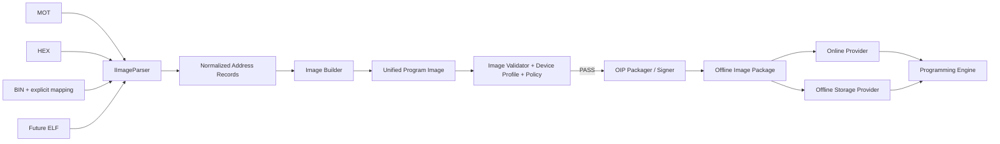
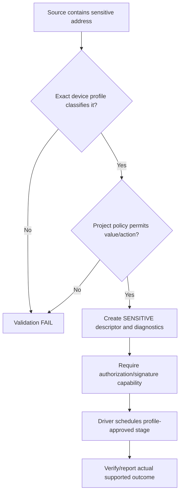
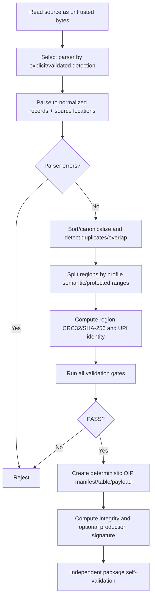
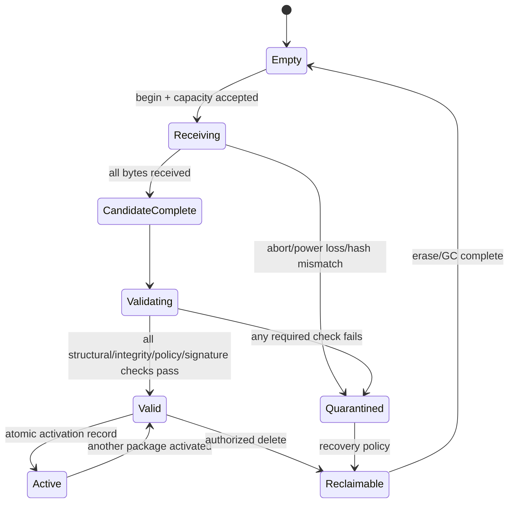
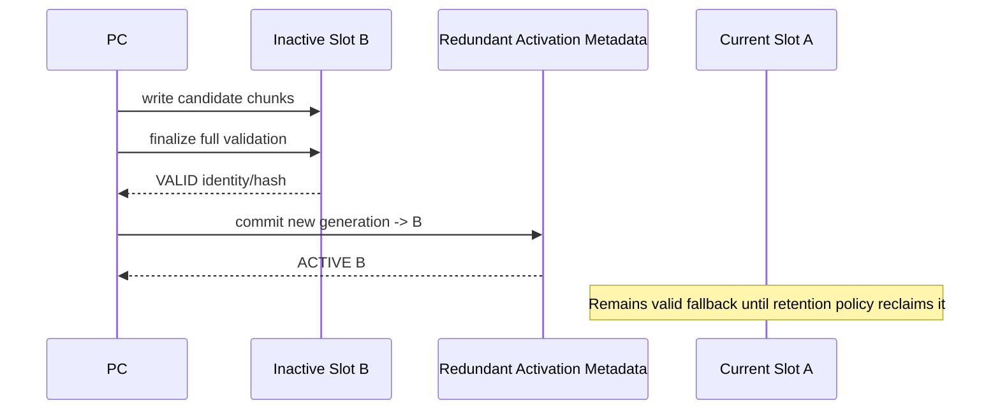
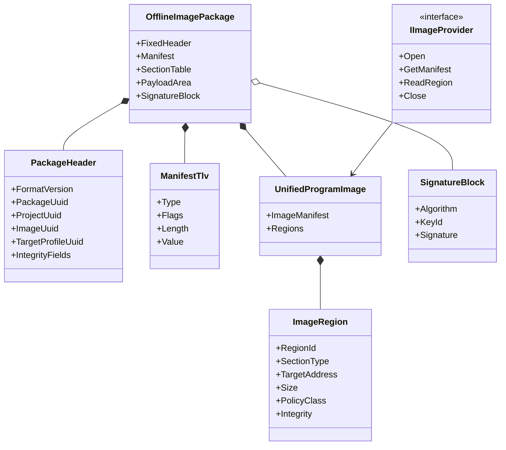

# Offline Image Specification (OIS)

| Field | Value |
| --- | --- |
| Document ID | OIS-RPP-001 |
| Container name | Offline Image Package (OIP) |
| Internal image model | Unified Program Image (UPI) |
| Format version | 1.0-draft |
| Endianness | Little-endian |
| Integrity | CRC32 plus SHA-256; signature policy is algorithm-agile |

<style>
@media print {
  @page { size: A4 portrait; margin: 10mm; }
  h2, h3 { break-after: avoid-page; }
  table, .mermaid, pre.mermaid, .mermaid svg { break-inside: avoid-page !important; page-break-inside: avoid !important; }
  .mermaid svg { max-width: 100% !important; max-height: 235mm !important; height: auto !important; }
}
</style>

## 1. Overview

### 1.1 Purpose

OIS defines a transport-neutral, power-loss-safe package that carries validated, target-addressed program regions and policy metadata from PC Image Builder to any Image Provider. The Programming Engine understands UPI regions and never parses Motorola S-record, Intel HEX, binary, or future ELF files.

### 1.2 Responsibilities

- Preserve project, target profile, firmware, build, provenance, and compatibility identity.
- Represent code flash, data flash, option/security/configuration/calibration regions without target-specific parser logic.
- Provide deterministic sizes, offsets, alignment, CRC32, SHA-256, and optional production signature.
- Define validation, activation, A/B/multiple-image, recovery, rollback, and power-loss behavior.
- Allow streaming on small programmer SRAM and capacity preflight on constrained storage.

### 1.3 Non-responsibilities

OIS does not define input text syntax, RL78 Protocol B frames, programmer
firmware update packages, target algorithms, signing-key custody, or physical
Flash partition addresses. In particular, the fixed M032/M484 bridge
application BIN used by `FW Upload (USB HID)` is not an OIP and is validated by
the Programmer SDK's board-specific update profile. It must never be written to
an OIP package slot or selected as an RL78 image provider.

### 1.4 Interfaces

PC parsers/builders create UPI/OIP through the OIS writer contract. Firmware OIS Validator and Storage Manager consume the durable container. Programming Engine sees only the abstract `IImageProvider` manifest/region/read interface described in Section 13.

## 2. Design Model



UPI is the semantic image. OIP is its durable serialized container. An OIP may carry one UPI in V1 and multiple alternative UPI entries in a future minor version only when a deterministic selection manifest is present and the receiver advertises that capability.

## 3. Common Binary Rules

- All integers are unsigned little-endian.
- All offsets are from byte zero of the package unless explicitly stated.
- Offset + size must be checked without integer overflow and must fall within `package_total_size`.
- Sections must not overlap each other, the header, manifest, descriptor table, or signature block.
- Reserved bytes are zero. Nonzero reserved bytes reject V1 packages.
- UTF-8 strings have explicit lengths, no terminator, and must be valid UTF-8.
- Alignment is a declared storage/performance property, never inferred from padding.
- Unknown required TLV/section/flag rejects the package. Unknown optional TLV may be skipped by length and logged.
- Sparse gaps are not implicit data. Each region declares fill/preserve behavior.

## 4. OIP File Layout

```text
Offset 0
┌────────────────────────────┐
│ Fixed Header (256 bytes)   │
├────────────────────────────┤
│ Manifest TLV Area          │
├────────────────────────────┤
│ Section Descriptor Table   │
├────────────────────────────┤
│ Alignment Padding (zero)   │
├────────────────────────────┤
│ Section Payloads           │
├────────────────────────────┤
│ Signature Block (optional) │
└────────────────────────────┘
```

### 4.1 Fixed Header — 256 Bytes

| Offset | Size | Field | V1 rule |
| ---: | ---: | --- | --- |
| 0 | 4 | Magic | ASCII `OIP1` (`4F 49 50 31`) |
| 4 | 2 | Header size | `256` |
| 6 | 1 | Format major | `1` |
| 7 | 1 | Format minor | `0` |
| 8 | 4 | Package flags | Section 4.2 |
| 12 | 4 | Package total size | Includes optional signature block |
| 16 | 4 | Manifest offset | At or after fixed header |
| 20 | 4 | Manifest size | TLV bytes |
| 24 | 4 | Section table offset | Aligned, non-overlapping |
| 28 | 2 | Section count | `1..1024`, additionally limited by receiver capability |
| 30 | 2 | Descriptor size | `96` in V1 |
| 32 | 4 | Payload area offset | First payload byte |
| 36 | 4 | Payload area size | Stored payload bytes plus declared padding |
| 40 | 16 | Package UUID | Unique release/package identity |
| 56 | 16 | Project UUID | Project identity |
| 72 | 16 | Image UUID | UPI identity |
| 88 | 16 | Target profile UUID | Exact profile family identity |
| 104 | 4 | Target profile version | major/minor/patch/reserved bytes |
| 108 | 4 | Minimum programmer firmware | major/minor/patch/reserved bytes |
| 112 | 8 | Build time | Unix epoch milliseconds UTC; zero only for reproducible-build policy |
| 120 | 4 | Release sequence | Monotonic project/product anti-rollback value |
| 124 | 4 | Required capabilities | All bits must be supported |
| 128 | 32 | Manifest SHA-256 | Hash of manifest bytes |
| 160 | 32 | Payload SHA-256 | Hash of stored payload area bytes |
| 192 | 4 | Header CRC32 | Section 4.3 |
| 196 | 4 | Package CRC32 | Section 4.3 |
| 200 | 4 | Signature block offset | Zero when absent; otherwise after payload |
| 204 | 4 | Signature block size | Zero when absent |
| 208 | 16 | Signing key ID | Zero when unsigned; identity only, never key material |
| 224 | 32 | Reserved | Zero |

### 4.2 Package Flags

| Bit | Name | Meaning |
| ---: | --- | --- |
| 0 | `SIGNED` | Signature block present and required to validate |
| 1 | `COMPRESSED_SECTIONS` | At least one descriptor uses compression |
| 2 | `ENCRYPTED_SECTIONS` | At least one descriptor uses encryption |
| 3 | `MULTI_IMAGE` | Selection manifest contains multiple UPI candidates; not supported by V1 baseline |
| 4 | `PRODUCTION_LOCKED` | Package requires production authorization/project-lock policy |
| 5 | `ALLOW_OFFLINE` | Package may be activated for offline button/auto-run |
| 6 | `ALLOW_ONLINE` | Package may be used by online provider |
| 7 | `ANTI_ROLLBACK` | Release sequence policy must be enforced |
| 8..31 | Reserved | Zero in V1 |

Compression/encryption flags do not authorize algorithms; each section algorithm and required capability must also be supported. V1 baseline requires uncompressed/unencrypted payload unless an approved minor-version capability is negotiated.

### 4.3 Integrity Calculations

V1 CRC32 is CRC-32/ISO-HDLC: polynomial `0x04C11DB7`, reflected input/output, initial `0xFFFFFFFF`, XOR-out `0xFFFFFFFF`, check value `0xCBF43926` for ASCII `123456789`.

- **Header CRC32:** CRC over all 256 header bytes with both header CRC and package CRC fields treated as zero.
- **Package CRC32:** CRC over bytes zero through the byte immediately before the signature block, or through end-of-package when unsigned, with both header/package CRC fields treated as zero.
- **Manifest SHA-256:** exact manifest bytes, including TLV headers/padding.
- **Payload SHA-256:** exact stored payload area bytes, including declared zero alignment padding.
- **Section CRC/SHA:** exact uncompressed plaintext program bytes represented by the section.

Validation order is bounds/magic/version/reserved → header CRC → table/offset structure → package CRC → manifest/payload hashes → section transforms/hashes → semantic compatibility/policy → signature/rollback according to approved security policy. Implementations may combine streaming passes while preserving this acceptance order and fail-closed result.

## 5. Manifest TLV Area

### 5.1 TLV Header

| Offset | Size | Field |
| ---: | ---: | --- |
| 0 | 2 | Type |
| 2 | 2 | Flags: bit 0 `REQUIRED`, bit 1 `MULTIPLE_ALLOWED`; others zero |
| 4 | 4 | Value length |
| 8 | N | Value |
| 8+N | 0..3 | Zero padding to 4-byte boundary |

### 5.2 Manifest Types

| Type | Name | Requirement / value |
| ---: | --- | --- |
| `0x0001` | Project name | Required UTF-8, 1..128 bytes |
| `0x0002` | Project revision | Required UTF-8, 1..64 bytes |
| `0x0003` | Target display name | Required UTF-8; informative, never used for compatibility |
| `0x0004` | Target part allow-list | Required structured exact part/profile identities |
| `0x0005` | Firmware version | Required UTF-8 canonical product version |
| `0x0006` | Source provenance | Parser ID/version, source format, source SHA-256, build tool identity |
| `0x0007` | Builder version | Required semantic/build identity |
| `0x0008` | Programming policy | Required operation/erase/verify/retry/sensitive-region policy ID/hash |
| `0x0009` | Option-byte policy | Required when option regions exist; Section 8 |
| `0x000A` | Data-flash policy | Required when data flash is supported/represented |
| `0x000B` | Production policy | Optional lot/barcode/serial/project-lock rules; no passwords/secrets |
| `0x000C` | Human description | Optional UTF-8 |
| `0x000D` | Release notes | Optional UTF-8, bounded by receiver capability |
| `0x000E` | Minimum device-driver profile | Required profile hash/version |
| `0x000F` | Selection rules | Required only with `MULTI_IMAGE`; unsupported in baseline |
| `0x0010` | Custom metadata | Optional namespaced key/value with size limit |
| `0x0011..0x7FFF` | Reserved standard | Not allocated |
| `0x8000..0xBFFF` | Vendor optional | Namespaced; cannot change programming safety without required capability |
| `0xC000..0xFFFF` | Prohibited/reserved | Reject |

Duplicate single-instance TLVs reject the package. Names/display text never replaces UUID/hash comparison.

## 6. Unified Program Image Section Descriptor

Every descriptor is 96 bytes.

| Offset | Size | Field | Rule |
| ---: | ---: | --- | --- |
| 0 | 2 | Section type | Section 7 |
| 2 | 2 | Section flags | REQUIRED, SENSITIVE, SPARSE, PRESERVE_GAPS, EXECUTABLE, VERIFY_REQUIRED |
| 4 | 4 | Region ID | Unique nonzero within UPI |
| 8 | 4 | Target address | Logical target byte address |
| 12 | 4 | Uncompressed size | Program bytes represented |
| 16 | 4 | Stored size | Payload bytes after transform |
| 20 | 4 | Payload offset | Package-relative |
| 24 | 4 | Erase unit hint | Zero means profile decides; nonzero must match profile |
| 28 | 2 | Program unit hint | Zero means profile decides; nonzero must match profile |
| 30 | 1 | Verify method | Section CRC, target CRC, readback, status-only; policy/profile constrained |
| 31 | 1 | Fill byte | Used only when section policy explicitly fills sparse gaps |
| 32 | 4 | Data CRC32 | Uncompressed plaintext bytes |
| 36 | 32 | Data SHA-256 | Uncompressed plaintext bytes |
| 68 | 1 | Compression algorithm | `0` none in baseline |
| 69 | 1 | Encryption algorithm | `0` none in baseline |
| 70 | 1 | Hash algorithm | `1` SHA-256 |
| 71 | 1 | Reserved | Zero |
| 72 | 4 | Section metadata offset | Manifest-relative value area or zero |
| 76 | 4 | Section metadata size | Zero when absent |
| 80 | 1 | Address width | `3` for 24-bit semantic address, `4` for 32-bit; stored field remains u32 |
| 81 | 1 | Policy class | NORMAL, OPTION, SECURITY, CALIBRATION, DEVICE_CONFIG |
| 82 | 14 | Reserved | Zero |

Descriptors are sorted by target address, then policy class, then region ID. Region IDs remain stable within a package and appear in progress/error context.

## 7. Section Types and Program Image Rules

| Value | Type | Purpose |
| ---: | --- | --- |
| `0x0001` | CODE_FLASH | Executable/non-executable target code Flash bytes |
| `0x0002` | DATA_FLASH | Target data Flash bytes |
| `0x0003` | OPTION | Option-byte/config fuse region; always SENSITIVE |
| `0x0004` | SECURITY | Security ID/protection/lock region; always SENSITIVE |
| `0x0005` | DEVICE_CONFIG | Device-specific configuration outside ordinary Flash |
| `0x0006` | CALIBRATION | Authorized calibration data with distinct preservation policy |
| `0x0007` | SERIALIZATION | Per-unit generated data template; requires production capability |
| `0x0008..0x7FFF` | Reserved standard | Reject if required |
| `0x8000..0xBFFF` | Vendor | Requires namespaced capability/profile |
| `0xC000..0xFFFF` | Prohibited | Reject |

UPI invariants:

1. Regions have nonzero size and do not arithmetically overflow.
2. Physical byte ranges do not overlap unless an approved profile explicitly models a sensitive logical subregion; the builder then splits it into non-overlapping descriptors.
3. Every region lies wholly in a profile-defined programmable range of the same semantic type.
4. Ordinary code/data descriptors cannot cover option/security ranges.
5. Sparse gaps use one explicit policy: preserve, profile erase-fill, or explicit fill. No implicit `0xFF` assumption is allowed.
6. Every input byte maps to exactly one accepted descriptor or a diagnostic that blocks release.
7. Descriptor hints never override the device profile.
8. Required verify method must be supported by driver/profile and project policy.

## 8. Option Byte and Security Policy

### 8.1 Policy Values

| Policy | Meaning |
| --- | --- |
| `PRESERVE` | Do not modify region; image must not carry program bytes for it |
| `REQUIRE_MATCH` | Read/identity mechanism must prove existing value matches expected; no write |
| `PROGRAM_EXPLICIT` | Program exact bytes from a SENSITIVE descriptor after authorization |
| `PROGRAM_DEFERRED` | Program exact bytes at driver-defined final safe stage |
| `REJECT_IF_PRESENT` | Any source bytes in region block validation |

`ERASE_TO_DEFAULT` and arbitrary masked writes are not baseline policies because they can unintentionally lock or change target behavior. They require a future explicit device/profile contract.

### 8.2 RL78/G15 Profile Consideration

The G15 hardware manual identifies option bytes at `0x000C0..0x000C3` and on-chip debug security ID at `0x000C4..0x000CD`. The G15 Image Builder profile must classify these separately from surrounding code flash even when a MOT file presents a contiguous address range. Actual semantics and programmable behavior remain in the controlled device profile/driver, not hard-coded in OIS core.

### 8.3 Sensitive Flow



## 9. Signature Block

### 9.1 Layout

| Offset | Size | Field |
| ---: | ---: | --- |
| 0 | 4 | Magic ASCII `SIG1` |
| 4 | 2 | Block size including final CRC |
| 6 | 1 | Signature block version (`1`) |
| 7 | 1 | Signature algorithm |
| 8 | 1 | Hash algorithm (`1` SHA-256) |
| 9 | 1 | Flags |
| 10 | 2 | Signature length |
| 12 | 2 | Certificate/metadata length |
| 14 | 2 | Reserved zero |
| 16 | 16 | Signer key ID |
| 32 | 4 | Signed byte length |
| 36 | N | Signature bytes |
| 36+N | M | Optional bounded certificate/metadata bytes |
| end-4 | 4 | Signature-block CRC32 with this field zero |

The signed content is the canonical package bytes from offset zero through the byte before the signature block, with header/package CRC fields treated as zero. This covers all identities, offsets, manifest hashes, payload hashes, metadata and payload bytes without circular CRC/signature dependencies.

Algorithm registry is capability-negotiated. Baseline architecture reserves `0=NONE/development only`, `1=ECDSA P-256 with SHA-256`, and future values through the common registry. Production policy must select an approved algorithm based on firmware footprint, secure provisioning and threat analysis; the draft does not authorize a key-management implementation.

## 10. Image Builder and Validator

### 10.1 Parser Contract

Each parser reports parser ID/version, detected format, source hash, normalized address/data records, entry/start metadata if available, warnings/errors, and source locations. It never decides target compatibility or silently clamps addresses.

Motorola S-record validation includes record type, byte count, address width, checksum, duplicate/overlap, supported data/termination records and content after termination. Intel HEX includes checksum, record length/type, base/segment/linear address state, EOF and overlap. Binary requires explicit base address, semantic region and expected size; defaults may come only from a selected approved project/profile and remain visible.

### 10.2 Validation Gates

| Gate | Required checks |
| --- | --- |
| Structural | parser success, sizes, checksums, EOF/end record, deterministic canonicalization |
| Address | overflow, target range, type, alignment, unsupported/reserved/protected address |
| Record | overlap, duplicate identical/conflicting data, gaps and fill policy |
| Device | exact profile, memory size, capabilities, driver/profile version |
| Sensitive | option/security/calibration policy, explicit values, authorization requirement |
| Integrity | UPI region CRC32/SHA-256 and provenance/source hash |
| Compatibility | image/project/firmware/profile/release version and required capabilities |
| Production | locked project, signing/anti-rollback/barcode/serialization policy |

Programming and OIP generation are blocked by any ERROR. Warnings require policy-defined acknowledgment and are recorded in package/job provenance.

### 10.3 Build Flow



## 11. Package and Slot State Machine



Only `ACTIVE` is selected for default offline programming. A `VALID` package may be inspected or activated. `RECEIVING`, `QUARANTINED`, or merely CRC-valid packages are never executable image providers.

## 12. Multiple Images, A/B and Recovery

### 12.1 Capability-driven Slots

Storage reports provider, usable bytes, erase/write granularity, maximum package, slot count, A/B/atomic-activation capability, wear/health and update-sharing restrictions. The PC preflights against these values; a package never assumes two slots.

The approved NuMaker-M032SE and M032 TEST BOARD internal profiles each have
one 64 KiB slot and two 512-byte metadata journal pages. They advertise
atomic/recoverable activation metadata but
not `CAP_STORAGE_AB`. Starting a replacement first commits `NO_IMAGE`, then
erases slot A. Until the replacement is fully validated and activated, offline
programming is unavailable. Previous-package rollback requires external storage
or a higher-capacity programmer MCU.

The slot remains at `0x00010000-0x0001FFFF` after either M032 bridge is divided
into a resident bootloader and application. Returning to the bridge bootloader erases
only the application CRC page at `0x0000FA00-0x0000FBFF`; a normal application-
only USB HID or UART ISP update therefore leaves OIP metadata and slot A
unchanged. A debugger full-
chip erase is outside this preservation guarantee.

The Nu-Link2-Me profile uses its W25Q16JVSSIQ as one geometry-driven slot: two
4 KiB metadata journal sectors followed by a `0x1FE000`-byte package area. It
also does not advertise `CAP_STORAGE_AB`; replacement invalidates the prior
active identity before slot erase. The larger capacity changes preflight limits,
not OIP semantics, integrity order, activation rules or rollback claims.

### 12.2 A/B Activation



### 12.3 Boot Recovery

At boot, Storage Manager selects the highest-generation activation record with
valid CRC whose referenced package is structurally and policy valid. Fallback to
a previous package occurs only when the provider advertises retention and the
referenced allocation remains intact. The M032 single-slot profile instead
reports no active image after an interrupted replacement. It never scans raw
bytes and activates them implicitly.

Power loss during target programming does not alter active package identity. The interrupted job is recorded as unknown/interrupted and a new button press creates a new attempt according to offline retry policy.

### 12.4 Volatile execution cache

A board with sufficient SRAM may normalize the selected target code region into
a volatile execution cache before target entry. The durable OIP remains the
authority. Cache identity must include package UUID, exact target profile, code
size and content CRC; download, finalization, activation, validation failure or
identity mismatch invalidates the cache. Cache fill and integrity validation
must finish before target RESET/erase. Loss of power merely discards the cache
and does not change package state. The Nu-Link2-Me M484 profile uses this rule
for a 64 KiB cache; the constrained M032 profile continues streaming.

## 13. Data Structures Presented to Programming Engine

| Structure | Fields |
| --- | --- |
| Image Manifest | package/image/project/profile UUIDs and versions, firmware version, build/release, capabilities, policies, section count, hashes |
| Image Region | region ID/type/policy class, target address, size, flags, fill policy, verify requirement, hashes |
| Provider Capability | seek/sequential, maximum read, alignment, storage identity, integrity guarantees |
| Validation Summary | validator/profile/policy versions, pass/warning/error counts, signature/key ID, rollback result |

Engine reads regions through `IImageProvider`; no raw descriptor pointer or storage address escapes the provider.

### 13.1 Image Object Model



## 14. Configuration and Versioning

- Major format changes alter interpretation or safety and are rejected without an adapter.
- Minor additions are backward-compatible and capability/TLV guarded.
- Descriptor size allows future minor-version tail extension only when receiver accepts the declared size.
- OIS version, device profile version, builder/validator version, project revision, release sequence and firmware version are distinct.
- Release sequence is scoped by an approved product/project identity and compared only under declared anti-rollback policy.
- Deterministic builds define canonical TLV ordering, descriptor sorting, zero padding and reproducible timestamp policy.

## 15. Error Handling

Errors are categorized as structural, range, integrity, signature, compatibility, policy, storage, transform, provider, rollback or unknown. Reports include stable code, package/section/region identity, offending offset/address/size when safe, expected/actual numeric digest metadata, and validator version. They do not expose keys or arbitrary untrusted text to firmware logs.

A failure before activation leaves prior ACTIVE unchanged. A provider read failure during programming enters Engine recovery and produces FAIL; it never substitutes fill bytes.

## 16. Production Considerations

- Production packages are signed, project-locked and archived with release evidence under approved policy.
- Package UUID is unique per exact content/release; identical rebuild policy must be explicit.
- Build service and programmer verify the same canonical signed bytes using independent implementations/golden vectors.
- Signing key ID, approval identity and release sequence are auditable; private keys never enter OIP or programmer logs.
- Customer firmware payload is excluded from routine diagnostic bundles and protocol traces.
- Serialization regions are templates only when driver/production policy explicitly supports per-unit materialization and post-write verification; per-unit bytes/result hashes are recorded without mutating the released base package.

## 17. Risk Analysis

| Risk | Control |
| --- | --- |
| Malicious offset/size overflow | Ordered bounds validation and overflow-safe arithmetic before reads |
| MOT option bytes hidden inside code region | Profile-based semantic split and sensitive policy gate |
| Sparse gap overwritten with guessed `0xFF` | Explicit fill/preserve policy per region |
| Partial download becomes active | Candidate/VALID/ACTIVE separation and redundant atomic activation |
| Signature validates different byte interpretation | Canonical byte range, reserved-zero rules, golden vectors |
| A/B assumed on insufficient M032 Flash | Runtime storage capability and preflight rejection |
| Rollback blocks legitimate recovery | Scoped release sequence and authorized recovery policy/audit |
| Compression/encryption exhausts SRAM | Capability/algorithm limits and streaming resource tests |
| Multiple image selects wrong target | Exact deterministic selection and signature/profile checks; baseline disabled |

## 18. Unit and Conformance Test Suggestions

- Header every boundary/offset/count/descriptor-size/reserved bit and CRC known-answer.
- Overlap among header/manifest/table/payload/signature and arithmetic overflow near `u32` limits.
- Manifest duplicate/single/multiple/unknown required/optional, invalid UTF-8 and padding.
- Section order, zero size, range overlap, protected-range split, sparse/fill, transform/hash mismatch.
- Signature canonicalization, wrong key/algorithm/metadata, unsigned production rejection, rollback boundaries.
- MOT/HEX/BIN valid and adversarial corpus; independent parser implementations produce identical UPI.
- Storage power cut at every chunk/finalize/VALID/activation/GC record boundary.
- M032 maximum/minimum capacity and memory-bounded streaming.
- Independent PC packager and firmware reader golden packages for every supported minor version.

## 19. Extension Strategy and Future Improvement

Reserved algorithms/TLVs/section types may be added only with registry, capability, resource limit, security review and conformance vectors. Future options include ELF parser, multi-image selection, external NOR/SD, compression, encryption, secure-element signature verification, differential packages, and content-addressed station cache. None may bypass UPI validation or atomic activation.
