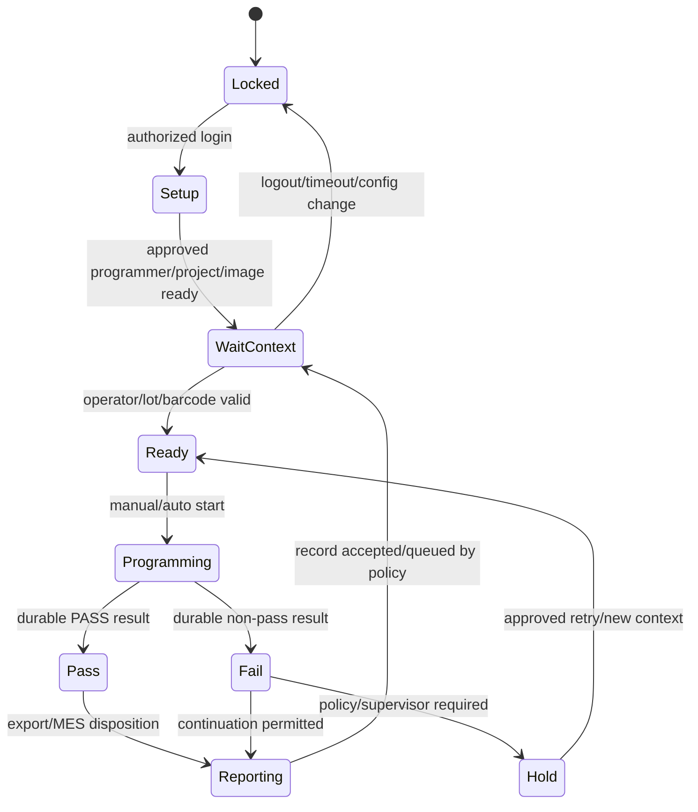
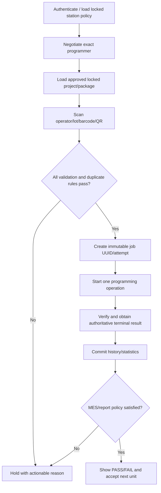
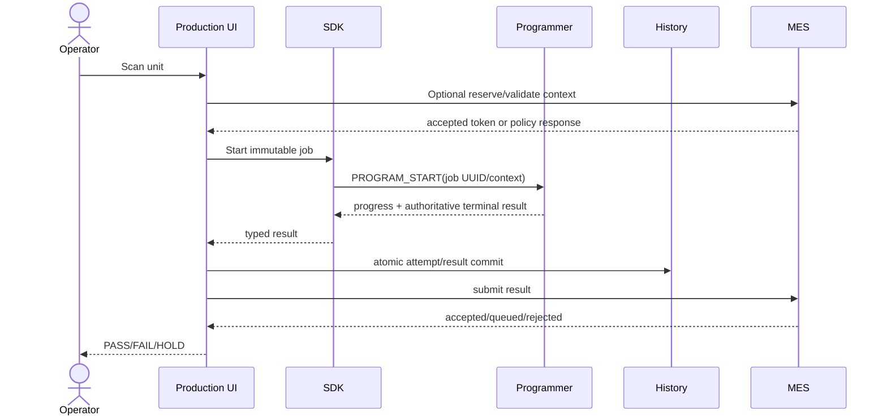

# Production Tool Specification

| Field | Value |
| --- | --- |
| Document ID | PTS-RPP-001 |
| Version | 1.0-draft |

## 1. Overview and Purpose

Production Mode turns the general programmer platform into a controlled station workflow. It minimizes operator choices, binds every attempt to approved project/image/profile/station context, and produces durable, exportable results.

## 2. Roles and Authorization

| Role | Typical permissions |
| --- | --- |
| Operator | Scan, start approved job, view current result, acknowledge allowed failure |
| Technician | Diagnose/retry/recover target, view detailed logs, replace programmer |
| Supervisor | Unlock hold, change lot/project, reset lot counters, approve disposition |
| Engineer | Build/validate package and project; cannot sign unless separately authorized |
| Administrator | Station/config/plug-in/MES policy |
| Security/Release | Sign package/update, manage trust/revocation; no routine station operation |

Password is one credential-provider option, not a mandated storage design. Plaintext credentials are prohibited. Sessions expire and protected actions create audit events.

## 3. Station State Machine

## 4. Workflow

## 5. Features and Interfaces

| Feature | Responsibility / inputs → outputs | Error/future handling |
| --- | --- | --- |
| Batch queue | Approved scanned units → serialized jobs | Duplicate/invalid entries held; future multi-channel scheduler |
| Automatic programming | Valid scan/fixture interlock → start | Disabled by default; bounded error stop; future PLC trigger |
| Statistics | Terminal attempts → pass/fail/cancel/interrupted/yield/time | Denominator policy versioned; future SPC |
| Programming counter | Lifetime + lot counters | Lifetime immutable; lot reset audited |
| Programming time | Monotonic stage/total duration | Clock anomalies flagged |
| Device history | Job/attempt identity and full version/hash trace | Append-only; retention/export policy |
| CSV export | Current filtered immutable records → UTF-8 versioned CSV | Atomic write; future signed report/PDF/XLSX |
| Serial number | Scanned/reserved/generated value → job/per-unit region | Driver/project capability required; future MES allocation |
| Barcode/QR | Scanner input → normalized production context | Format/duplicate/lot rules; camera/network future |
| Project lock | Signed/approved project/image/profile hashes | Any change invalidates approval; central repository future |
| Operator/factory mode | Role session + simplified locked UI | Logout/timeout/hold; SSO/card future |
| MES | Context/reservation/result exchange | Fail-open/closed/local queue policy explicit |

## 6. Record and CSV Contract

Records follow Common Contract §9. CSV includes schema version, station/programmer, job UUID/attempt, operator/lot/barcode, project/image/package/profile identities/hashes, target identity, timestamps/durations, stage retries, PC/SDK/firmware/PLP/OIS/driver versions, terminal result/error/detail, and MES disposition.

CSV rules: UTF-8 with BOM policy declared by schema, RFC 4180 quoting, invariant numeric/date formats, one row per attempt, deterministic columns, no formula injection (dangerous leading characters escaped by export policy), and no private keys/tokens/image bytes.

## 7. Sequence Diagram

## 8. Configuration and Versioning

Managed station configuration contains policy schema/version/signature, station identity, approved programmer/project/package/profile hashes, auto-start/interlock, operator roles/timeouts, barcode/serial rules, retry/hold rules, CSV schema/path, MES endpoint/certificate/queue/timeout and retention. Secrets use OS/approved secure storage, not portable plaintext files.

## 9. Error Handling

Production errors map to FAIL, HOLD, RETRY_ALLOWED, SERVICE_REQUIRED or STATION_BLOCKED dispositions. A programming PASS can still become HOLD if durable history or mandatory MES acceptance fails. Repeating failures stop automatic mode at the configured threshold and require explicit disposition.

## 10. Risk Analysis

| Risk | Control |
| --- | --- |
| Wrong project/image used | Signed project lock and visible hashes/version |
| Duplicate serial programmed | Local/MES uniqueness policy before start and durable reservation token |
| Retry inflates yield | Job UUID + distinct attempts and versioned denominator |
| PASS shown before record/MES | State machine waits for required reporting policy |
| Scanner injects command/formula | Strict input schema and safe CSV encoding |
| Shared password destroys attribution | Role provider, session timeout and audit; SSO/card future |
| Offline MES causes data loss | Bounded durable queue or fail-closed policy with visible state |

## 11. Test Suggestions

- Every role/action/timeout/lock and credential failure.
- Barcode/QR prefix/suffix/length/charset/duplicate/rapid scans.
- Auto-start interlock, repeated failure threshold and emergency/service workflow.
- Retry/attempt/yield/counter/time calculations and lot reset audit.
- History disk full/corruption/read-only/duplicate ingestion and recovery.
- CSV quoting/encoding/formula injection/filter/schema/atomic write.
- MES accept/reject/timeout/auth/certificate/out-of-order/duplicate result and queue recovery.
- Operator UI at supported DPI/languages with keyboard/scanner-only workflow.

## 12. Future Improvement

Gang programming, PLC/fixture digital interlocks, SPC dashboards, signed station records, SSO/smart cards, central project repository, remote station health, offline MES queue attestation and multiple MES/report plug-ins.

