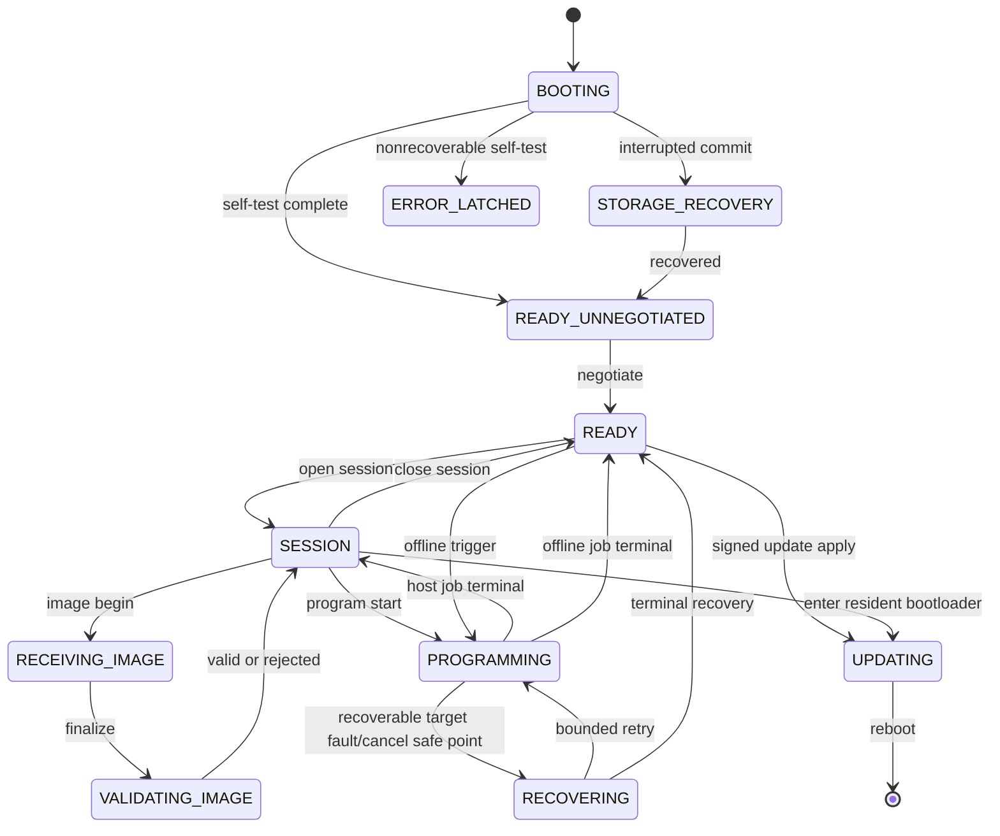
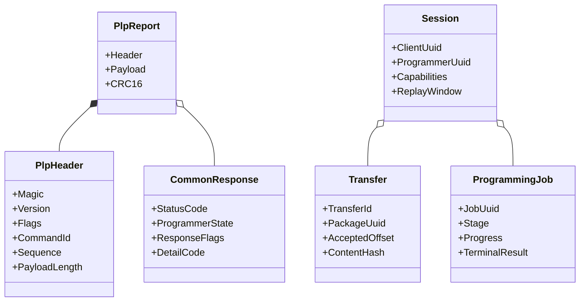
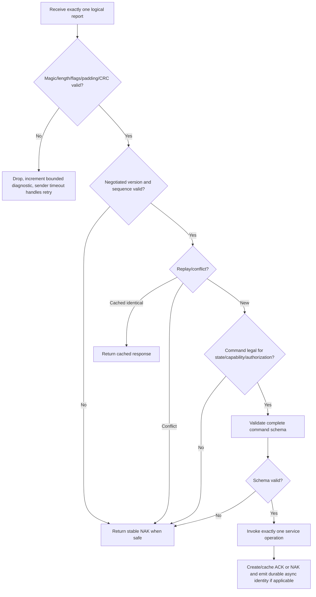
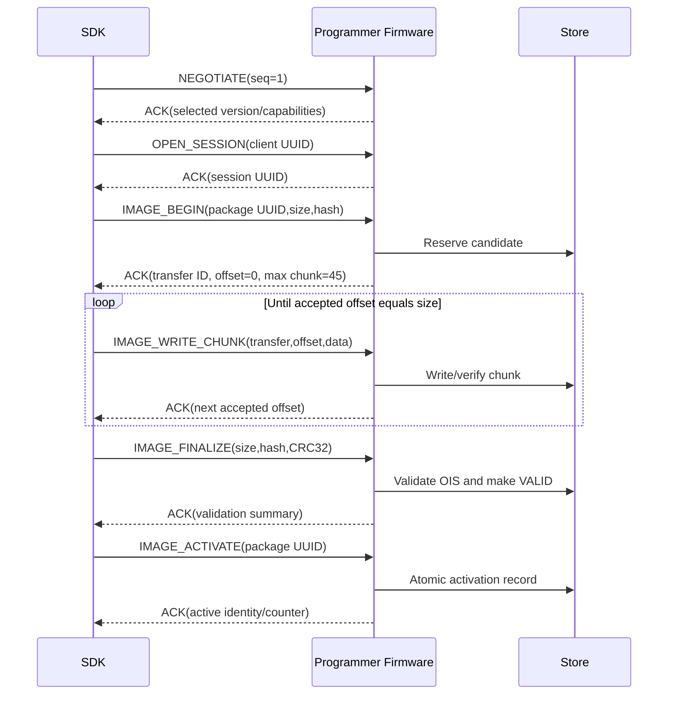

# Programmer Protocol Specification (PPS)

| Field | Value |
| --- | --- |
| Document ID | PPS-RPP-001 |
| Wire name | Programmer Link Protocol (PLP) |
| Version | 1.0-draft |
| V1 transports | USB HID or M032 TEST BOARD UART, exact 64-byte PLP reports |
| Endianness | Little-endian for all multi-byte integers |
| Integrity | CRC-16/CCITT-FALSE per report; CRC32/SHA-256 at transfer level |

<style>
@media print {
  @page { size: A4 portrait; margin: 10mm; }
  h2, h3 { break-after: avoid-page; }
  table, .mermaid, pre.mermaid, .mermaid svg { break-inside: avoid-page !important; page-break-inside: avoid !important; }
  .mermaid svg { max-width: 100% !important; max-height: 235mm !important; height: auto !important; }
}
</style>

## 1. Overview

### 1.1 Purpose

PLP defines every application-level exchange between Programmer SDK and programmer firmware. It is independent of MFC, the physical target MCU, and the internal firmware architecture. The same command model may be carried by future CDC, UART, Ethernet, or BLE adapters when their transport profile preserves PLP message semantics.

### 1.2 Responsibilities

- Discovery identity and version/capability negotiation.
- Session ownership and exclusive destructive-operation control.
- Device information, status, logs, configuration, and storage queries.
- Online image staging, offline image download, validation, activation, listing, deletion, and recovery.
- Online/offline programming, target information, permitted readback/reset, progress, cancellation, and results.
- Programmer firmware update as a separate authorized flow.
- Unified status/error transport, sequencing, retry behavior, and forward-compatible reserved ranges.

### 1.3 Non-responsibilities

PLP does not define RL78 Protocol B bytes, MOT parsing, UPI/OIP internal layout, GUI behavior, HID enumeration APIs, production credentials, or board pin mapping.

### 1.4 Interfaces

The upstream interface is the Programmer SDK command/operation model. The downstream interface is the firmware Command Service. V1 is carried by USB HID or the M032 TEST BOARD UART through transport adapters on both ends; PPS command semantics remain independent of those adapters.

## 2. USB HID Transport Profile

| Property | V1 requirement |
| --- | --- |
| USB class | HID, vendor-defined usage page |
| Logical input report | 64 bytes |
| Logical output report | 64 bytes |
| Report ID | None in V1 |
| Endpoint behavior | One host request produces one direct response; asynchronous events use input reports |
| Maximum PLP payload | 52 bytes |
| V1 maximum in-flight requests | 1, negotiable for future versions |
| Default VID/PID | TBD by `USB-001`; development identity must not ship as production identity |
| Discovery filter | VID/PID plus usage page/usage plus successful `NEGOTIATE`; path alone is not identity |
| Instance identity | Stable programmer UUID returned by `GET_DEVICE_INFO`; USB serial string recommended |

Some Windows HID APIs expose an extra leading report-ID byte even when the descriptor has no report IDs. That API byte is an adapter concern and is not part of the 64-byte PLP report; byte 0 below is always the PLP magic.

The transport adapter must handle surprise removal, multiple matching programmers, stale OS paths, access denial, and device re-enumeration after firmware update.

### 2.1 M032 TEST BOARD UART Transport Profile

The external 3.3 V TTL VCOM link uses PF.2/UART0_RXD and PF.3/UART0_TXD at
115200 baud, 8 data bits, no parity and one stop bit. The byte stream carries
the same exact 64-byte PLP report defined below, without a report-ID byte or
length prefix. The receiver searches for `PLP_MAGIC`, collects 64 bytes and
accepts only a CRC-valid frame. Noise, a truncated frame or a bad CRC causes
bounded magic/CRC resynchronization and never reaches Command Service.

USB and UART share PLP version, sequence, replay, state, capability, error and
payload semantics. UART discovery uses a COM-port descriptor, then successful
`NEGOTIATE`, `OPEN_SESSION` and the distinct `M032 TEST BOARD` product identity;
enumerating a COM port alone is not programmer identity.
The host COM adapter accepts partial reads and accumulates bytes under the
operation deadline; it must not wait for a scratch buffer larger than the
64-byte wire report and discard an otherwise complete report on timeout.

## 3. Report Format

### 3.1 Fixed Layout

| Offset | Size | Field | Requirement |
| ---: | ---: | --- | --- |
| 0 | 1 | Magic | `0xA5` |
| 1 | 1 | Protocol major | `0x01` for this specification |
| 2 | 1 | Protocol minor | `0x00` for this specification |
| 3 | 1 | Flags | Section 3.2 |
| 4 | 2 | Command ID | Little-endian command identifier |
| 6 | 2 | Sequence | Nonzero request sequence; response echoes request sequence |
| 8 | 2 | Payload length | `0..52`; little-endian |
| 10 | 52 | Payload/padding | Payload followed by zero padding |
| 62 | 2 | Report CRC16 | CRC-16/CCITT-FALSE over bytes `0..61`, little-endian |

CRC parameters: polynomial `0x1021`, initial `0xFFFF`, no reflection, XOR-out `0x0000`, check value for ASCII `123456789` is `0x29B1`.

Receivers must validate magic, supported major, flags, payload length, zero padding, and CRC before dispatch. A malformed frame is not passed to a command handler. Since command/sequence may be corrupt, the receiver may increment a diagnostic counter but does not respond to a CRC-invalid frame; the sender's timeout initiates bounded retry.

### 3.2 Flags

| Bit | Name | Meaning |
| ---: | --- | --- |
| 0 | `RESPONSE` | Frame is a direct response |
| 1 | `ACK` | Request accepted/completed; `RESPONSE` must also be set |
| 2 | `NAK` | Request rejected/failed; `RESPONSE` must also be set |
| 3 | `MORE` | More fragments/pages/events are available |
| 4 | `EVENT` | Unsolicited event; must not set `RESPONSE`, `ACK`, or `NAK` |
| 5 | `RETRY` | Request is an explicit retransmission of the same sequence and content |
| 6..7 | Reserved | Sender writes zero; receiver rejects nonzero in V1 |

`ACK` and `NAK` are mutually exclusive. Direct responses use the same command ID as the request. Events use the event command range.

### 3.3 Sequence and Replay

- Host request sequences are `1..65535`, increment modulo 65535, and never use zero.
- Direct responses echo the request sequence.
- Firmware event sequences use an independent `1..65535` counter; event payloads carry correlation UUIDs.
- A retry reuses exactly the same command ID, sequence, payload, and sets `RETRY`.
- Firmware holds a negotiated replay window, at least the last completed request in V1.
- A byte-identical duplicate of a replay-safe request returns the cached response without repeating side effects.
- Same sequence with different content returns `PROTOCOL_SEQUENCE_CONFLICT`.
- Non-replay-safe commands are never automatically retried unless their payload contains the specified idempotency UUID and the command definition marks them safe.

### 3.4 Common Response Prefix

Every ACK/NAK payload begins with:

| Offset | Size | Field | Meaning |
| ---: | ---: | --- | --- |
| 0 | 4 | Status code | Unified 32-bit code; zero for ACK |
| 4 | 1 | Programmer state | Section 7 enumeration |
| 5 | 1 | Response flags | bit 0 `DATA_VALID`; bit 1 `RETRYABLE`; bit 2 `PARTIAL`; others reserved |
| 6 | 2 | Detail code | Command-specific stable numeric detail; zero if none |
| 8 | 0..44 | Response data | Command-specific schema |

Human-readable text is not a wire-contract substitute. The SDK localizes status/detail codes and may fetch structured logs for diagnostic context.

## 4. Data Types and Encoding

| Type | Encoding |
| --- | --- |
| `u8/u16/u32/u64` | Unsigned little-endian integer |
| `uuid` | 16 RFC 4122 network-order bytes; display formatting is SDK responsibility |
| `hash256` | 32 raw SHA-256 bytes |
| `timestamp` | Unsigned 64-bit Unix epoch milliseconds UTC; zero means unavailable |
| `duration` | Unsigned 32-bit milliseconds unless a field says otherwise |
| `version` | Four `u8`: major, minor, patch, reserved; build is separate `u32` |
| `string` | UTF-8, explicit byte length, no terminator; invalid UTF-8 is rejected |
| `enum` | Fixed unsigned width; unknown required value is rejected |
| `bitset` | Fixed unsigned width; unknown set bit is rejected unless declared optional |

All reserved bytes are zero on transmit and ignored only when the field is explicitly marked `ignore-on-receive`; otherwise nonzero is a format error.

## 5. Command Registry

### 5.1 Ranges

| Range | Owner |
| --- | --- |
| `0x0000` | Invalid / never transmitted |
| `0x0001..0x00FF` | Link/session control |
| `0x0100..0x01FF` | Device/status/log/storage information |
| `0x0200..0x02FF` | Image and offline package management |
| `0x0300..0x03FF` | Target programming operations |
| `0x0400..0x04FF` | Settings and provisioning policy |
| `0x0500..0x05FF` | Programmer firmware update and bootloader handoff |
| `0x0600..0x06FF` | Production records/statistics |
| `0x0700..0x0FFF` | Reserved standard commands |
| `0x7000..0x70FF` | Asynchronous events |
| `0x8000..0xBFFF` | Vendor extension; negotiated and namespaced |
| `0xC000..0xDFFF` | Experimental; prohibited in production |
| `0xE000..0xFFFF` | Reserved; must not be allocated |

### 5.2 Link and Session Commands

| ID | Name | Allowed state | Replay safe | Purpose / response |
| ---: | --- | --- | --- | --- |
| `0x0001` | `NEGOTIATE` | DISCOVERED | Yes | Select common PLP version, capabilities, limits, replay/event windows |
| `0x0002` | `PING` | Any negotiated | Yes | Liveness, uptime and session echo |
| `0x0003` | `OPEN_SESSION` | READY | Yes by client session UUID | Acquire logical session; destructive session may require authorization |
| `0x0004` | `CLOSE_SESSION` | SESSION | Yes | Release session if no unsafe target phase is active |
| `0x0005` | `RESET_LINK` | READY/ERROR | No automatic retry | Clear protocol session/queues without changing programmer firmware |
| `0x0006` | `GET_PROTOCOL_LIMITS` | Negotiated | Yes | Return payload, in-flight, replay, event and timeout limits |
| `0x0007` | `RESET_PROGRAMMER` | SESSION/idle | No automatic retry | ACK, then normally reset the programmer MCU without invalidating the application |

`NEGOTIATE` request data: minimum major/minor, maximum major/minor, host capability bitset, requested maximum in-flight count, requested event window, and host instance UUID. Response data: selected major/minor, programmer capability bitset, accepted limits, firmware PLP minimum/maximum, and programmer UUID. A major range with no intersection returns `PROTOCOL_VERSION_INCOMPATIBLE` using the received major only if the frame can be safely decoded.

`RESET_PROGRAMMER` is available only when `CAP_PROGRAMMER_RESET` is advertised,
the request payload is empty, a negotiated session is open, and no image
transfer or programming job is active. Firmware queues the ACK before scheduling
the reset. It does not erase or modify the application CRC; the resident
bootloader therefore validates and starts the same application after reset. The
SDK closes the application transport after ACK and the user scans/reconnects to
the same application PID. The command is non-replay-safe.

### 5.3 Device and Diagnostic Commands

| ID | Name | Purpose |
| ---: | --- | --- |
| `0x0100` | `GET_DEVICE_INFO` | Programmer UUID, product, HW revision, firmware/build, boot/reset reason, protocol/OIS ranges |
| `0x0101` | `GET_CAPABILITIES` | Paged capability TLVs: transports, drivers, storage, security, operations |
| `0x0102` | `GET_STATUS` | Current state, session/job/transfer UUIDs, active package, last result, health flags |
| `0x0103` | `GET_LOG_PAGE` | Paged structured log records after cursor; redaction already applied |
| `0x0104` | `CLEAR_LOG` | Privileged log rotation/clear; audit record remains |
| `0x0105` | `GET_STORAGE_INFO` | Provider, capacity, free/usable bytes, erase size, slot count, health/wear flags |
| `0x0106` | `GET_ACTIVE_PACKAGE` | Active OIP identity, hashes, project/profile/image versions and activation counter |
| `0x0107` | `GET_LAST_OFFLINE_RESULT` | Last retained terminal result and compact failure snapshot when no host observed the job |
| `0x0108` | `GET_OPERATING_MODE` | Persistent Online Only/Offline Armed policy, autorun and active package |
| `0x0109` | `GET_OFFLINE_FAILURE_HISTORY` | Page through bounded runtime failure records that are not erased by later successful offline jobs |

Paged commands accept cursor `u32` and maximum record count `u8`; ACK returns next cursor and sets `MORE` when another page is available. Cursors are session-scoped snapshots; stale cursors return `PROTOCOL_CURSOR_STALE`.

### 5.4 Image and Offline Commands

| ID | Name | Allowed state | Replay safe | Purpose |
| ---: | --- | --- | --- | --- |
| `0x0200` | `IMAGE_BEGIN` | SESSION/READY | Yes by package UUID | Reserve candidate transfer after capacity/policy preflight |
| `0x0201` | `IMAGE_WRITE_CHUNK` | RECEIVING_IMAGE | Yes by transfer+offset | Write sequential or capability-approved ranged chunk |
| `0x0202` | `IMAGE_FINALIZE` | RECEIVING_IMAGE | Yes | Validate complete size, CRC32, SHA-256, OIS and signature/policy |
| `0x0203` | `IMAGE_ACTIVATE` | IMAGE_VALID | Yes by package UUID | Atomically make validated package selectable/active |
| `0x0204` | `IMAGE_LIST` | READY/SESSION | Yes | Paged slot/package metadata |
| `0x0205` | `IMAGE_DELETE` | READY/SESSION | Yes by package UUID | Delete non-in-use package; active delete requires explicit replace policy |
| `0x0206` | `IMAGE_GET_METADATA` | READY/SESSION | Yes | Return redacted OIS metadata and validation status |
| `0x0207` | `IMAGE_ABORT` | RECEIVING_IMAGE | Yes | Mark candidate incomplete and reclaim according to storage policy |
| `0x0208` | `IMAGE_RECOVER` | STORAGE_RECOVERY | No automatic retry | Authorized rescan/recovery with result report |

`IMAGE_BEGIN` request carries package UUID, total package size, package CRC32, OIS version, intended slot (`AUTO` permitted), policy flags, and the first 16 SHA-256 bytes. ACK returns transfer ID, accepted offset, maximum chunk data, storage provider/slot, and resume token. Full SHA-256 is mandatory at finalize.

`IMAGE_WRITE_CHUNK` payload uses `transfer_id:u16`, `offset:u32`, `data_length:u8`, and `data:0..45`. Data length must match payload length. V1 requires the reported accepted offset; a mismatched offset returns the required offset and `STORAGE_OFFSET_MISMATCH`. Report CRC protects each chunk, and final CRC32/SHA-256 protects the complete transfer.

`IMAGE_FINALIZE` carries transfer ID, total size, SHA-256, and package CRC32. ACK means durable `VALID`, not `ACTIVE`. Activation is a separate atomic command so download and factory release approvals can be separated.

### 5.5 Programming Commands

| ID | Name | Replay safe | Purpose / restrictions |
| ---: | --- | --- | --- |
| `0x0300` | `PROGRAM_START` | Yes by job UUID | Start online-staged or active/offline-source job; ACK means accepted, result is event/query |
| `0x0301` | `PROGRAM_GET_JOB` | Yes | Return job phase, progress, metrics, cancellation state, terminal result |
| `0x0302` | `PROGRAM_CANCEL` | Yes by job UUID | Request cooperative cancellation; ACK distinguishes accepted/pending/already terminal |
| `0x0303` | `TARGET_READ_SIGNATURE` | Yes | Non-destructive identify using selected driver/profile |
| `0x0304` | `TARGET_GET_INFO` | Yes | Generic device information/capabilities supported by driver |
| `0x0305` | `TARGET_READ_FLASH` | Yes | Disabled by default; requires capability and authorization; paged/streamed |
| `0x0306` | `TARGET_RESET` | No automatic retry | Explicit reset/release with reason logged |
| `0x0307` | `TARGET_RECOVER` | No automatic retry | Reapply safe electrical/link state and report outcome |

`PROGRAM_START` includes job UUID, source kind, package/image reference, device profile UUID/version hash, programming policy flags, operator/job correlation token, and expected target identity hash. The firmware returns the existing job for a duplicate UUID with identical intent; a conflicting intent returns `PROGRAM_JOB_CONFLICT`.

An ACK indicates job acceptance only. Progress is delivered through events and `PROGRAM_GET_JOB`; terminal success is never inferred from the absence of an error.

### 5.6 Settings Commands

| ID | Name | Purpose |
| ---: | --- | --- |
| `0x0400` | `CONFIG_GET` | Paged versioned configuration by namespace |
| `0x0401` | `CONFIG_STAGE_BEGIN` | Reserve transfer for a complete configuration snapshot |
| `0x0402` | `CONFIG_STAGE_CHUNK` | Transfer one idempotent configuration chunk |
| `0x0403` | `CONFIG_COMMIT` | Validate and atomically commit staged config; reports reboot requirement |
| `0x0404` | `CONFIG_ROLLBACK` | Restore last-known-good snapshot |
| `0x0405` | `CONFIG_FACTORY_RESET` | Privileged; preserves immutable identity/provisioning |
| `0x0406` | `SET_OPERATING_MODE` | Atomically switch Online Only/Offline Armed without deleting the package |

Partial mutation of safety-critical configuration is prohibited. Unknown safety-critical fields reject the snapshot.

`OFFLINE_ARMED` is a persistent policy, not a USB personality. HID remains
enumerated and accepts PLP sessions in either mode. A host session suppresses
an external-reset-triggered autorun before erase. Power-on reset alone does not
start V1 offline programming. `SET_OPERATING_MODE` requires no active job; an
Offline Armed request additionally requires a validated active package,
persistent storage and a ready target driver. `ONLINE_ONLY` preserves the
stored package.

### 5.7 Programmer Firmware Update Commands

| ID | Name | Purpose |
| ---: | --- | --- |
| `0x0500` | `FW_UPDATE_BEGIN` | Authorize and reserve signed programmer-update candidate |
| `0x0501` | `FW_UPDATE_CHUNK` | Transfer update chunk with transfer/offset semantics |
| `0x0502` | `FW_UPDATE_FINALIZE` | Full integrity/signature/hardware/rollback validation |
| `0x0503` | `FW_UPDATE_APPLY` | Commit pending update and announce re-enumeration |
| `0x0504` | `FW_UPDATE_STATUS` | Current/previous/pending versions, rollback and last error |
| `0x0505` | `FW_UPDATE_ABORT` | Abandon candidate safely |
| `0x0506` | `FW_ENTER_BOOTLOADER` | Invalidate the current bridge application and hand off to its resident USB HID or UART ISP bootloader |

Target programming commands cannot apply programmer firmware, and OIP target
packages cannot be interpreted as programmer updates. The staged `0x0500`–
`0x0505` family is the production-oriented signed candidate/apply design; apply
requires READY, no active transfer/job, sufficient power policy, and a valid
signed candidate.

`FW_ENTER_BOOTLOADER` is the implemented development application-update handoff.
It is not a staged update, is not replay-safe, and does not accept image bytes.
The request is legal only in `SESSION`, with a negotiated open session,
`CAP_PROGRAMMER_UPDATE`, no active image transfer, no active programming job and
an installed board boot callback. Before the ACK is built, firmware erases the
entire reserved application CRC page. Before that destructive erase, the board
callback requires `CONFIG0.CBS[7:6]=10` on both boards and `MBS bit 5=1` on
M484; an incompatible setting returns `UPDATE_PACKAGE_INCOMPATIBLE`
(`0x20C03001`) and leaves the application valid. It then reports state
`UPDATING`, waits
for the ACK input transfer to complete, and resets to APROM address zero after a
short guard delay; a bounded reset fallback also applies. The SDK closes its
application transport locally after the ACK and must not send `CLOSE_SESSION`.

After reset, a USB resident Nuvoton ISP bootloader enumerates separately as
`VID:PID 0416:3F00`. M032 TEST BOARD remains on the selected COM port at
115200 8-N-1 and carries the same fixed 64-byte Nuvoton ISP packets; neither
boot transport carries PLP. The UART CONNECT response additionally reports
board ID `0x3142544D` (`MTB1`). The SDK bootloader client validates board
identity and complete geometry, then programs one fixed-layout application
BIN. The bootloader never accepts writes to `0x00000000-0x00003FFF`. It starts
the application only when vector and CRC32 validation pass; otherwise the USB
PID or UART ISP remains available so an interrupted update can be repeated.
This path does not update the resident bootloader and provides no signature,
A/B or anti-rollback claim.

For UART, the application COM handle is closed immediately after the
`FW_ENTER_BOOTLOADER` ACK. A subsequent bootloader scan probes each enumerated
COM candidate with a bounded NuvoISP CONNECT sequence and exposes only a
candidate that reports `MTB1` and the authoritative M032 TEST BOARD geometry.

### 5.8 Production Commands

| ID | Name | Purpose |
| ---: | --- | --- |
| `0x0600` | `PRODUCTION_GET_STATS` | Count, pass, fail, cancel, yield basis, average/min/max duration |
| `0x0601` | `PRODUCTION_GET_HISTORY` | Paged durable job summaries |
| `0x0602` | `PRODUCTION_RESET_STATS` | Privileged new lot/batch baseline with audit record |
| `0x0603` | `PRODUCTION_SET_CONTEXT` | Stage operator/lot/station/barcode correlation for next job |
| `0x0604` | `PRODUCTION_GET_COUNTERS` | Lifetime monotonic and resettable counters |

PC CSV export is normally produced from SDK history models; the wire returns structured records, not CSV text.

### 5.9 Event Commands

| ID | Name | Payload purpose |
| ---: | --- | --- |
| `0x7000` | `EVENT_STATE_CHANGED` | Old/new programmer state, reason code, session/job correlation |
| `0x7001` | `EVENT_JOB_PROGRESS` | Job UUID, phase, basis-point progress, bytes/address, elapsed time |
| `0x7002` | `EVENT_JOB_RESULT` | Job UUID, attempt, terminal status, stage, metrics and target identity hash |
| `0x7003` | `EVENT_LOG_AVAILABLE` | Highest log cursor, severity/category summary, overflow flag |
| `0x7004` | `EVENT_DEVICE_REBOOTING` | Reason, expected re-enumeration delay, pending firmware version |
| `0x7005` | `EVENT_OFFLINE_RESULT` | Durable offline job UUID/result/package identity |
| `0x7006` | `EVENT_STORAGE_CHANGED` | Slot/provider/health/active package transition |

Events are advisory and may be lost on disconnect. Authoritative state is recoverable through `GET_STATUS`, `PROGRAM_GET_JOB`, `GET_LAST_OFFLINE_RESULT`, and `GET_OFFLINE_FAILURE_HISTORY`. An event never requires an event ACK in V1; bounded device queues coalesce progress while never silently dropping a terminal job result from durable history.

### 5.10 Command Payload Schemas

The schemas below close the binary contract for every V1 command. `req` is the complete request payload. `rsp` is response data after the 8-byte Common Response Prefix. `uuid` is 16 bytes; `hash256` is 32 bytes. `reservedN` means N zero bytes. A command with `req: empty` has payload length zero.

#### 5.10.1 Shared Page and Fragment Envelopes

| Envelope | Exact fields | Rule |
| --- | --- | --- |
| `PageRequest` | `snapshot:u32, cursor:u32, max_data:u8, filter:u8, reserved2` | `snapshot=0,cursor=0` starts a snapshot; `max_data<=35` |
| `PageResponse` | `snapshot:u32, next_cursor:u32, data_length:u8, data:0..35` | Common response `MORE` flag indicates continuation |
| `FragmentRequest` | `object_uuid:uuid, offset:u16, total_size:u16, data_length:u8, data:0..31` | Data is a PLP-TLV byte stream; repeated identical offset is replay safe |
| `FragmentResponse` | `object_uuid:uuid, accepted_offset:u16, state:u8, reserved1` | Sender resumes only at accepted offset |
| `PLP-TLV` | `type:u16, flags:u8, length:u8, value:0..255` | bit 0 of flags is REQUIRED; TLVs may span page/fragment boundaries |

Paged data is a byte stream of complete logical PLP-TLV records after page reassembly. Snapshot ID prevents a changing log/history/package list from invalidating cursors.

Standard paged-record TLVs are:

| Type | Name | Exact value schema |
| ---: | --- | --- |
| `0x0001` | Device UUID | `uuid` |
| `0x0002` | Product name | UTF-8, 1..64 bytes |
| `0x0003` | Hardware version | `major:u8, minor:u8, revision:u8, reserved1` |
| `0x0004` | Firmware version | `major:u8, minor:u8, patch:u8, reserved1, build:u32` |
| `0x0005` | Boot/reset | `boot_reason:u16, reset_reason:u16, boot_count:u32, prior_error:u32` |
| `0x0006` | PLP range | `min_major:u8, min_minor:u8, max_major:u8, max_minor:u8` |
| `0x0007` | OIS range | `min_major:u8, min_minor:u8, max_major:u8, max_minor:u8` |
| `0x0008` | Board profile | `board_profile_uuid:uuid, version:4 bytes` |
| `0x0009` | Device health | `health_flags:u32, uptime_ms:u32, log_overflow:u32, storage_health:u8, reserved3` |
| `0x0100` | Capability | `capability_id:u16, capability_version:u8, capability_flags:u8, value:remaining bytes` |
| `0x0200` | Storage provider | `provider_id:u8, provider_type:u8, flags:u16, total:u32, usable:u32, free:u32, max_package:u32, erase_unit:u32, write_unit:u16, slot_count:u8, health:u8, wear_count:u32` |
| `0x0201` | Storage slot | `provider_id:u8, slot:u8, package_state:u8, flags:u8, package_uuid:uuid, stored_size:u32, generation:u32, validation_flags:u32` |
| `0x0300` | Log record | `record_sequence:u32, utc_ms:u64, monotonic_ms:u32, severity:u8, category:u8, event_id:u16, error:u32, detail:u16, stage:u8, flags:u8, correlation_uuid:uuid` |
| `0x0301` | Log numeric context | `record_sequence:u32, key1:u16, value1:u32, key2:u16, value2:u32`; omit unused pairs |
| `0x0400` | Package summary | `package_uuid:uuid, state:u8, provider_id:u8, slot:u8, flags:u8, stored_size:u32, activation_generation:u32, release_sequence:u32, target_profile_uuid:uuid` |
| `0x0401` | Metadata fragment | `package_uuid:uuid, offset:u16, total_size:u16, data:remaining bytes`; data is the exact redacted OIS manifest stream |
| `0x0500` | Target identity | `matched_profile_uuid:uuid, signature_digest:16 bytes, target_flags:u32, raw_signature_length:u16, region_count:u16` |
| `0x0501` | Raw target signature | `offset:u16, total_size:u16, data:remaining bytes` |
| `0x0502` | Target memory region | `address_space:u8, region_type:u8, flags:u16, start:u32, size:u32, erase_unit:u32, program_unit:u16, reserved2` |
| `0x0600` | Statistics | `generation:u32, total:u64, pass:u64, fail:u64, cancelled:u32, interrupted:u32, outcome_unknown:u32, average_ms:u32, minimum_ms:u32, maximum_ms:u32` |
| `0x0700` | History job attempt | `job_uuid:uuid, attempt:u16, result:u8, terminal_stage:u8, error:u32, detail:u16, start_utc_ms:u64, duration_ms:u32, project_hash:16 bytes, image_hash:16 bytes, target_hash:16 bytes` |
| `0x0701` | History production context | `job_uuid:uuid, context_uuid:uuid, operator_hash:8 bytes, lot_hash:8 bytes, barcode_hash:16 bytes, mes_disposition:u8, flags:u8, reserved2` |
| `0x0800` | Configuration descriptor | `namespace:u16, schema_major:u8, schema_minor:u8, generation:u32, total_size:u32, content_sha256:hash256` |
| `0x0801` | Configuration fragment | `namespace:u16, offset:u16, total_size:u16, data:remaining bytes` |
| `0x0900..0x7FFF` | Reserved standard | Not allocated |
| `0x8000..0xBFFF` | Vendor optional | Namespaced and capability-gated |
| `0xC000..0xFFFF` | Prohibited | Reject |

Hashes in history/context are truncated first bytes of SHA-256 for compact retrieval; the full canonical identities remain in project/package/job archives and may be retrieved through their dedicated metadata records. Truncation is for correlation only, never authorization or compatibility.

#### 5.10.2 Link and Session

| Command | Request payload | ACK response data |
| --- | --- | --- |
| `NEGOTIATE` | `min_major:u8, min_minor:u8, max_major:u8, max_minor:u8, host_caps:u32, requested_inflight:u8, requested_event_window:u8, requested_replay_window:u8, reserved1, host_uuid:uuid` | `selected_major:u8, selected_minor:u8, inflight:u8, event_window:u8, replay_window:u8, reserved3, programmer_caps:u32, fw_min_major:u8, fw_min_minor:u8, fw_max_major:u8, fw_max_minor:u8, programmer_uuid:uuid` |
| `PING` | `echo_token:u32` | `echo_token:u32, uptime_ms:u32, session_flags:u16, reserved2` |
| `OPEN_SESSION` | `client_session_uuid:uuid, session_type:u8, flags:u8, authorization_context:uuid, reserved2` | `programmer_session_uuid:uuid, lease_ms:u32, ownership:u8, reserved3` |
| `CLOSE_SESSION` | `programmer_session_uuid:uuid, flags:u16, reserved2` | `closed_session_uuid:uuid` |
| `RESET_LINK` | `reason:u16, flags:u16, client_session_uuid:uuid` | `reset_generation:u32, reserved4` |
| `GET_PROTOCOL_LIMITS` | empty | `max_payload:u8, max_inflight:u8, replay_window:u8, event_window:u8, max_page_data:u8, max_image_chunk:u8, reserved2, response_timeout_ms:u16, transfer_timeout_ms:u16, reconnect_timeout_ms:u32` |
| `RESET_PROGRAMMER` | empty | empty; Common Response Prefix reports `SESSION` |

`session_type`: `0=diagnostic`, `1=programming`, `2=production`, `3=service/update`. Authorization context is zero when the selected session type does not require an authenticated context.

#### 5.10.3 Device, Diagnostics and Storage

| Command | Request payload | ACK response data |
| --- | --- | --- |
| `GET_DEVICE_INFO` | `PageRequest` | `PageResponse` of Device Info TLVs |
| `GET_CAPABILITIES` | `PageRequest` | `PageResponse` of Capability TLVs |
| `GET_STATUS` | empty | `state:u8, health_flags:u32, programmer_session_uuid:uuid, active_job_uuid:uuid, active_transfer_id:u16, active_slot:u8, reserved4` |
| `GET_LOG_PAGE` | `PageRequest` | `PageResponse` of structured Log Record TLVs |
| `CLEAR_LOG` | `authorization_context:uuid, through_cursor:u32, flags:u32` | `new_snapshot:u32, retained_audit_count:u32` |
| `GET_STORAGE_INFO` | `PageRequest` | `PageResponse` of Storage/Slot TLVs |
| `GET_ACTIVE_PACKAGE` | empty | `package_uuid:uuid, activation_generation:u32, slot:u8, validation_flags:u32, release_sequence:u32, reserved3` |
| `GET_LAST_OFFLINE_RESULT` | empty | `job_uuid:uuid, attempt:u16, terminal_result:u8, stage:u8, error:u32, detail:u16, elapsed_ms:u32, snapshot_version:u8, snapshot_valid:u8, protocol_step:u8, unit_byte_index:u8, tx_value:u8, tx_bit_index:u8, timer_state:u8, pin_flags:u8, target_address:u32, timer_count:u16`; zero job UUID means none available |
| `GET_OPERATING_MODE` | empty | `mode:u8, autorun_enabled:u8, active_package_available:u8, reserved1, mode_generation:u32, active_package_uuid:uuid` |
| `GET_OFFLINE_FAILURE_HISTORY` | `minimum_sequence:u32`; zero selects oldest retained | `sequence:u32, next_sequence:u32, dropped_count:u16, flags:u8, schema:u8, job_counter:u32, captured_uptime_ms:u32, attempt:u16, terminal_result:u8, stage:u8, error:u32, detail:u16, snapshot_version:u8, snapshot_valid:u8, protocol_step:u8, unit_byte_index:u8, tx_value:u8, tx_bit_index:u8, timer_state:u8, pin_flags:u8, target_address:u32, timer_count:u16` |

The V1 compact snapshot version is `1`. `pin_flags` bits are PA.9 DOUT,
PA.9 PIN, PA.10 PIN, PA.10 GPIO interrupt pending, TX busy, RX enabled,
destructive stage entered, and link-layer capture valid, from bit 0 through
bit 7 respectively. `target_address` is the first byte of the current
four-byte programming unit and `unit_byte_index` is the byte within that unit.
The common core retains the last result plus the newest 64 offline terminal
failures in RAM until bridge reset or power loss. PASS updates the last result
but does not erase failure history. History `flags` bit 0 means a record is
present and bit 1 means at least one older record was overwritten;
`dropped_count` saturates at `0xFFFF`. `next_sequence=0` terminates traversal.
A platform that advertises durable history may additionally persist it. The
GUI treats unsupported `0x0107` or `0x0109` responses as older-firmware
conditions and does not reject the otherwise valid PLP session.

Device Info standard TLV types are `0x0001 programmer_uuid(uuid)`, `0x0002 product_name(UTF-8)`, `0x0003 hardware_version(4 bytes)`, `0x0004 firmware_version(8 bytes including build)`, `0x0005 boot_reset_reason(u16)`, `0x0006 PLP_range(4 bytes)`, `0x0007 OIS_range(4 bytes)`, `0x0008 board_profile_uuid(uuid)`, and `0x0009 device_health(u32)`. Capability TLV is `capability_id:u16, capability_version:u8, flags:u8, value_length:u8, value`; standard IDs are allocated by Common Contract Registry. Storage TLVs carry provider ID, total/usable/free/max-package bytes, erase/write units, slot count, atomic/A-B flags, and health/wear.

#### 5.10.4 Image and Offline Package

| Command | Request payload | ACK response data |
| --- | --- | --- |
| `IMAGE_BEGIN` | `package_uuid:uuid, total_size:u32, package_crc32:u32, ois_major:u8, ois_minor:u8, destination_slot:u8, policy_flags:u8, hash_prefix:16 bytes, reserved4` | `transfer_id:u16, accepted_offset:u32, max_chunk:u8, provider_id:u8, slot:u8, reserved1, resume_token:uuid` |
| `IMAGE_WRITE_CHUNK` | `transfer_id:u16, offset:u32, data_length:u8, data:0..45` | `transfer_id:u16, next_accepted_offset:u32, write_flags:u16` |
| `IMAGE_FINALIZE` | `transfer_id:u16, total_size:u32, package_sha256:hash256, package_crc32:u32` | `package_uuid:uuid, validation_flags:u32, release_sequence:u32, slot:u8, reserved3` |
| `IMAGE_ACTIVATE` | `package_uuid:uuid, expected_generation:u32, policy_flags:u32, authorization_context:uuid` | `package_uuid:uuid, new_generation:u32, slot:u8, reserved3` |
| `IMAGE_LIST` | `PageRequest` | `PageResponse` of Package Summary TLVs |
| `IMAGE_DELETE` | `package_uuid:uuid, policy_flags:u32, authorization_context:uuid` | `package_uuid:uuid, deletion_generation:u32, reclaim_pending:u8, reserved3` |
| `IMAGE_GET_METADATA` | `package_uuid:uuid, PageRequest` | `PageResponse` of redacted OIS metadata TLVs |
| `IMAGE_ABORT` | `transfer_id:u16, reason:u16, resume_token:uuid` | `transfer_id:u16, candidate_state:u8, reclaim_pending:u8` |
| `IMAGE_RECOVER` | `policy_flags:u32, authorization_context:uuid` | `recovery_generation:u32, recovered_count:u16, quarantined_count:u16, health_flags:u32` |

`hash_prefix` is the first 16 bytes of SHA-256 and is an early resume/candidate discriminator only. `IMAGE_FINALIZE` verifies the full SHA-256. V1 destination slot `0xFF` means automatic; explicit slot is accepted only with the storage-selection capability.

#### 5.10.5 Target and Programming

| Command | Request payload | ACK response data |
| --- | --- | --- |
| `PROGRAM_START` | `job_uuid:uuid, source_kind:u8, reserved1, program_flags:u16, source_uuid:uuid, target_profile_uuid:uuid` | `job_uuid:uuid, job_state:u8, stage:u8, attempt:u16, accepted_flags:u32` |
| `PROGRAM_GET_JOB` | `job_uuid:uuid` | `job_uuid:uuid, operation_state:u8, stage:u8, terminal_result:u8, cancel_state:u8, progress_bps:u16, attempt:u16, current:u32, total:u32, elapsed_ms:u32, error:u32, detail:u16` |
| `PROGRAM_CANCEL` | `job_uuid:uuid, reason:u16, flags:u16, authorization_context:uuid` | `job_uuid:uuid, cancellation_disposition:u8, current_stage:u8, reserved2` |
| `TARGET_READ_SIGNATURE` | `target_profile_uuid:uuid, link_mode:u8, flags:u8, reserved2` | `matched_profile_uuid:uuid, signature_digest:16 bytes, raw_signature_length:u16, target_flags:u16` |
| `TARGET_GET_INFO` | `target_profile_uuid:uuid, PageRequest` | `PageResponse` of target information TLVs |
| `TARGET_READ_FLASH` | `read_uuid:uuid, address_space:u8, reserved3, address:u32, total_length:u32, offset:u32, max_data:u8, reserved3` | `read_uuid:uuid, offset:u32, data_length:u8, data:0..23`; `MORE` continues |
| `TARGET_RESET` | `target_profile_uuid:uuid, reset_policy:u16, reason:u16` | `reset_outcome:u8, link_state:u8, reserved2` |
| `TARGET_RECOVER` | `target_profile_uuid:uuid, recovery_policy:u16, reason:u16` | `recovery_outcome:u8, link_state:u8, attempts:u8, reserved1, last_driver_detail:u16` |

`source_kind`: `0=online staged UPI/OIP`, `1=active offline package`, `2=explicit stored package`. `source_uuid` is the committed package/image object identity. Per-unit production context is staged separately and correlated by job UUID.

`signature_digest` is the first 16 SHA-256 bytes of the complete canonical target signature record after the firmware driver has performed exact profile matching. The complete raw/decoded signature record is available through paged `TARGET_GET_INFO`. A zero requested profile UUID permits auto-detection only when installed drivers declare the probe safe and the result is unambiguous.

#### 5.10.6 Configuration

| Command | Request payload | ACK response data |
| --- | --- | --- |
| `CONFIG_GET` | `namespace:u16, reserved2, PageRequest` | `PageResponse` of the canonical versioned configuration byte stream |
| `CONFIG_STAGE_BEGIN` | `config_uuid:uuid, namespace:u16, schema_major:u8, schema_minor:u8, total_size:u32, hash_prefix:16 bytes, flags:u32` | `transfer_id:u16, accepted_offset:u32, max_chunk:u8, reserved1, resume_token:uuid` |
| `CONFIG_STAGE_CHUNK` | Same layout as `IMAGE_WRITE_CHUNK` | Same layout as `IMAGE_WRITE_CHUNK` response |
| `CONFIG_COMMIT` | `transfer_id:u16, generation:u32, content_sha256:hash256, flags:u32` | `committed_generation:u32, reboot_required:u8, active_schema_major:u8, active_schema_minor:u8, reserved1` |
| `CONFIG_ROLLBACK` | `namespace:u16, reserved2, target_generation:u32, authorization_context:uuid` | `active_generation:u32, reboot_required:u8, reserved3` |
| `CONFIG_FACTORY_RESET` | `scope_flags:u32, authorization_context:uuid, confirmation_token:uuid` | `new_generation:u32, reboot_required:u8, preserved_identity:u8, reserved2` |
| `SET_OPERATING_MODE` | `mode:u8, autorun_enabled:u8, reserved2, expected_generation:u32` | Same data as `GET_OPERATING_MODE` |

Session authorization must already cover `CONFIG_COMMIT`; its request payload is exactly 42 bytes.

#### 5.10.7 Programmer Firmware Update

| Command | Request payload | ACK response data |
| --- | --- | --- |
| `FW_UPDATE_BEGIN` | `update_uuid:uuid, total_size:u32, content_sha256:hash256` | `transfer_id:u16, accepted_offset:u32, max_chunk:u8, target_bank:u8, resume_token:uuid` |
| `FW_UPDATE_CHUNK` | Same layout as `IMAGE_WRITE_CHUNK` | Same layout as `IMAGE_WRITE_CHUNK` response |
| `FW_UPDATE_FINALIZE` | `transfer_id:u16, total_size:u32, content_sha256:hash256, package_crc32:u32` | `update_uuid:uuid, candidate_version:4 bytes, validation_flags:u32, rollback_sequence:u32` |
| `FW_UPDATE_APPLY` | `update_uuid:uuid, authorization_context:uuid, policy_flags:u32` | `reboot_reason:u16, expected_delay_ms:u32, pending_version:4 bytes, reserved2` |
| `FW_UPDATE_STATUS` | empty | `current_version:4 bytes, previous_version:4 bytes, pending_version:4 bytes, update_state:u8, rollback_state:u8, target_bank:u8, reserved1, last_error:u32, last_detail:u16, reserved2` |
| `FW_UPDATE_ABORT` | `transfer_id:u16, reason:u16, resume_token:uuid` | `update_state:u8, reclaim_pending:u8, reserved2` |
| `FW_ENTER_BOOTLOADER` | empty | empty; Common Response Prefix reports `UPDATING` |

#### 5.10.8 Production

| Command | Request payload | ACK response data |
| --- | --- | --- |
| `PRODUCTION_GET_STATS` | `PageRequest` | `PageResponse` of statistics TLVs |
| `PRODUCTION_GET_HISTORY` | `PageRequest` | `PageResponse` of job-attempt record TLVs |
| `PRODUCTION_RESET_STATS` | `scope:u16, reason:u16, authorization_context:uuid, new_lot_uuid:uuid` | `new_generation:u32, lifetime_preserved:u8, reserved3` |
| `PRODUCTION_SET_CONTEXT` | `FragmentRequest`; object UUID is production-context UUID and data is context TLVs | `FragmentResponse` |
| `PRODUCTION_GET_COUNTERS` | empty | `lifetime_total:u64, lifetime_pass:u64, lot_total:u32, lot_pass:u32, lot_fail:u32, interrupted:u32, generation:u32` |

Production context standard TLVs are operator ID, role, station, lot, batch, barcode/QR, serial number, MES token and privacy flags. Maximum reassembled context size is capability-reported and bounded; strings are UTF-8 with field-specific limits.

#### 5.10.9 Event Payloads

Events have no Common Response Prefix.

| Event | Exact payload |
| --- | --- |
| `EVENT_STATE_CHANGED` | `old_state:u8, new_state:u8, reason:u16, correlation_uuid:uuid, state_generation:u32` |
| `EVENT_JOB_PROGRESS` | `job_uuid:uuid, stage:u8, flags:u8, progress_bps:u16, current:u32, total:u32, address:u32, elapsed_ms:u32, retry_count:u8, reserved3` |
| `EVENT_JOB_RESULT` | `job_uuid:uuid, attempt:u16, terminal_result:u8, stage:u8, error:u32, detail:u16, elapsed_ms:u32, target_identity_hash:16 bytes` |
| `EVENT_LOG_AVAILABLE` | `snapshot:u32, highest_cursor:u32, highest_severity:u8, reserved3, category_flags:u32, overflow_count:u32` |
| `EVENT_DEVICE_REBOOTING` | `reason:u16, expected_delay_ms:u32, pending_version:4 bytes, reserved2` |
| `EVENT_OFFLINE_RESULT` | Same layout as `EVENT_JOB_RESULT` |
| `EVENT_STORAGE_CHANGED` | `provider_id:u8, slot:u8, package_state:u8, health:u8, package_uuid:uuid, generation:u32` |

## 6. State Machine

### 6.1 Programmer Link/Application State

| Value | State | Allowed high-level operations |
| ---: | --- | --- |
| 0 | BOOTING | None except enumeration |
| 1 | READY_UNNEGOTIATED | NEGOTIATE |
| 2 | READY | Info, session open, offline start, update preflight |
| 3 | SESSION | Info, image transfer, programming, config |
| 4 | RECEIVING_IMAGE | Chunk/finalize/abort/status |
| 5 | VALIDATING_IMAGE | Status only; bounded operation |
| 6 | PROGRAMMING | Status, job query, cancellation |
| 7 | RECOVERING | Status and bounded recovery observation |
| 8 | UPDATING | Firmware-update status only |
| 9 | STORAGE_RECOVERY | Status, logs, authorized recovery |
| 10 | ERROR_LATCHED | Status, logs, safe reset/recovery |



Illegal commands receive `PROTOCOL_INVALID_STATE` with current state and required state detail. They cause no side effect.

### 6.2 Protocol Object Model



### 6.3 Receive and Dispatch Flow



## 7. ACK, NAK, Retry, Timeout and Cancellation

### 7.1 ACK/NAK Policy

- ACK with status zero means the synchronous portion completed or an asynchronous job was durably accepted.
- NAK contains one unified error, state, retryability flag, and stable detail code.
- A command never reports ACK and later silently disappears; accepted async jobs have durable/queryable identity.
- Unsupported command returns `PROTOCOL_COMMAND_UNSUPPORTED`; known command with unsupported capability returns `PROTOCOL_CAPABILITY_UNSUPPORTED`.

### 7.2 Default Timeouts

| Exchange | Initial response timeout | Automatic retry |
| --- | ---: | ---: |
| NEGOTIATE/PING/info/status | 500 ms | Up to 3 |
| Open/close session | 1000 ms | Up to 3 if replay safe |
| Image chunk | 1000 ms | Up to 3 |
| Image finalize | 5000 ms before ACK/NAK | Up to 1 status reconciliation; do not restart blindly |
| Program start acceptance | 1000 ms | Query by job UUID before retransmit |
| Config commit | 3000 ms | Query status; no blind duplicate |
| Firmware finalize/apply | capability-reported | Query update status |
| Enter resident bootloader | 1000 ms | No blind retry; scan for `0416:3F00` after timeout |
| Event silence during active job | 2000 ms | Poll job; not an immediate failure |

Retry delays are 100, 200, and 400 ms plus 0–25 ms jitter. The negotiated device limits and target profile may lengthen job-phase deadlines but may not create unbounded waits. Target operation deadlines are not HID response deadlines.

### 7.3 Disconnect Recovery

1. SDK marks the transport disconnected and stops new requests.
2. In-flight command becomes `outcome_unknown`, not automatically failed if it could have been accepted.
3. On re-enumeration, SDK negotiates again and queries programmer/job/transfer status using UUIDs.
4. SDK resumes a transfer only at the programmer-reported accepted offset and matching resume token.
5. A programming job is observed or cancellation is requested; it is never restarted as a new job without operator/policy approval.

For `FW_ENTER_BOOTLOADER`, a lost ACK is expected to be followed by USB removal
or a change from PLP application mode to UART ISP because application
invalidation precedes the ACK. The SDK scans for `0416:3F00` on USB, or performs
the bounded `MTB1` UART probe, rather than reconnecting to the PLP application
or blindly repeating the command.

For `RESET_PROGRAMMER`, the SDK likewise never repeats the request. After an ACK
it closes locally and expects the normal application PID to disappear and
re-enumerate. A lost ACK has an ambiguous reset outcome; recovery is a fresh
scan and connection, not replay of `0x0007`.

### 7.4 Cancellation

Cancellation is a request, not proof of immediate stop. Response state is `ACCEPTED`, `PENDING_SAFE_POINT`, `ALREADY_TERMINAL`, or `NOT_CANCELLABLE`. The Programming Engine continues any indivisible target frame/flash operation, restores safe target electrical state, records a terminal cancellation/error result, then releases the job lock.

## 8. Detailed Transfer Sequence



## 9. Binary Protocol Examples

These vectors use PLP 1.0, zero padding, and CRC-16/CCITT-FALSE over bytes 0–61. They are normative conformance vectors.

### 9.1 PING Request

Command `0x0002`, sequence `0x0001`, empty payload, CRC `0xE83D` stored little-endian:

```text
A5 01 00 00 02 00 01 00 00 00 00 00 00 00 00 00
00 00 00 00 00 00 00 00 00 00 00 00 00 00 00 00
00 00 00 00 00 00 00 00 00 00 00 00 00 00 00 00
00 00 00 00 00 00 00 00 00 00 00 00 00 00 3D E8
```

### 9.2 PING ACK

Flags `RESPONSE|ACK`, common response prefix status `0`, state `READY (2)`, CRC `0x71A1`:

```text
A5 01 00 03 02 00 01 00 08 00 00 00 00 00 02 00
00 00 00 00 00 00 00 00 00 00 00 00 00 00 00 00
00 00 00 00 00 00 00 00 00 00 00 00 00 00 00 00
00 00 00 00 00 00 00 00 00 00 00 00 00 00 A1 71
```

### 9.3 GET_STATUS Request

Command `0x0102`, sequence `0x1234`, CRC `0xFD46`:

```text
A5 01 00 00 02 01 34 12 00 00 00 00 00 00 00 00
00 00 00 00 00 00 00 00 00 00 00 00 00 00 00 00
00 00 00 00 00 00 00 00 00 00 00 00 00 00 00 00
00 00 00 00 00 00 00 00 00 00 00 00 00 00 46 FD
```

The PING ACK vector is a framing/CRC vector and uses the normative state value from Section 6.

## 10. Error Response and Mapping

The 32-bit code layout and categories are in `docs/contracts/CONTRACTS.md`. PPS-specific examples include:

- bad frame/length/flags/sequence/version;
- command unsupported or illegal in state;
- timeout, link removal, replay conflict, cursor stale;
- transfer capacity, offset, hash, CRC, signature, format, or compatibility failure;
- programming busy, target mismatch, driver timeout/status, verify mismatch, cancellation;
- storage full/wear/recovery failure;
- authorization, project lock, firmware rollback, or update incompatibility.

NAK context must never echo untrusted arbitrary text. Stable detail codes and bounded numeric context are used instead.

## 11. Configuration and Version Negotiation

Protocol limits are runtime-negotiated and immutable during a session. Configuration that changes USB identity, storage geometry, security policy, or enabled drivers requires a validated snapshot, commit, and reported reboot requirement. Firmware advertises the PLP major/minor range it can decode; the SDK selects the highest mutually supported minor within a common major.

A newer sender may use an optional command/field only when the receiver advertises the corresponding capability. Required unknown TLVs, flags, or enum values cause rejection; optional unknown TLVs are skipped by their declared length and recorded for diagnostics.

## 12. Production Considerations

- Only one destructive session owns the target channel in V1.
- Job UUID makes program-start reconciliation idempotent.
- Programmer lifetime counters are monotonic and separate from resettable lot counters.
- Protocol logs include command ID, sequence, duration, status and correlation IDs, not firmware payload data.
- Rate limits protect log retrieval, readback, update, and repeated failed authorization.
- Factory automation must query terminal job result; LED color or transport ACK alone is insufficient.
- Experimental and vendor commands are disabled in production builds unless explicitly approved.

## 13. Extension Strategy

New standard commands require registry allocation, capability bit, state legality, request/response schema, retry classification, errors, conformance vectors, SDK mapping, firmware handler tests, security review, and minor/major compatibility decision. Transport adapters may fragment PLP only below this layer and must present identical reports/messages to SDK core.

## 14. Risk Analysis

| Risk | Control |
| --- | --- |
| CRC-valid duplicate repeats destructive side effect | Replay cache plus operation UUID and command replay classification |
| Report padding differs across implementations | Padding must be zero and is covered by CRC |
| Lost terminal event creates ambiguous result | Durable job query/history is authoritative |
| Transfer resume combines different package bytes | Package UUID, resume token, offset, size and hash must all match |
| Major mismatch is misdecoded | Fixed base header and negotiation-only response policy |
| Long target operation appears as HID timeout | Immediate acceptance plus events/polling separates time domains |
| Firmware update command is confused with target image | Separate command range, package type, signing policy and update state |
| Interrupted bridge application upload appears to brick the board | Resident bootloader is outside the writable range and stays at `0416:3F00` while vectors/CRC are invalid |
| Lost bootloader-handoff ACK causes a second destructive request | `0x0506` is non-replay-safe; SDK scans the bootloader PID before any operator-directed retry |
| Log or readback exfiltrates IP | authorization/capability checks, redaction, disabled-by-default readback |

## 15. Unit and Conformance Test Suggestions

- Every field boundary: payload `0`, `52`, and `53`; sequence wrap; all illegal flag combinations.
- CRC known-answer, one-bit corruption at every byte, nonzero padding, truncated OS report.
- Duplicate/retry with same and conflicting content; replay window expiry.
- Timeout/retry schedule and disconnect reconciliation for every replay classification.
- Each command in each legal/illegal state and with absent capability.
- Image transfer offset, duplicate chunk, resumed session, full storage, final hash/signature failure.
- Event loss/coalescing followed by authoritative status recovery.
- Independent SDK and firmware golden-vector decoding across supported minor versions.
- `FW_ENTER_BOOTLOADER` payload/state/capability/busy/CBS/MBS matrix,
  no-invalidation-on-incompatible-CONFIG, ACK-completion reset, invalid-CRC
  stay-in-boot behavior and prohibited boot-region writes.
- `RESET_PROGRAMMER` payload/session/capability/busy matrix, ACK-completion
  reset, unchanged application CRC and normal application re-enumeration.
- Fuzz all length/offset/TLV inputs with no handler side effect before validation.

## 16. Future Improvement

- Negotiated multi-report window and selective acknowledgment for higher-latency transports.
- Authenticated session establishment and encrypted transports where threat model requires it.
- Formal machine-readable schema generation for C/C++/C#/Python/LabVIEW adapters.
- Multi-channel programmer addressing without changing single-channel command semantics.
