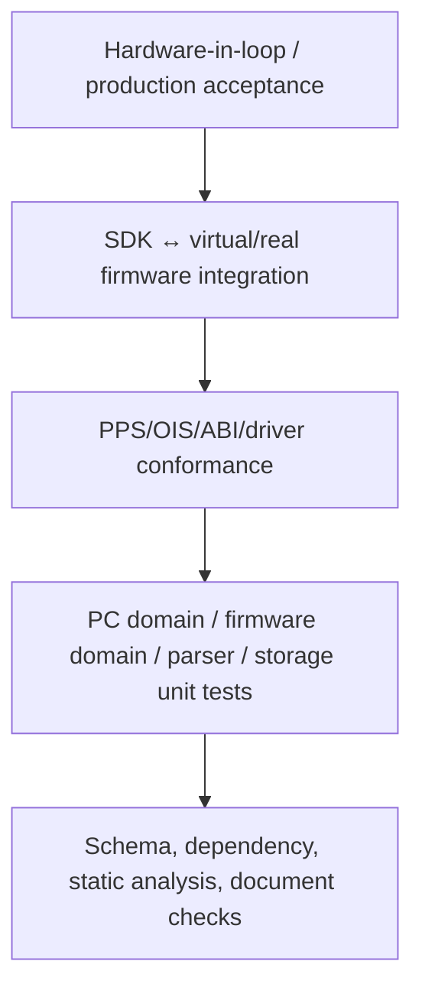

# Verification and Validation Strategy

| Field | Value |
| --- | --- |
| Document ID | VVS-RPP-001 |
| Version | 1.0-draft |

## 1. Test Pyramid and Ownership

| Level | Owner | Hardware | Release role |
| --- | --- | --- | --- |
| Static/document | All leads | None | Every change |
| Unit | Module owner | None/fake HAL | Every build |
| Conformance | Contract/validation team | Virtual first | Contract freeze and release |
| Integration | SDK + firmware teams | Virtual and M032 | Release candidate |
| HIL | Validation/hardware | M032 + each RL78 target/fixture | Product release |
| Production acceptance | Factory/Product | Actual station/MES/scanner | Factory deployment |

## 2. Required Suites

### 2.1 Document and Architecture

- Required files/sections and local links.
- Mermaid/code-fence pairing and render smoke.
- No implementation files during architecture-only phase.
- Dependency rules: GUI has no HID; Engine has no parser/transport/HAL concrete dependency; firmware upper layers have no BSP register dependency.
- Contract allocation uniqueness and version consistency.

### 2.2 Parser/Image/OIS

- Valid/corrupt MOT, HEX, BIN mapping.
- Boundary/overflow/overlap/duplicate/gap/protected/option/security cases.
- Deterministic UPI/OIP output and independent reader/packager golden vectors.
- CRC32/SHA/signature/rollback/unknown required versus optional.
- Power-loss storage fault injection at every persistent transition.

### 2.3 PPS/SDK

- Every command legal/illegal state, capability and authorization.
- Frame corruption, flags, length, sequence, padding, CRC and version.
- Retry/replay/idempotency and ambiguous disconnect reconciliation.
- Event loss/coalescing, query recovery and exactly-one terminal callback.
- ABI layouts/exports/ownership/threading and all language bindings.

### 2.4 Firmware/Driver

- Scheduler budgets, queue saturation, watchdog progress and safe-pin recovery.
- Fake HAL/storage/provider/driver state/error/cancel matrix.
- Protocol B link simulator for timeout/framing/status/echo/direction faults.
- Target profile exact match and no erase on mismatch.
- Button bounce/LED priority/offline cold boot/repeated programming.
- Resident bootloader/app linker boundaries, fixed SRecord BIN size/CRC,
  `FW_ENTER_BOOTLOADER` state/capability/busy matrix, invalid vector/CRC boot
  gate, full HID-path enumeration, selected-profile/reported-application-
  geometry rejection before erase, APROM flash-algorithm audit, CBS/MBS
  rejection before erase without rewriting unrelated CONFIG bits,
  application-only ISP range, post-`ReadData` byte comparison,
  bounded FMC timeout/ISP-failure paths, interrupt-masked VECMAP handoffs with
  readback confirmation, and interrupted-update recovery.
- `RESET_PROGRAMMER` empty-payload/session/capability/busy matrix,
  ACK-completion/fallback reset, unchanged application CRC and normal
  application PID re-enumeration.

### 2.5 GUI/Production

- Readiness truth table, disabled destructive actions, stale snapshot.
- Debug/Release startup, HWND lifecycle, clean close, no UI blocking.
- zh-TW/en and 100/125/150% DPI, keyboard/accessibility.
- History atomicity, CSV schema/filter/encoding, barcode/operator/project lock.
- MES outage fail-open/closed/queue and supervisor disposition.

## 3. Golden Evidence

Contract freeze requires version-controlled synthetic fixtures with no customer IP:

- PPS 64-byte frames and malformed variants.
- OIP minimum/maximum, each section type, signed/unsigned, corrupted field variants.
- Target-link transaction captures from official references, sanitized and annotated.
- Virtual programmer scenario scripts and expected job/log/history results.
- Known CRC16/CRC32/SHA-256 vectors.

## 4. HIL Matrix

Dimensions include exact RL78 part number, code/data Flash population, target
voltage, TOOL0/dedicated UART capability, image size/sparsity, option policy,
erased/programmed target, USB reconnect, target/USB power interruption stages,
retry/noise injection, offline cold boot/button, and repeated endurance runs.
For each bridge board, the matrix also covers application PID to `0416:3F00`
transition, handoff ACK loss, every ISP erase/program interruption boundary,
invalid vector/CRC stay-in-boot behavior, selected-profile/reported-application-
geometry and required CBS/MBS rejection before erase, packet readback mismatch,
interrupt-safe handoff, complete retry and return to the application PID. With multiple connected
bootloaders, evidence must identify the selected full HID path. Bootloader
self-update is not a claimed operation.

Electrical claims such as TOOL0 voltage/timing/contention, target VDD stability and reset waveform require oscilloscope/logic-analyzer evidence. GUI logs alone cannot pass those checks.

## 5. Release Gates

1. Zero unresolved Critical/High architecture or safety defects.
2. All contract/unit/conformance suites pass for supported versions.
3. PC Debug and Release build/start/close pass.
4. Firmware build, map/resource margins, static analysis and watchdog tests pass.
5. HIL passes every claimed exact target profile.
6. Power-loss recovery demonstrates previous-or-new valid package, never partial active.
7. Production records/CSV/MES policy and security/key approvals pass.
8. Actual evidence and gaps are recorded in SELF_CHECK/HANDOFF/release report.

## 6. Failure Classification

- FAIL: required behavior executed and did not meet contract.
- BLOCKED: required dependency/hardware/decision unavailable; not a pass.
- NOT RUN: test not executed, with reason.
- CONDITIONAL: capability legitimately absent and requirement was not claimed.
- MANUAL: requires human/electrical/security review; evidence link required.

## 7. Future Improvement

Add protocol/OIS schema fuzzing in CI, deterministic power-cut fixture, waveform assertions, long-duration station soak, hardware farm, signed artifact provenance, SBOM/license scanning and traceability report generation.
