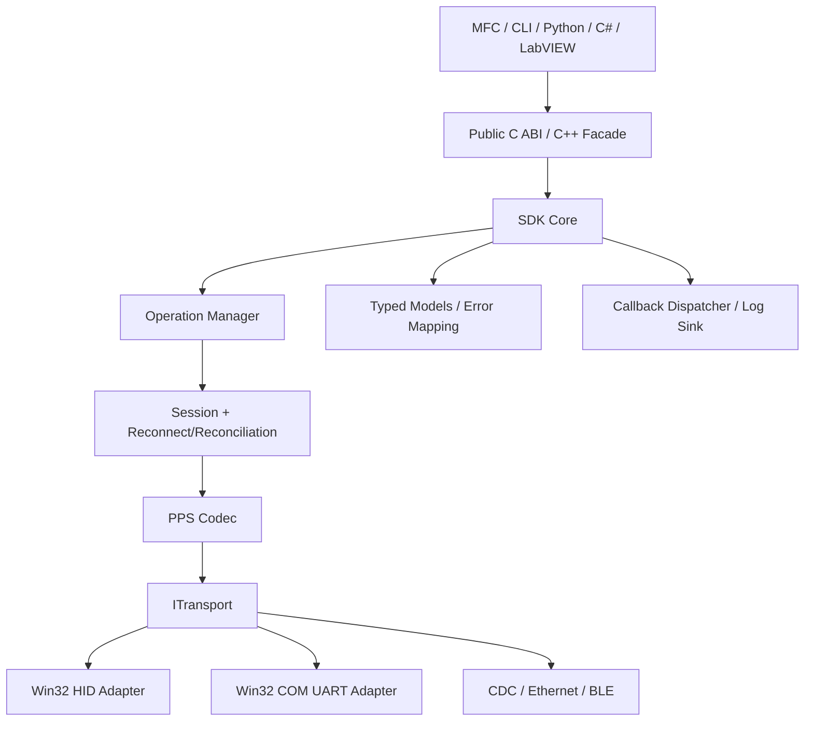
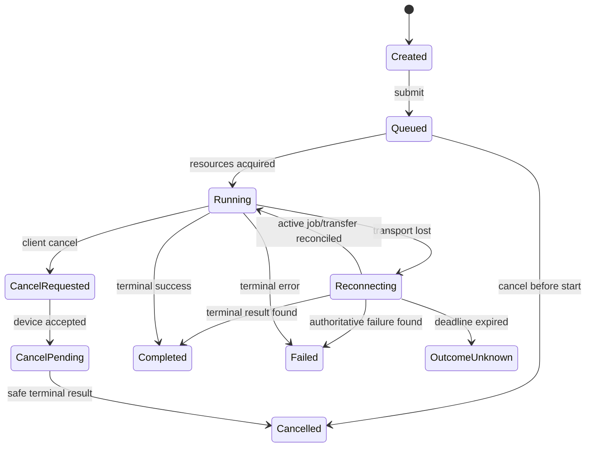
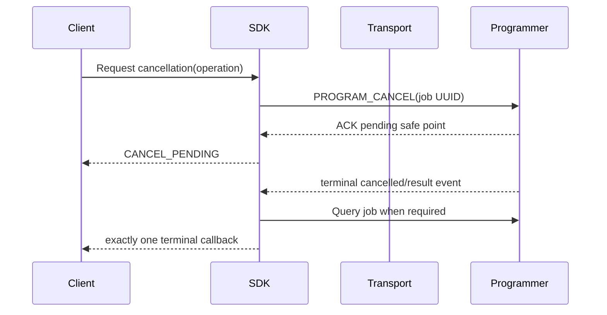
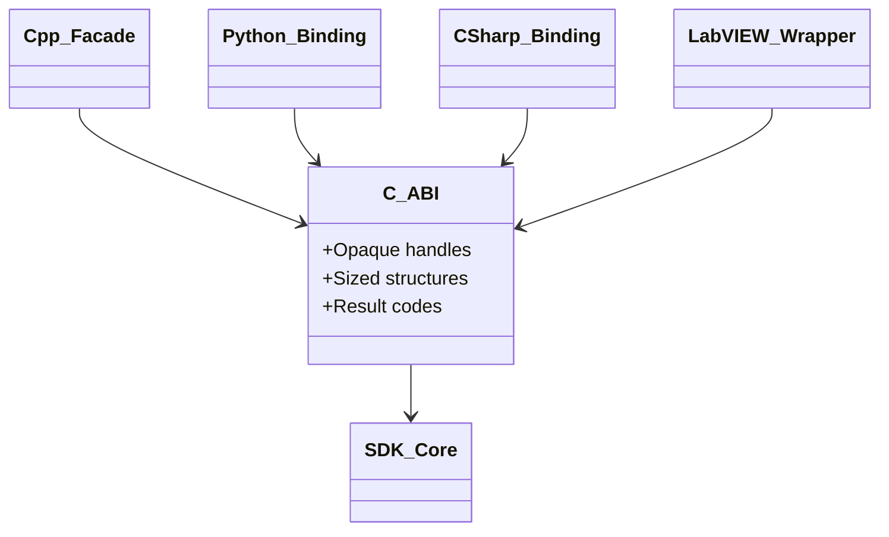

# Programmer SDK Specification (PSDK)

| Field | Value |
| --- | --- |
| Document ID | PSDK-RPP-001 |
| Product | Reusable Programmer SDK |
| Version | 1.0-draft |
| Primary implementation | Native Windows C-compatible ABI with C++ facade |
| Normative dependencies | SAS, PPS, OIS, Common Contract Registry |

<style>
@media print {
  @page { size: A4 portrait; margin: 10mm; }
  h2, h3 { break-after: avoid-page; }
  table, .mermaid, pre.mermaid, .mermaid svg { break-inside: avoid-page !important; page-break-inside: avoid !important; }
  .mermaid svg { max-width: 100% !important; max-height: 235mm !important; height: auto !important; }
}
</style>

## 1. Overview

### 1.1 Purpose

The Programmer SDK is the only supported PC boundary to programmer hardware. It hides USB HID and COM/UART access, PPS framing, sequencing, retry/reconnect, capability negotiation, transfer chunking, event reconciliation, and platform details from MFC and future clients.

### 1.2 Responsibilities

- Enumerate and identify programmers across registered transports.
- Open/close a negotiated connection and expose immutable capability snapshots.
- Offer asynchronous, cancellable device/image/program/config/update/production operations.
- Convert PPS responses/events into typed, stable models and unified errors.
- Reconcile ambiguous outcomes after timeout/disconnect using operation UUIDs.
- Hand a running bridge application to its resident bootloader and perform the
  board-profiled Nuvoton ISP HID or UART application-only update without
  exposing raw transport access to the GUI.
- Provide callback, polling/wait, progress, logging and configuration models suitable for C, C++, Python, C#, and LabVIEW.

### 1.3 Non-responsibilities

The SDK does not own MFC controls, parse RL78 target MOT/HEX/BIN, decide
project/option policy, implement RL78 Protocol B, store customer passwords/
signing keys, or declare PASS before an authoritative terminal job result. The
bridge updater is a separate exception to generic target-image parsing: it
loads only a raw fixed-size application BIN and validates its board profile and
CRC32 trailer before opening the bootloader.

### 1.4 Interfaces

Client interfaces are the versioned C ABI, C++ facade and language bindings. Programmer-facing communication uses PLP through `ITransport`. Optional injected interfaces cover allocators, logging, authentication/signing providers and future transport factories.

## 2. Architecture



SDK Core is UI-independent and transport-independent. Public ABI types are opaque handles and sized structures; clients never receive internal pointers or transport objects.

The current bridge update uses SDK-owned transport adapters.
`ProgrammerClient` sends PLP `FW_ENTER_BOOTLOADER` through the selected HID or
UART application connection. After USB re-enumeration or UART protocol
handoff, `BridgeFirmwareUpdater` uses the same internal Nuvoton ISP client over
HID `0416:3F00` or the selected COM port. The M032 TEST BOARD UART bootloader
must report board ID `MTB1` in addition to matching its fixed M032 application
geometry. MFC uses neither Win32 HID/COM nor ISP packets directly.

## 3. Public Object Model

| Object/handle | Purpose | Lifetime/ownership |
| --- | --- | --- |
| Library Context | SDK initialization, allocators, logging, transport registry, global options | Created first; destroyed after all children |
| Discovery Session | Enumerates and monitors programmer instances | Owns discovery callbacks; explicit stop/destroy |
| Device Descriptor | Immutable candidate identity/path/transport snapshot | Value copied or SDK-owned until documented release |
| Connection | One negotiated programmer session and serialized command channel | Explicit close/destroy; thread-safe public calls |
| Capability Snapshot | Immutable PLP/device/storage/driver/security limits | Valid for connection generation; refresh creates new snapshot |
| Operation | Async request state/result/progress/cancellation | Explicit release after terminal; UUID stable across reconnect |
| Image Transfer | Operation subtype with package/offset/resume details | Same operation lifetime |
| Programming Job | Operation subtype with job UUID/stage/metrics/result | Queryable after event loss/reconnect |
| Log Subscription | Structured SDK/transport/programmer events | Explicit unsubscribe; bounded callback policy |
| Buffer/Page | SDK-returned variable data with explicit size and release operation | Allocator-compatible release only |
| Bridge Firmware Profile/Image | Fixed board identity, application range, bytes and verified CRC/checksum | Value owned by caller/updater; never treated as OIP |
| Bridge Firmware Updater | Discovery, probe, erase/program/checksum and run/reset for resident ISP HID | Explicit connect/disconnect; one bootloader instance per updater |

Destroying a client wrapper never cancels an active programmer job implicitly. Cancellation is explicit. Context destruction with active children returns BUSY or follows a configured bounded shutdown policy; it never silently abandons owned threads.

## 4. Core API Families

This is a language-neutral operation contract, not an implementation header.

### 4.1 Library and Version

| Operation | Input | Output | Errors / behavior |
| --- | --- | --- | --- |
| Initialize | sized init options, allocator/log callbacks | library context | validates ABI major and structure sizes |
| Shutdown | context, shutdown policy/deadline | terminal status | BUSY when children/operations remain under fail-safe policy |
| Get SDK Version | context optional | API/ABI/build/timestamp/features | callable without device |
| Get Contract Versions | context | supported PLP/OIS/project/profile ranges | immutable for loaded SDK |
| Set Log Sink | context, severity/category filter, callback | subscription token | callback dispatch policy explicit |

### 4.2 Discovery and Connection

| Operation | Input | Output | Errors / behavior |
| --- | --- | --- | --- |
| Enumerate Devices | transport/filter options | descriptor page | read-only snapshot; handles multiple identical VID/PID |
| Start Discovery | filter and event callback | discovery session | added/removed/changed events carry stable SDK instance token |
| Stop Discovery | session | completion | idempotent |
| Open Connection | descriptor, timeouts, requested capabilities, client UUID | connection + negotiated snapshot | performs transport open + NEGOTIATE + optional OPEN_SESSION |
| Close Connection | connection, policy/deadline | completion | active job is queried; not implicitly restarted/cancelled |
| Refresh Device Info | connection | immutable info/capability snapshot | serialized through operation manager |
| Ping | connection | latency/uptime/session status | bounded retry according to config |
| Reset Programmer | negotiated idle application connection | acknowledged reset, then local connection close | requires reset capability; non-replay-safe; application CRC is unchanged |
| Enter Bootloader | negotiated application connection | acknowledged handoff, then local connection close | requires update capability and idle session; non-replay-safe; does not send CLOSE_SESSION after ACK |

### 4.3 Image and Offline Package

| Operation | Input | Output/progress | Errors / behavior |
| --- | --- | --- | --- |
| Query Storage | connection | provider/geometry/slot/health snapshot | used before package transfer |
| Begin Package Download | connection, random-access reader, OIP identity, destination/policy | operation | preflights size/OIS/security capability |
| Resume Package Download | connection, operation/package UUID | operation | resumes only matching device token/offset/hash |
| Finalize Package | transfer operation | validation result | ACK means VALID, not ACTIVE |
| Activate Package | connection, package UUID, authorization context | active identity/counter | atomic/idempotent |
| List Packages | connection, page query | package page/cursor | immutable page snapshot |
| Get Package Metadata | connection, UUID | redacted metadata/validation | no payload bytes by default |
| Delete Package | connection, UUID, policy | result | active/in-use deletion blocked unless approved replace policy |
| Abort Package Download | operation | terminal status | candidate remains non-active; recovery may reclaim |
| Get Last Offline Result | connection | durable result | valid after PC was absent |

The random-access reader contract provides size, immutable identity/hash, and bounded read-at-offset. SDK may call reads from a worker thread. The caller must keep the reader alive until operation terminal callback and release.

### 4.4 Programming

| Operation | Input | Output/progress | Errors / behavior |
| --- | --- | --- | --- |
| Read Target Signature | connection, device-profile reference, safe probe policy | target identity/capabilities | non-destructive; exact support still profile/driver controlled |
| Read Target Information | connection, profile reference | typed information page | unavailable fields explicit |
| Start Programming | connection, immutable job intent, source reference | programming operation/job UUID | idempotent; acceptance is not PASS |
| Query Programming Job | connection, job UUID | authoritative job snapshot | reconciles lost events/disconnect |
| Request Cancellation | programming operation/job UUID | accepted/pending/terminal disposition | cooperative safe-point cancellation |
| Wait Operation | operation, deadline | state/result | never required on GUI thread |
| Poll Operation | operation | current immutable snapshot | nonblocking |
| Read Target Flash | connection, authorized range/sink | operation/data | disabled unless driver+target+policy allow |
| Reset Target | connection, release policy | result | explicit and audited |
| Recover Target | connection, recovery policy | result | bounded; reports final electrical/link state |

### 4.5 Configuration, Firmware Update and Production

| Family | Operations | Key behavior |
| --- | --- | --- |
| Programmer Config | get, validate/stage, commit, rollback, factory reset | snapshot-based; reboot requirement reported; immutable identity preserved |
| Programmer Update | enter resident bootloader; validate/probe/program/run bridge application; future query/begin/chunk/finalize/apply/abort | current path is fixed app-only Nuvoton ISP HID; staged signed package remains a separate future production path |
| Logs | subscribe, page query, clear/rotate with authorization | structured/redacted, cursor-based |
| Statistics | query lifetime/lot, reset lot with authorization | reset creates audit record |
| History | page query by cursor/filter | terminal attempts, latest offline result and bounded runtime offline failure history |
| Production Context | stage operator/station/lot/barcode context | bounded, validated, consumed/correlated according to job policy |

### 4.6 Implemented Bridge Application Updater

The C++ facade exposes the following bounded vertical-slice operations:

| Operation | Input | Output / behavior |
| --- | --- | --- |
| `ProgrammerClient::ResetProgrammer` | open negotiated, idle PLP application session | Sends empty `0x0007`; closes the local transport after ACK without `CLOSE_SESSION`; the same valid application re-enumerates |
| `ProgrammerClient::GetLastOfflineResult` | open negotiated PLP application session | Reads `0x0107`, decodes the retained terminal result and optional V1 TOOL0 failure snapshot; zero job UUID means no result |
| `ProgrammerClient::GetOfflineFailureHistory` | open negotiated PLP application session | Traverses `0x0109` until `next_sequence=0`, returns retained V1 failures in sequence order, and exposes overflow/dropped count; unsupported older firmware is handled by the GUI caller |
| `ProgrammerClient::EnterBootloader` | open negotiated PLP application session | Sends empty `0x0506`; closes the local transport after ACK without `CLOSE_SESSION` |
| `BridgeFirmwareUpdater::Profile` | M032SE3AE or M484SIDAE | Fixed application start, size, display name and CRC offset |
| `LoadApplicationImage` / `ValidateImage` | selected profile and raw BIN/path | Requires exact size and matching little-endian CRC-32/ISO-HDLC; computes whole-image additive checksum |
| `EnumerateBootloaders` | none | Returns descriptors including full HID path for Nuvoton HID `0416:3F00`; legacy `0416:A316` may be recognized for compatibility |
| `EnumerateSerialPorts` | none | Returns OS COM candidates for application PLP or M032 TEST BOARD UART ISP; this is discovery only and never proves bootloader mode |
| `Connect` / `ConnectUnique` / `Probe` | descriptor or unique-device policy | Opens one ISP HID instance and reads bootloader version, device ID, configuration words and authoritative application geometry |
| `ProgramApplication` | validated image, progress and cancel callbacks | Requires selected profile to match reported application geometry before erase; then connect/sync, application-only APROM update, post-read byte comparison and final additive checksum. PDID is displayed, not allowlisted |
| `RunApplication` | connected bootloader | Requests application start; UART waits for the external-VCOM transmit queue to drain before closing the COM handle, while USB removal/re-enumeration is expected |
| `ResetBootloader` | connected bootloader | Explicit bootloader reset without claiming application success |

Profile constants are owned by the Common Contract Registry. The application
start is `0x4000`. M032 requires exactly `0xBC00` bytes with CRC at BIN offset
`0xBBFC`; M484 requires exactly `0x7C000` bytes with CRC at BIN offset
`0x7BFFC`. The updater never accepts a bootloader-inclusive/factory BIN.
Image size alone is insufficient identity: the updater binds the selected
M032/M484 profile to the bootloader's reported application geometry and rejects
a wrong application start, size, end or CRC location before sending the
erase/update command. The full HID path identifies the selected bootloader
instance; probed PDID is displayed but not checked against a hard-coded
allowlist.

The same destructive preflight requires `CONFIG0.CBS[7:6]=10` on both bridge
profiles and additionally `MBS bit 5=1` for M484. A mismatch fails closed before
erase. These are validation gates, not requests to rewrite CONFIG; initial
Nu-Link ICP/Keil provisioning must preserve all unrelated CONFIG bits.

Cancellation is checked between ISP exchanges and programming packets. It is a
local stop request, not rollback: because application validity is already
removed before the handoff, cancellation or power loss leaves the board in the
resident bootloader. Recovery is another complete valid application upload.

The Win32 COM implementation accepts partial reads and reassembles the exact
64-byte PLP/NuvoISP frame within a bounded outer deadline. It must not request
a larger scratch-buffer length and then discard a valid 64-byte response when
that larger read times out. After `FW_ENTER_BOOTLOADER` is acknowledged, the
application client closes its COM handle before UART ISP discovery begins.
GUI UART bootloader discovery applies a bounded `Probe` to every OS candidate
and retains only the descriptor whose authoritative board ID is `MTB1`.

## 5. Structures and ABI Rules

### 5.1 Sized Structures

Every public input/output structure begins conceptually with `structure_size` and `structure_version`. Callers zero unknown tail fields. SDK reads only fields present in the supplied size and writes only within caller-declared capacity. Reserved fields are zero.

### 5.2 Strings, Arrays and Memory

- Public C ABI strings are UTF-8 byte spans with explicit length; no locale-dependent ANSI.
- Fixed identifiers use 16-byte UUID or fixed hash arrays.
- Variable results use caller-sized two-call query, page iterator, or SDK buffer with explicit release; each API documents which model.
- Allocator callbacks are fixed for context lifetime. Memory allocated by one SDK module/version is released through the same SDK context operation.
- No C++ STL type, exception, RTTI class, compiler-specific object layout, or HWND appears in the C ABI.

### 5.3 Thread Safety

- Context and connection public operations are thread-safe unless an operation explicitly states callback-thread restrictions.
- One connection serializes V1 PLP requests internally.
- Callbacks may arrive on SDK dispatch threads, never assumed UI thread.
- A callback may query immutable operation state but must not block waiting on the same operation or destroy its dispatch context.
- Callback ordering is preserved per connection for state/result; progress may coalesce but never follows terminal result.

## 6. Asynchronous Operation Model

### 6.1 Operation States

| State | Meaning |
| --- | --- |
| CREATED | Valid handle, not queued |
| QUEUED | Waiting for exclusive connection/resource |
| RUNNING | Request/transfer/job active |
| RECONNECTING | Transport lost; SDK reconciling by UUID |
| CANCEL_REQUESTED | Client requested cancellation |
| CANCEL_PENDING | Programmer accepted; awaiting safe point |
| COMPLETED | Terminal success with typed result |
| FAILED | Terminal unified error |
| CANCELLED | Terminal safe cancellation result |
| OUTCOME_UNKNOWN | Reconciliation deadline expired; job may still be queryable later |



### 6.2 Progress Model

Progress event fields: operation UUID, job/transfer UUID, operation type, stage enum, current/total units, basis points `0..10000` when meaningful, current address/region, elapsed time, retry count, cancellation disposition, and latest nonterminal warning. Percent may be unknown; clients must display stage/indeterminate progress rather than fabricate it.

### 6.3 Callback Contract

Callbacks include discovery event, connection state, operation state, progress, log event, and terminal result. Each receives context pointer/token supplied by caller and immutable data valid for callback duration unless copied. Terminal callback occurs exactly once per local operation handle. Event loss across process crash is recovered through query/history, not callback replay assumptions.

## 7. Cancellation and Reconciliation



If the link is lost after a side-effecting request, SDK marks outcome ambiguous, reconnects to the same programmer UUID, negotiates, then queries transfer/job/update status. It never repeats `PROGRAM_START` as a new UUID. Caller-configured reconciliation deadline bounds automatic work; exceeding it returns `OUTCOME_UNKNOWN` with IDs needed for later query.

`FW_ENTER_BOOTLOADER` is a special personality transition. Once the application
ACK is received, the SDK intentionally closes without a PLP close command and
the caller scans for `0416:3F00`. If the ACK is lost, the CRC may already be
invalidated, so recovery also starts by scanning for the bootloader instead of
blindly replaying `0x0506`. After programming, the user explicitly requests
`RunApplication`; failure to re-enumerate as the PLP application is not reported
as a verified physical success without device evidence.

`RESET_PROGRAMMER` is a normal application restart rather than a personality
change. It uses the same non-replay-safe ACK-then-close discipline, but does not
invalidate application CRC. Recovery after an uncertain response is a fresh
scan for the normal application PID and a new PLP session.

## 8. Error Model

### 8.1 Error Object

| Field | Meaning |
| --- | --- |
| Unified code | Stable 32-bit category/component/reason code |
| Source domain | SDK, transport, PPS, image, storage, program, driver, update, production, security |
| Detail code | Stable command/module-specific numeric detail |
| Retryability | never, same request, reconnect/query, operator action, service action |
| Operation stage | Where failure occurred |
| Native code | Sanitized Win32/library code when useful |
| Correlation | programmer/session/operation/job/package UUIDs |
| Numeric context | bounded address/offset/expected/actual values |
| Message key | Localization key; not a wire string |

The C ABI returns a stable code and offers last/operation error detail by handle; C++ and managed bindings may wrap it in result/exception conventions without losing the original code. Exceptions never cross the C ABI.

### 8.2 Error Handling Rules

- Transport timeouts distinguish `not_sent`, `sent_outcome_unknown`, and authoritative NAK.
- Cleanup errors attach as secondary details and do not replace the first causal error.
- Unknown device detail values remain numeric and map to `UNKNOWN_REMOTE_DETAIL`, not success.
- API misuse returns immediately without device side effects.
- Client callbacks are isolated; a callback failure does not corrupt SDK worker state and is logged/rate-limited.

## 9. Configuration

| Group | Examples | Defaults/limits |
| --- | --- | --- |
| Discovery | transport filters, VID/PID/usage, scan interval | product manifest supplies identity; broad wildcard requires engineering mode |
| PLP | response/retry/replay/event/reconnect deadlines | defaults from PPS; bounded by safety ceilings |
| Transfer | chunk/window, resume, read buffer | negotiated, V1 max data 45 for image chunks |
| Bridge update | last application BIN path, selected board profile, ISP timeout | profile change invalidates the loaded image; exact size/CRC are not configurable |
| Callbacks | dispatch mode, queue bound, progress coalescing | serialized per connection |
| Logging | severity/category, redaction, sink | INFO production baseline; payload logging disabled |
| Shutdown | cancellation and reconciliation deadline | fail-safe; no silent active-job restart |
| Plug-ins | allowed transport roots/publishers | signed/allow-listed production policy |

Configuration is supplied as a validated snapshot at context/connection creation. Safety ceilings cannot be relaxed by ordinary clients. The SDK does not own user INI files; the application Configuration Manager persists settings.

## 10. Versioning and Compatibility

### 10.1 Version Domains

- API version: source-level additions and behavior contract.
- ABI version: binary layout/export compatibility; major encoded in library/export naming policy.
- SDK build: release traceability.
- PLP/OIS ranges: data/wire compatibility.
- Transport plug-in ABI: separate from main SDK client ABI.

### 10.2 Rules

1. ABI major mismatch prevents initialization.
2. New optional structure tail fields are ABI-minor compatible through size/version.
3. Functions are never removed or change semantics within an ABI major.
4. Capability query, not SDK version text, determines device feature availability.
5. Bindings expose SDK/ABI/PLP/OIS versions and preserve unknown enum values numerically.

## 11. Language Bindings

### 11.1 C

Normative lowest common denominator: opaque handles, explicit result codes, sized structures, UTF-8 spans, callbacks with user context, explicit ownership/release, no exceptions.

### 11.2 C++

Header-only or thin compiled facade may provide RAII handles, typed results/futures, spans, UTF conversions at UI boundary, and scoped subscriptions. It must not create a second protocol implementation.

### 11.3 Python

Binding uses the C ABI through a packaged native library, maps operations to futures/asyncio-compatible completion, preserves unified codes and deterministic handle release, and releases the interpreter lock around waits/native work where safe. Callback dispatch into Python is serialized and shutdown-safe.

### 11.4 C#

P/Invoke or a thin C++/CLI layer uses safe handles, explicit UTF-8 marshaling, immutable managed result copies, `Task`/cancellation adapters, and prevents delegates from garbage collection during subscription. Managed cancellation remains a request, not forced native thread abort.

### 11.5 LabVIEW

Flat C ABI wrappers avoid callbacks as the only completion mechanism. Poll/wait APIs, numeric handles, caller-allocated arrays or explicit release functions, flattened fixed-width records, and error cluster mapping are provided. A dedicated integration guide defines 32/64-bit calling convention and UI-thread constraints.



## 12. Transport Interface

`ITransport` capabilities cover enumerate/open/close, exact report/message size, asynchronous receive, send completion, cancellation, connection identity, MTU, ordering/reliability and native diagnostic status. SDK Core alone owns PPS encoding/retry/replay. A transport plug-in must not reinterpret commands or synthesize programming success.

HID adapter responsibilities include Windows API report-ID sentinel handling, overlapped I/O, surprise removal, cancellation, stable path/serial extraction, access errors and post-update re-enumeration. It does not expose HANDLE values through public SDK models.

## 13. Logging and Diagnostics

SDK log envelope follows the common registry: wall/monotonic time, severity/category, component/event, connection generation, UUID correlations, command/sequence/duration/status when applicable, retry and sanitized native context. Default logs do not contain report payloads, image bytes, passwords, tokens, keys or certificate secrets.

A diagnostic support bundle may include SDK/app/build manifests, sanitized logs, device info/capability snapshots, configuration schema/version with secrets removed, and operation summaries. Customer firmware and production personal data require explicit separate consent/policy.

## 14. File Organization and Packaging

```text
pc/sdk/
├─ include/          stable public C ABI and C++ facade declarations
├─ core/             operation/session/reconnect/capability/error logic
├─ protocol/         generated PPS codec and command models
├─ transport/        transport interface and adapters
├─ model/            public/internal typed model conversion
├─ binding/          Python, C#, LabVIEW adapters and packaging
├─ tests/            unit/ABI/integration/fault tests
├─ docs/             generated API and binding guides
└─ samples/          future minimal client examples, only after implementation phase
```

Release package contains native x64 library, public headers/type library as applicable, symbols in controlled symbol package, version/license manifest, binding packages, API documentation and conformance result. Debug/internal exports are not in the production ABI.

## 15. Production Considerations

- Library loading uses an approved absolute/application path and verifies release manifest/signature policy; no uncontrolled DLL search.
- One process owns a destructive programmer session; OS/device sharing conflicts are explicit.
- Operation/job UUIDs and programmer UUID are persisted by clients before destructive start when recovery is required.
- SDK has bounded worker threads/queues and publishes resource/shutdown behavior.
- Automation clients must query authoritative result and store full version/hash correlations.
- Telemetry is opt-in/managed; no hidden network communication exists in core SDK.
- Signing/authentication provider is injected; SDK never contains production private keys.

## 16. Risk Analysis

| Risk | Control |
| --- | --- |
| MFC bypasses SDK and duplicates HID logic | No public HID dependency in GUI; architecture/build dependency checks |
| ABI breaks bindings | C ABI, sized structs, opaque handles, ABI conformance suite |
| Callback deadlock/reentrancy | dispatch contract, immutable data, prohibited waits/destruction in same callback |
| Disconnect duplicates programming | job UUID and query reconciliation before any retry |
| Destroying handle stops job unexpectedly | explicit cancel semantics; handle release is not cancellation |
| Native/managed lifetime leak | safe handles, explicit release, terminal callback once, stress tests |
| Error details lost in binding | stable code plus complete copied error object |
| Untrusted transport plug-in changes semantics | signed/allow-listed manifest and PPS owned only by SDK Core |
| Wrong bridge profile erases the wrong application range | exact fixed image size/CRC profile, device probe, boot-region exclusion and explicit board selection |
| Same-size or mislabeled image is sent to incompatible bootloader geometry | Full HID path binds the instance; selected profile must match its authoritative reported application geometry before erase. PDID is diagnostic/display data, not an allowlist |
| Boot configuration cannot safely return to the APROM resident bootloader | Require CBS APROM-with-IAP mode on both profiles and M484 MBS bit 5 before erase; do not rewrite unrelated CONFIG bits |
| Handoff timeout is replayed after CRC invalidation | non-replay-safe classification and bootloader-PID discovery before recovery |

## 17. Unit, ABI and Integration Test Suggestions

- Initialize/shutdown with every structure size/version, allocator failure and active child state.
- Discovery add/remove/change, duplicate VID/PID, access denied, stale path and device UUID change.
- Golden PPS codec, sequence wrap, retry/replay, malformed reports and event coalescing.
- Every operation state transition, cancellation timing and exactly-one terminal callback.
- Disconnect before/after acceptance for transfer, program, config commit and update apply.
- M032/M484 bridge image exact size, bad CRC, wrong profile, boot-region
  exclusion, selected-profile/reported-application-geometry mismatch before
  erase, ISP packet/readback/checksum
  failures, cancellation and interrupted-update recovery through `0416:3F00`.
- Thread sanitizer/stress equivalents: concurrent query/cancel/release/log subscriptions and callback reentrancy.
- ABI symbol/layout/calling-convention tests across supported compilers and bindings.
- UTF-8 invalid/boundary strings, arrays/pages, allocator ownership and large result limits.
- Python interpreter shutdown, C# delegate lifetime/safe handle, LabVIEW polling/calling convention.
- Virtual programmer fault matrix and M032 HIL conformance.

## 18. Extension Strategy and Future Improvement

New transports implement the transport ABI; new device/target capabilities appear as generic capability/profile data and typed optional operations. New language bindings wrap the C ABI. Future work includes Linux/macOS transport adapters, headless signed CLI/service, authenticated remote transport, multi-programmer context, gang-job coordinator and out-of-process transport plug-ins. Core programming semantics and result/error models remain unchanged.
